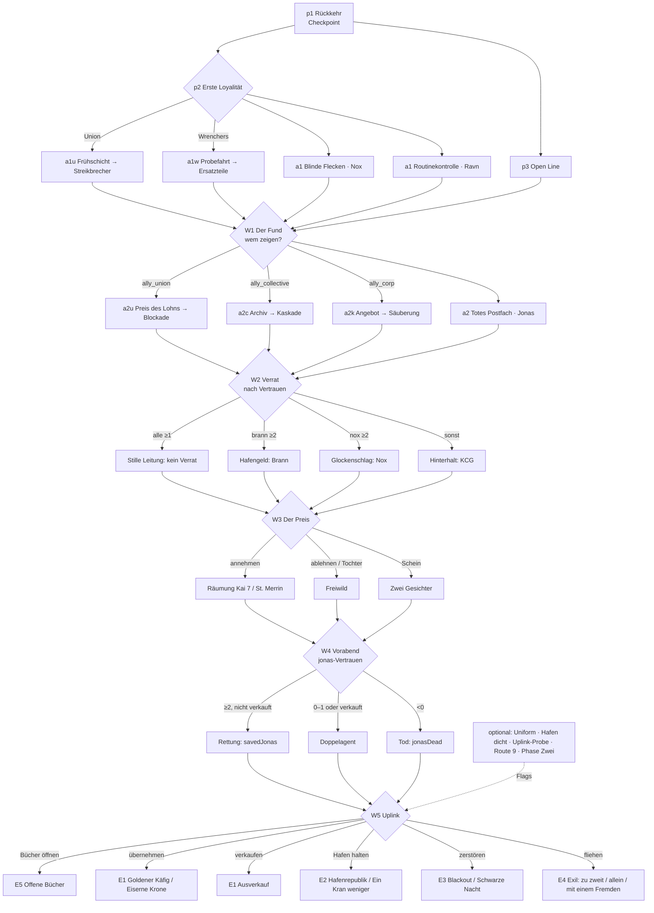

# MTA 6 – Story-Bibel: »Nullstunde«

Daten: `godot/data/story.json` (identisch: `Content/Data/story.json`). Prüfung: `godot_console --headless --path godot --script res://tests/story_sim.gd`. Missionstypen: `docs/MISSIONSTYPEN.md`. Schema-Konventionen: `docs/STORY_SCHEMA_CHANGES.md`.

**Umfang:** 67 Missionen, davon 37 Haupt- und Zweigmissionen und 30 Nebenaufträge (8 Gigs, 12 Nebenquests, 6 Events, 2 Rennen, 2 Verträge). Dazu 54 Entscheidungen mit 134 Optionen, 5 Wendepunkte und 12 Enden (E1–E5 mit Varianten).

## 1. Prämisse und Ton

Kestrel Bay, eine Hafenstadt an einer Bucht, gehört Aurelia Holdings. Das Überwachungsnetz **Aegis** zählt Kennzeichen, Gesichter und Verhalten. In vierzehn Tagen startet »Phase Zwei«: Straßen, Kredite und Wohnungen hängen dann am Verhaltens-Score. Die Stadt nennt den Termin **Nullstunde**.

**Mira Voss**, Ex-Rennfahrerin, kehrt nach sieben Jahren zurück, weil ihr Bruder Jonas verschwunden ist. Am Checkpoint erfasst Aegis ihr Kennzeichen. Ab dann ist sie im Netz.

**Ton-Regel:** *Die Welt ist ernst, die Medien sind satirisch.* Humor entsteht aus Konzernsprache (»Flexibilitätspartner«, »Bestandsnutzer«, »präventive Nachbarschaftsbegehung«), aus Werbung (»Aegis – Wir sehen, was Sie brauchen«, »Aurelia Calm™: Ihre Stadt, optimiert«), aus Bürokratie (»Rückkehrerin, Motivation unklar«) und aus dem Radio (Clearwave FM verharmlost, Open Line fragt nach). Nie auf Kosten der Opfer: Tote bleiben Tote, Satire zielt nach oben. Die Outros sind kurze Nachbilder, oft ein satirischer Konter auf einen ernsten Moment.

## 2. Bezirke

| Bezirk | Rolle | Story-Funktion |
|---|---|---|
| **Kestrel Core** | Konzernviertel, Aegis maximal | Tower, Archiv, Angebot (W3), Phase Zwei |
| **Saltmarket** | Hafen, Union | Streik, Blockade, Hafenrepublik (E2) |
| **Lantern Hill** | Altstadt, Collective | Kamera-Hacks, Glockenturm, Räumung |
| **Greenmoor** | Gated Community | Wohlverhaltenszentrum, Lockdown, Satire |
| **Rustline** | Industrie, Wrenchers | Rennen, Fluchtwege, Verstecke |
| **Sunstrip** | Promenade, Pier | Open Line, Jonas-Kontakt, Nachtmarkt |
| **Route 9 / Ashridge / Küstenstraße / Salzebene** | Umland | Checkpoint (Prolog), Tunnel (W4), Sendemast (Finale), Rennen |

## 3. Figuren

| Figur | Motivation | Geheimnis | Vertrauen steuert |
|---|---|---|---|
| **Mira Voss** | Jonas finden, alte Schuld begleichen | hat vor sieben Jahren ein Rennen verkauft, Jonas zahlte dafür | – |
| **Jonas Voss** (`jonas`) | Beweise gegen Aegis sichern, die Schwester schützen | hat Daten verkauft und berichtet bei niedrigem Vertrauen an Kandel | W4: ≥ 2 → Rettung, 0–1 → Doppelagent, < 0 → Tod |
| **Tomasz »Brann« Brandt** (`brann`) | Jobs und Würde für den Hafen | verhandelt heimlich mit Aurelia | W2: ≥ 2 → er verrät (tiefster Verrat). Akt III: < 0 → er führt den KCG-Konvoy und kann sterben |
| **Nox** (`nox`) | Aegis stoppen, die Schwester retten | hat Jonas' Daten gekauft und an Aurelia weitergereicht | W2: ≥ 2 → Nox verrät. Akt III: < 1 → Yara muss die Uplink-Probe allein machen |
| **Cmdr. Ravn Okoye** (`ravn`) | Pflicht, Ordnung, Zweifel | Akte über tödliche Fehlfestnahmen | ≥ 2 → wechselt die Seite (`ravnTurned`), öffnet in W4 die Sperre. < 0 verhindert den Treue-Pfad in W2 |
| **Odalys »Dutch« Halloran** (`dutch`) | Unabhängigkeit, Respekt | wettet auf alle Seiten | ≥ 1 → Fluchtroute und Rettungsweg in W4 |
| **Dr. Idris Kandel** (`kandel`) | »Ordnung durch Sichtbarkeit« | Tochter starb an einem Ort ohne Kamera | ≥ 2 oder `kandelInfo` → Option »Erzählen Sie mir von Ihrer Tochter« in W3, Kandel wird Zeuge für E5 |
| **Pia Sorensen** (`pia`) | Wahrheit, Quote | Quelle »die Lerche« im Konzern | Zeugin in E5; leakt den Ledger (`leakedLedger`) |
| **Yara Quill** | Altstadt retten | hielt Abrisspläne zurück | Ersatzfigur der Uplink-Probe, kann verhaftet werden |
| **Edda Marsh** | Behandlung ihres Sohnes | verkauft eigene Verhaltensdaten | Folgequest bringt `towerPass` (alternative Freischaltung des Doppelspiels); wird Union-Sprecherin, wenn Brann fällt |
| Nebenfiguren | Spindel (Gig-Vermittler), Hanne Lark (Witwe), Silberfisch (Fälscher), Opa Fenn (Kranführer) | | |

## 4. Fraktionen

| Fraktion | Will | Belohnt | Bestraft |
|---|---|---|---|
| **Aurelia Holdings** (`aurelia`) | Phase Zwei | Gehorsam, ausgelieferte Zeugen, Räumungen | Leaks, Ablehnung in W3 |
| **Kestrel Civil Guard** (`kcg`) | Ordnung | Kooperation, Auslieferungen | Flucht, Sabotage |
| **Dockers' Union** (`union`) | Hafenautonomie | Streikhilfe, Blockade | Verkaufte Streikpläne, Räumung von Kai 7 (`betrayedUnion` sperrt E2) |
| **Lantern Collective** (`collective`) | Aegis stoppen | Hacks, Original-Beweise | Meldung von Nox, Räumung der Altstadt |
| **Rustline Wrenchers** (`wrenchers`) | Respekt, Geld | Rennen, Teile, Fälscher-Jagd | Verrat an KCG |

## 5. Struktur (Perlenkette)

Feste Knoten: **p1 → p2 → (Akt I) → W1 → (Akt II) → W2 → W3 → (Akt III) → W4 → W5**. Dazwischen verzweigen sich die Abschnitte und laufen wieder zusammen.

| Akt | Hauptknoten | Verzweigte Abschnitte |
|---|---|---|
| **Prolog** | `p1` Rückkehr (Checkpoint), `p2` Erste Loyalität (Union oder Wrenchers), `p3` Open Line (Jonas' Codewort im Radio) | – |
| **Akt I – Schuldner** | `w1_find` **W1 »Der Fund«** | Union-Kette (`a1u_fruehschicht`, `a1u_streikbrecher`) **oder** Wrenchers-Kette (`a1w_probefahrt`, `a1w_ersatzteile`); für alle: `a1_blinde_flecken` (Nox), `a1_kontrolle` (Ravn) |
| **Akt II – Netz** | `a2_postfach` (Jonas gesteht), **W2 »Verrat«** (4 Varianten), `w3_price` **W3 »Der Preis«** | Je nach W1: Union (`a2u_lohn`, `a2u_blockade`), Collective (`a2c_archiv`, `a2c_kaskade`) oder Konzern (`a2k_angebot`, `a2k_saeuberung`) |
| **Akt III – Nullstunde** | Pfadmission je W3-Antwort, **W4 »Der Vorabend«** (3 Varianten) | Angenommen: `a3_raeumung_hafen` / `a3_raeumung_altstadt`; abgelehnt: `a3_freiwild`; Doppelspiel: `a3_zwei_gesichter`. Optionale Finalvorbereitung: `a3_uniform`, `a3_hafen_brann`/`a3_hafen_ohne`, `a3_probe_nox`/`a3_probe_yara`, `a3_route9`, `a3_phase2` |
| **Finale** | `w5_finale` **W5 »Uplink«** | Optionen hängen von Stand und Flags ab |

### Wendepunkte im Detail

- **W1 – Der Fund:** Jonas lebt und hat den Ledger-Kern versteckt. Wem Mira ihn zeigt (Union, Collective, Aurelia), bestimmt die Akt-II-Route (`ally_*`).
- **W2 – Verrat** (genau eine Variante, Partition über Vertrauen):
  1. `w2_treue` »Stille Leitung«: brann ≥ 1, nox ≥ 1, jonas ≥ 1, ravn ≥ 0. **Niemand verrät.** Stattdessen ruft Kandel live auf Open Line an.
  2. `w2_brann` »Hafengeld«: sonst, wenn brann ≥ 2. Der Vertraute verrät am schwersten.
  3. `w2_nox` »Glockenschlag«: sonst, wenn nox ≥ 2. Nox hat Jonas' Daten gekauft.
  4. `w2_hinterhalt`: sonst. Niemand vertraute Mira, irgendwer hat früh und billig geredet. Ravn stellt die Falle.
- **W3 – Der Preis:** annehmen (`soldOut`), ablehnen (`refused`), zum Schein annehmen (`doublePlay`; nur mit jonas ≥ 1 und Aegis ≤ 45 **oder** mit Eddas `towerPass`) oder Kandel nach seiner Tochter fragen (`kandelDoubts`; nur mit kandel ≥ 2 oder `kandelInfo`).
- **W4 – Der Vorabend:** `w4_rettung` (nicht verkauft und jonas ≥ 2, setzt `savedJonas`; Rettungsweg über Ravn, Dutch oder allein), `w4_doppelagent` (jonas 0–1 oder verkauft: Jonas hat für Kandel berichtet), `w4_verlust` (jonas < 0: Jonas stirbt im Tunnel, `jonasDead`).
- **W5 – Uplink:** Bücher öffnen (E5), übernehmen (E1), verkaufen (E1-Variante), Hafen halten (E2), zerstören (E3), fliehen (E4).

## 6. Entscheidungsgraph

## 7. Enden

| ID | Titel | Bedingung (Option in W5 + Ende) | Welt danach |
|---|---|---|---|
| **E5** *(geheim)* | Offene Bücher | Union, Collective und Wrenchers je ≥ 25, `savedJonas`, **kein** `killedCivilians`, Beweis: `ledgerOriginal` **oder** `leakedLedger` **oder** `kandelDoubts` | Ledger live auf Open Line, gerichtlicher Stopp von Phase Zwei, fragile Reform |
| E1_verkauf | Goldener Käfig: Ausverkauf | `hasUplinkKeys` | Aegis läuft unter neuem Eigentümer, Mira reich im Ausland |
| E1_blut | Goldener Käfig: Eiserne Krone | übernehmen + `massacre` | Mira auf Kandels Stuhl, Erinnerung wird bestraft |
| E1 | Goldener Käfig | Aurelia ≥ 30 + (`uplinkAccess` oder `soldOut`) | Überwachung bleibt, Mira profitiert |
| E2_ohne | Hafenrepublik: Ein Kran weniger | Hafen halten + `brannDead` | Docks autonom unter Edda |
| E2 | Hafenrepublik | Union ≥ 30, `portHeld`, kein `betrayedUnion` | Docks autonom, Core bleibt Aurelia |
| E3_nacht | Blackout: Schwarze Nacht | zerstören + `killedCivilians` | frei von Aegis, aber nicht unschuldig |
| E3 | Blackout | (Collective ≥ 20 + `jammerReady`) oder `backdoorPlanted` | Netz tot, Anarchie und Hoffnung |
| E4_zu_zweit / E4_allein / E4_fremder / E4 | Exil | Flucht, Variante nach Jonas' Schicksal | Stadt unverändert |

Simulationsverteilung (6000 Läufe, 4 Strategien): E2 994 · E3_nacht 926 · E3 799 · E1 708 · E4_zu_zweit 597 · E1_verkauf 495 · E4 444 · E1_blut 293 · **E5 240** · E4_allein 222 · E4_fremder 220 · E2_ohne 62. E5 bleibt selten, ist aber zuverlässig erreichbar.

## 8. Konsequenzen in der Welt

- **Tat-Flags:** `killedCivilians` (Streikbrecher über die Kaimauer, brennende Barrikaden, Durchbruch durch den Nachtmarkt, gewaltsame Räumung) öffnet die Nebenquest *Die Witwe von Kai 7*, sperrt E5 und färbt E3 zu »Schwarze Nacht«. `massacre` macht aus E1 die »Eiserne Krone«. `betrayedUnion` (verkaufte Streikpläne oder Räumung von Kai 7) sperrt E2.
- **Verzögerte Folgen:** Wer Eddas Geheimnis bewahrt (*Donnerstagsfahrten*), bekommt Wochen später den Hintereingang zum Tower, und damit das Doppelspiel in W3 auch ohne passende Werte. Ein absichtlich verlorenes Rennen (*Die Revanche*) oder die ausgequetschte Lerche liefert `kandelInfo`, das in W3 Kandel öffnet. Wer Nox' Schwester befreit, hebt Nox' Vertrauen und macht so Nox' Verrat in W2 wahrscheinlicher. Nähe hat ihren Preis.
- **Weltzustand-Tags:** `strike`, `blockade`, `free_port`, `evicted` (Saltmarket), `blind`, `protest`, `gentrified` (Lantern), `lockdown` (Greenmoor), `blackout` (Core). Sie lösen Events aus (`ev_hafenstreik`, `ev_torsperre`, `ev_stromausfall`) und sind für Welt, KI und Radio gedacht (siehe MISSIONSTYPEN.md).
- **Wer stirbt, verrät, hilft:** Brann (Verräter bei hohem Vertrauen, Toter oder Flüchtiger bei negativem), Nox (Verräter bei hohem Vertrauen, sonst fehlt Nox im Akt III und Yara riskiert die Verhaftung), Ravn (Helfer bei ≥ 2, Fallensteller bei geringem Vertrauen), Jonas (gerettet, Doppelagent oder tot), Dutch (Fluchthelferin bei ≥ 1), Kandel (Zeuge bei ≥ 2).

## 9. Nebenaufträge nach Bezirk

| Bezirk | Aufträge |
|---|---|
| Saltmarket | Kistentanz (Gig), Donnerstagsfahrten → Der Hintereingang (Kette), Die Witwe von Kai 7 (Konsequenz), Hafenstreik (Event), Der letzte Kranführer |
| Rustline / Salzebene | Abschleppdienst (Gig), Salzebene-Sprint (Rennen), Dutchs Wette, Der Kennzeichenfälscher (Vertrag) |
| Lantern Hill | Kameras überkleben, Ampelchor (Gigs), Glockenturm, Razzia (Event, Aegis ≥ 55) |
| Core | Kurier mit Kameraroute (Gig), Score-Beratung, Ravns Akte, Stromausfall (Event nach Blackout) |
| Greenmoor | Drohnenausfall (Gig), Nachbarschaftswache, Nox' Schwester, Jonas' Wohnung, Torsperre (Event nach Kaskade) |
| Sunstrip / Küste / Route 9 | Influencer-Taxi, Checkpoint-Lotse (Gigs), Die Quelle (Pia, E5-Beweis), Nachtmarkt (Event), Coast Road (Rennen), Die Revanche (Rennen), Der Deserteur (Vertrag) |

## 10. Schreibregeln für weitere Inhalte

1. Jede Entscheidung kostet etwas, und keine Option wird als gut oder böse markiert.
2. Satire in Durchsagen, Werbung und Konzernsprache, Ernst bei Figuren und Opfern.
3. Varianten als eigene Missionen mit disjunkten `requires` plus Sperr-Flag, nie als Textverzweigung.
4. Neue Flags zuerst in `registry.flags` eintragen, nur boolesch vergleichen.
5. Nach jeder Änderung den Simulator laufen lassen und die JSON nach `Content/Data/story.json` kopieren.
