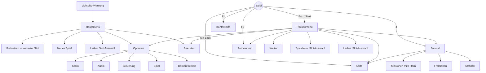

# MTA 6 – UI/UX (Menüs, Einstellungen, Barrierefreiheit, Tutorial, Fotomodus, Lokalisierung)

Alle Oberflächen sind reines **Slate** (kein UMG/Blueprint), Standard-Styles (`FAppStyle`/`FCoreStyle`), Anzeige über
`UGameViewportClient::AddViewportWidgetContent`. Texte kommen aus `Content/Data/text.<de|en>.json` (290 Schlüssel).

## 1. Menüstruktur



Zurück: Esc bzw. Gamepad-B in jedem Bildschirm (`SMTAScreenFrame`); der Controller führt einen Rücksprung-Stapel.

## 2. Wireframes (ASCII)

Hauptmenü / Pause
```
+--------------------------+----------------------------------------+
| MTA 6                    |                                        |
| Kestrel Bay              |        (Spielszene / Hintergrund)      |
|  [ Fortsetzen   ]        |                                        |
|  [ Neues Spiel  ]        |                                        |
|  [ Spiel laden  ]        |                                        |
|  [ Optionen     ]        |                                        |
|  [ Beenden      ]        |                                        |
| Fiktive Stadt ...        |                                        |
+--------------------------+----------------------------------------+
```
Slot-Auswahl
```
 Spiel laden
 +-------------------------+  +----------------------------------+
 | Autospeicherung  12.11. |  | Spielzeit   3 h 20 min           |
 | [Slot 1]         10.11. |  | Mission     Hafenfracht          |
 | Slot 2           Leer   |  | Ort         Saltmarket           |
 | Slot 3           Leer   |  | Datum       10.11.2026 21:04     |
 +-------------------------+  | [ Diesen Stand laden ]           |
 [ Zurück ]                   +----------------------------------+
```
Optionen
```
 Optionen
 [Grafik][Audio][Steuerung][Spiel][Barrierefreiheit]
 +----------------------------------------------------------+
 | Grafikvorgabe      < Mittel >                            |
 | Auflösungsskala    ----o------   80                      |
 | Hohe Kontraste     [x]                                   |
 +----------------------------------------------------------+
 [ Anwenden und speichern ] [ Standardwerte ] [ Zurück ]
```
Karte / Journal
```
 [Karte][Missionen][Fraktionen][Statistik]            [Schließen]
 +----------------------------------------------------------+
 |  LANTERN HILL      GREENMOOR      (Raster je Bezirk)     |
 |        KESTREL CORE   ^ Spieler     X Wegpunkt           |
 |  SALTMARKET           RUSTLINE                           |
 +----------------------------------------------------------+
 Ziehen=verschieben, Rad=Zoom, Klick=Wegpunkt, Rechtsklick=löschen
```
Fotomodus: Panel rechts (Sichtfeld, Blende, Fokus, Belichtung, Filter, Kontrast, Sättigung, Korn, Vignette, Temperatur, Tageszeit, Wetter, Zeit einfrieren, HUD aus, Foto/Panel aus/Beenden).

## 3. Einstellungen (alle in `GameUserSettings.ini`, Klasse `UMTAGameUserSettings`)

- **Grafik (19):** Preset, Hardware-Erkennung, Fenstermodus, Auflösung, VSync, FPS-Limit, Upscaler (TAA/TSR/FSR), Upscaler-Qualität, Auflösungsskalierung, Schatten, GI, Lumen, Nanite, Sichtweite, Texturen, Effekte, Nachbearbeitung, Bewegungsunschärfe (+ Preset-Tabelle Niedrig/Mittel/Hoch/Ultra).
- **Audio (5):** Gesamt, Musik, Radio, Effekte, Sprache.
- **Steuerung (6 + Belegung):** Lenkempfindlichkeit, Totzone Stick/Trigger, Kameraempfindlichkeit, Y invertieren, Vibration; 13 umbelegbare Einträge (Tastatur 2 Slots + Gamepad).
- **Spiel (9):** Sprache, Schwierigkeit, Fahndungsstärke, Bremshilfe, Routenführung, Untertitel, Untertitelgröße, Untertitel-Hintergrund, Tutorial-Hinweise.
- **Barrierefreiheit (11):** Farbenblind-Modus + Stärke, große Schrift, UI-Skalierung, hoher Kontrast, Lenkassistent + Stärke, Ein-Tasten-Modus, reduzierte Kamerabewegung, Lichtblitze reduzieren, Startwarnung.

Zielhardware: RX 5700 XT (kein HW-RT) -> Preset **Mittel**, TSR **Ausgewogen** (67 %), Lumen/GI Stufe 1, Nanite 1, 60 FPS-Limit.

## 4. Barrierefreiheits-Checkliste

- [x] Untertitel mit Größe und Hintergrund einstellbar (Werte über `UMTAAccessibilitySubsystem::GetSubtitleScale()`)
- [x] Freie Tastenbelegung (Tastatur + Gamepad), Konflikte werden aufgelöst
- [x] Getrennte Lautstärkeregler
- [x] Schwierigkeit jederzeit änderbar (Pausenmenü -> Optionen -> Spiel)
- [x] Farbenblind-Modi (3 Typen, Stärke) als Matrix für UI und Material-Parameter (`MPC_Accessibility`)
- [x] Marker unterscheiden sich in Form, nicht nur in Farbe
- [x] Große Schrift, UI-Skalierung, hoher Kontrast (schwarz/weiß/gelb)
- [x] Lenkassistent, Bremshilfe, Ein-Tasten-Modus (Flag; Fahrzeug wertet ihn aus)
- [x] Reduzierte Kamerabewegung (inkl. Bewegungsunschärfe aus), Lichtblitze reduzieren, Startwarnung
- [x] Menüs per Tastatur/Gamepad navigierbar (fokussierbare Buttons, Esc/B = zurück)
- [ ] Text-to-Speech, visuelle Sirenen-Hinweise (Wunschliste, Konzept 12.6)

## 5. Anbindung (Codeschnipsel)

```cpp
// Menü (einmal in der Ebene / per SpawnActor)
Menu = GetWorld()->SpawnActor<AMTAMenuController>();
Menu->OnSaveRequested.AddUObject(this, &AMyMode::HandleSave);   // FString Slot -> UMTASaveGame
Menu->OnLoadRequested.AddUObject(this, &AMyMode::HandleLoad);
Menu->OnNewGameRequested.AddUObject(this, &AMyMode::StartNew);
Menu->OnQuitRequested.AddUObject(this, &AMyMode::QuitGame);
Menu->QuerySlots.BindLambda([](TArray<FMTASaveSlotInfo>& Out){ /* Slots + Vorschau füllen */ });
Menu->SetMapDataProvider(MapStore);   // UMTAMapDataStore oder eigene IMTAMapDataProvider-Klasse
Menu->ShowMainMenu(bHasSave);

// Karte: Pose pro Tick, Missionen/Fraktionen/Statistik setzen
MapStore->SetPlayerWorld(FVector2D(Loc.X, Loc.Y), Rot.Yaw);
MapStore->Missions.Add(...); MapStore->OnWaypointChanged.AddUObject(...);

// Fotomodus
auto* Photo = UMTAPhotoModeSubsystem::Get(this);
Photo->LockQuery.BindLambda([this](FString& R){ if (bInCombat) { R = TEXT("photo.locked_combat"); return true; } return false; });
Photo->OnTimeOfDayRequested.AddUObject(Weather, &UWeather::PreviewHour);   // -1 = wiederherstellen

// Tutorial
GetGameInstance()->GetSubsystem<UMTATutorialSubsystem>()->FireTrigger("first_heat");

// Lokalisierung / Einstellungen im Code
FText T = MTATr(TEXT("menu.main.new"));
float Vol = GetGameInstance()->GetSubsystem<UMTASettingsSubsystem>()->GetBusVolume(EMTAAudioBus::Radio);
float Steer = Settings->ApplySteeringSensitivity(Raw); Steer = Access->ApplySteeringAssist(Steer, SpeedKmh);
```
`Config/DefaultEngine.ini` (Hauptagent): `[/Script/Engine.Engine] GameUserSettingsClassName=/Script/MTA6.MTAGameUserSettings`.

## 6. Dateien

`MTAMenu{Controller,Widgets,Map,Style,Types}`, `MTASettings{Types,User,Subsystem}`, `MTAAccessibilitySubsystem`, `MTALocalizationSubsystem`, `MTATutorialSubsystem`, `MTAPhotoMode`; Daten: `tutorial.json` (14 Hinweise), `text.de.json`, `text.en.json`.
