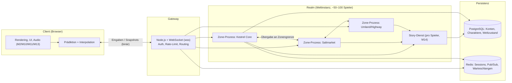
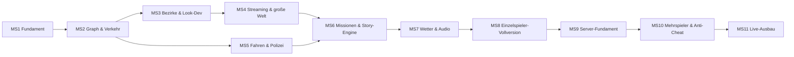

# MTA 6 – Weltkonzept

> Modulares Konzept für eine außergewöhnlich gute Spielwelt von **MTA 6**, einem **eigenständigen**, dystopisch-realistischen Open-World-Fahrspiel (Einzelspieler-Kern, später gemischt mit MMO-Elementen) mit eigener Stadt, eigenen Figuren und eigener Story.
> Version 2 (ergänzt um Realismus/Detailtiefe, Story-Engine mit Entscheidungen, Server/Mehrspieler und dystopische Stadtidentität). Zusammenhang mit der Iterationsplanung: [`ITERATIONSPLAN.md`](ITERATIONSPLAN.md) (Zuordnung in Kapitel 9).
> Stand: 19.11.2026 · Sprache: Deutsch · Ausgangsbasis: Prototyp `index.html` + `game.js` (Three.js, Browser).
>
> **Abgrenzung:** Dieses Dokument verwendet ausschließlich allgemeine Genre-Prinzipien (Open-World-Design, lebendige Städte, Systemik). Karte, Namen, Figuren, Marken und Story-Elemente sind vollständig eigen – nichts davon ist von GTA oder anderen Rockstar-Titeln abgeleitet.

---

## Inhalt

1. [Ist-Zustand des Prototyps](#1-ist-zustand-des-prototyps)
2. [Vision und Designsäulen](#2-vision-und-designsäulen)
3. [Modulübersicht und Schnittstellen](#3-modulübersicht-und-schnittstellen)
4. [Module im Detail (M1–M12)](#4-module-im-detail)
5. [Realismus und Detailtiefe (M13)](#5-realismus-und-detailtiefe-m13)
6. [Story-Engine, Entscheidungen und Fraktionen (M14)](#6-story-engine-entscheidungen-und-fraktionen-m14)
7. [Open World trifft MMO: Server und Mehrspieler (M15)](#7-open-world-trifft-mmo-server-und-mehrspieler-m15)
8. [Die Welt: Kestrel Bay (dystopisch)](#8-die-welt-kestrel-bay)
9. [Roadmap mit Meilensteinen](#9-roadmap-mit-meilensteinen)
10. [Empfohlene Dateistruktur (ES-Module)](#10-empfohlene-dateistruktur-es-module)
11. [Quellen](#11-quellen)
12. [Zusammenfassung und die 5 nächsten Schritte](#12-zusammenfassung-und-die-5-nächsten-schritte)

---

## 1. Ist-Zustand des Prototyps

Gelesen wurde `game.js` (689 Zeilen, eine Datei, globale Variablen). Was vorhanden ist und was es für die Planung bedeutet:

| Bereich | Ist-Zustand | Konsequenz |
|---|---|---|
| Stadt | Raster 8×8 Blöcke, `P = 80 m`, Straßenbreite 16 m → ca. 640 × 640 m. Zufällige Gebäude (Box + Canvas-Fenstertextur), Parks mit Kegel-Bäumen, Berge als Kegel am Horizont | Zu klein und zu gleichförmig; keine Bezirke, kein Terrain, keine Höhen |
| Zufall | `Math.random()` ohne Seed | Welt nicht reproduzierbar → kein Seed, keine Tests, kein Speichern von Weltzustand |
| Rendering | Ein `Mesh` pro Gebäude/Gehweg/Baum, pro Gebäude eigenes Material; `PCFSoftShadowMap`, 2048er Sonnenschatten | Draw Calls wachsen linear mit der Stadt – bei größerer Welt nicht tragbar → Instancing/Merging nötig |
| Fahrzeuge | Arcade-Kinematik (Geschwindigkeit + Lenkwinkel), Box-Modell, Kollision nur gegen Block-AABBs (alle 64 Blöcke je Frame) und Kreisabstand zu NPC-Autos | Spielbar, aber kein Federweg/Gewicht/Drift; Kollision braucht räumlichen Index |
| Agenten | Verkehr (36), Fußgänger (70), Polizei als „Linien-Agenten“: Position entlang einer Achse, an Kreuzungen gewichtete Zufallsabbiegung; Polizei wählt die zum Spieler nächste Option | Gute Basis, aber ohne Spurlogik, Ampeln, Vorfahrt, Wegenetz-Graph, Sim-LOD |
| Polizei/Gesetz | `heat` 0–5, Polizei spawnt 90–200 m entfernt, Festnahme bei Stillstand <3 m/s in 7 m Nähe über 2,5 s | Gutes Spielgefühl-Skelett; es fehlt Sichtlinie/Suchzustand, Straßensperren, Verbrechenstypen |
| Missionen | Ein Marker, zufälliges Ziel >150 m, Zeitbonus | Reine Lieferfahrt; keine Mission-Typen, keine Story, kein Fortschritt außer Geld |
| Tag/Nacht | 1 Spielstunde = 20 s (Tag = 8 min), Himmel/Nebel/Sonne/Fensterlicht, Scheinwerfer | Funktioniert; fehlen Wetter, Straßenlaternen, Himmelskörper |
| Audio | Zwei Oszillatoren als Motor, Mute-Taste | Platzhalter |
| UI | HUD (Geld, Sterne, Tempo, HP, Uhr), runde Minimap per Canvas | Gut als Ausgangspunkt; keine große Karte, Wegpunkte, Menüs |

**Schwächen, die jede Erweiterung blockieren:** globaler Zustand, kein Seed, ein Draw Call je Objekt, Allokationen pro Frame (`concat`, `map` im Update), keine Trennung zwischen Simulation und Darstellung.

---

## 2. Vision und Designsäulen

**Pitch:** *Kestrel Bay* ist eine sonnenverbrannte Küstenmetropole, die von einem Konzern „optimiert“ wird: glänzende Türme voller Kameras, rostige Docks, neonbunte Nächte, ein Highway, der in die Berge schneidet. Der Konzern *Aurelia Holdings* betreibt das Überwachungsnetz **Aegis**, das Kennzeichen, Gesichter und Zahlungen verknüpft und Zugang zu Straßen, Krediten und Wohnungen steuert. Man fährt, entkommt, handelt – und entscheidet, wem die Stadt am Ende gehört. Sie funktioniert auch ohne den Spieler.

**Zielplattform:** PC, Desktop-Browser (Chrome/Edge als Referenz, Firefox/Safari als „soll laufen“). Keine Installation, Start in unter 10 s. Mittelklasse-Notebook (integrierte GPU) als Mindestziel: 60 fps bei 1080p im „Mittel“-Preset, 30 fps im „Niedrig“-Preset.

### Die sieben Designsäulen

1. **Fahren fühlt sich großartig an.** Das Auto ist die Hauptfigur. Wenn eine leere Straße schon Spaß macht, trägt die Welt alles andere.
2. **Jeder Bezirk ist auf einen Blick erkennbar.** Silhouette, Farbpalette, Straßenmuster, Licht, Musik und Verkehr unterscheiden sich so stark, dass man ohne Karte weiß, wo man ist (Orientierung über Landmarken, siehe Quellen [Q7]).
3. **Die Stadt lebt ohne dich.** Verkehr, Passanten, Polizei und Wetter folgen eigenen Regeln. Der Spieler stört ein System, das bereits läuft (Systemik statt Skript, [Q5][Q6]).
4. **Systeme erzeugen Geschichten.** Wenige, saubere Regeln (Verfolgung, Ruf, Geld, Tageszeit, Wetter) kombinieren sich zu unvorhersehbaren Momenten; geschriebene Missionen setzen nur Anker.
5. **Browser-ehrlich gebaut.** Alles wird gegen feste Performance-Budgets entworfen (Instancing, Streaming, Sim-LOD). Eine schöne Welt, die nur auf einer Highend-GPU läuft, ist keine.
6. **Glaubwürdigkeit durch Detail.** Realismus entsteht aus vielen kleinen, konsistenten Dingen (Materialien, Verschleiß, Straßendetails, plausible Stadtstruktur), nicht aus maximaler Polygonzahl. Ziel ist der bestmögliche Look *innerhalb* der Browsergrenzen (Kapitel 5).
7. **Entscheidungen haben Folgen, und die Welt hat eine Haltung.** Dystopie ist kein Anstrich, sondern Spielmechanik: Überwachung (Aegis), Konzernmacht und soziale Gegensätze verändern, wie man fährt, flieht und handelt. Spielerentscheidungen verschieben Fraktionen, Bezirke und Enden (Kapitel 6).

### Alleinstellungsmerkmal (Unique Selling Point)

**„Eine Stadt, die man an der Tageszeit liest.“** Jeder Bezirk hat einen eigenen Tagesrhythmus (Büros leeren sich ab 18 Uhr, der Hafen arbeitet in der Frühschicht, die Promenade lebt nachts). Missionen, Verkehr, Polizeipräsenz und Preise hängen am Rhythmus. Dazu ein **Bezirks-Ruf-System** statt eines einzigen globalen Fahndungslevels: Wer in Saltmarket auffällt, ist dort bekannt, nicht automatisch überall. Zusätzlich das **Aegis-Profil**: Kameras lesen Kennzeichen; wer oft auffällt, wird in überwachten Bezirken schneller erkannt – es sei denn, man hackt Kameras, tauscht Kennzeichen oder fährt durch die „blinden“ Armenviertel. Die Dystopie wird so zu einer Fahrregel, nicht zu Kulisse.

---

## 3. Modulübersicht und Schnittstellen

### 3.1 Architekturdiagramm


### 3.2 Leitprinzipien der Architektur

- **Simulation und Darstellung strikt getrennt.** Die Simulation kennt nur Zahlen (Positionen, Zustände) und läuft mit festem Zeitschritt. Der Renderer liest diese Zustände. Dadurch ist Sim-LOD (ferne Agenten billig simulieren), Worker-Auslagerung und Testen ohne Browser möglich.
- **Ein Datenmodell für die Stadt (`CityData`)**: Straßengraph (Knoten, Kanten mit Spuren), Parzellen, Zonen/Bezirke. Weltgenerierung schreibt es, Streaming, KI, Karte und Missionen lesen es. So gibt es *eine* Wahrheit.
- **Events statt direkter Aufrufe** zwischen Modulen (`bus.emit('crime', {...})`). Polizei, Missionen, Audio und UI abonnieren, ohne sich zu kennen.
- **Alles seedbar:** ein `Rng(seed)` statt `Math.random()`; gleicher Seed = gleiche Stadt.
- **Server-fähig von Anfang an:** Da `sim/` und `world/` ohne Three.js und ohne DOM laufen, kann dieselbe Simulation später im Node-Server laufen. Im Einzelspielermodus läuft sie als **LocalServer** im selben Browser (Web Worker). So gibt es *einen* Code-Pfad für Einzel- und Mehrspieler (Kapitel 7).

### 3.3 Schnittstellentabelle

| Modul | Liefert (Output) | Braucht (Input) |
|---|---|---|
| M1 Weltgenerierung | `CityData` (Straßengraph, Parzellen, Zonen, Landmarken-Slots) | Seed, Bezirksdefinitionen, Heightmap |
| M2 Streaming/LOD | Sichtbare Chunks, Instanz-Buffer, Kollisions-Proxies | `CityData`, Kameraposition |
| M3 Bezirke | `DistrictDef` (Palette, Regeln, Dichte, Musik, Verkehrsprofil) | – (Designdaten) |
| M4 Fahrzeuge | `VehicleState` (Pose, Geschwindigkeit, Schaden), Kollisionsevents | Eingabe/KI-Steuerung, Bodenhöhe, Fahrzeugdaten |
| M5 Verkehrs-/Fußgänger-KI | Agentenzustände, Wahrnehmungsevents („Unfall gesehen“) | Straßengraph, Zeit, Wetter, Spielerposition |
| M6 Polizei/Gesetz | Fahndungsstufe pro Bezirk, Polizeiagenten, Festnahme/Flucht-Events | Verbrechensevents, Sichtlinien, Straßengraph |
| M7 Missionen/Story | Aufträge, Marker, Cutscene-/Dialogtrigger | `CityData`, Spielzustand, Events |
| M8 Wirtschaft | Geld, Ruf, Freischaltungen, Speicherstand | Missionsergebnisse, Verbrechensfolgen |
| M9 Tag/Nacht/Wetter | `Environment` (Sonne, Himmel, Nebel, Nässe, Wind) | Spielzeit, Bezirk |
| M10 Audio | Mix aus Motor-, Umgebungs-, Musik-, UI-Bussen | Fahrzeug-, Umwelt-, KI-Daten |
| M11 UI/Karte | HUD, Vollkarte, GPS-Route, Menüs | Alle Zustände (nur lesend) |
| M12 Performance/Tooling | Budgets, Profiler, Debug-Overlays, Seed-Tests | Alle Module |
| M13 Realismus-Pipeline | Material-Bibliothek (PBR), Decal-/Verschleiß-System, Prop-Sets, Qualitätsstufen | Bezirke (M3), Wetter/Zeit (M9), Streaming (M2) |
| M14 Story-Engine | Entscheidungen, Fraktionsstand, Weltzustand-Tags, Enden | Missions-Events (M7), Verbrechen (M6), Spielzustand (M8) |
| M15 Server/Mehrspieler | Autoritativer Weltzustand, Snapshots, Persistenz, Anti-Cheat-Prüfung | Alle Sim-Module (laufen auch im Server), M14 für Story-Phasen |

---

## 4. Module im Detail

Aufwandsschätzung in **Personentagen (PT)** für eine Entwicklerin/einen Entwickler mit KI-Unterstützung, jeweils pro Stufe; Werte sind grobe Schätzungen mit ±50 % Unsicherheit. Stufen: **MVP** (spielbar, trägt den Meilenstein), **Ausbau** (Qualitätssprung), **Wunschziel** (Politur/Luxus).

### M1 – Weltgenerierung

**Ziel:** Eine reproduzierbare, vielfältige Stadt statt eines zufälligen Rasters; Straßen und Parzellen entstehen aus Regeln, Bezirke formen das Ergebnis.

| Stufe | Umfang |
|---|---|
| MVP | Seed-RNG; Raster wird zu **Straßengraph** (Knoten/Kanten) mit Hierarchie (Hauptstraße, Nebenstraße, Gasse); Blöcke werden rekursiv in Parzellen unterteilt; Gebäudehöhe nach Bezirk statt nur nach Abstand zur Mitte |
| Ausbau | **Tensor-Feld-Straßen**: Raster in der Innenstadt, Radialmuster am Hang, Küstenparallelen an der Promenade, zu einem Feld verblendet; Heightmap-Terrain mit Straßen, die sich dem Gelände anpassen; Brücken/Tunnel; Wasserflächen |
| Wunschziel | Grammatik-basierte Fassaden (Shape Grammar) mit Bezirksstil; Einwohner-/Landnutzungssimulation, aus der Zonen entstehen; handgesetzte „Hero“-Gebiete werden in die generierte Stadt eingefügt |

**Technische Umsetzung:**
- Verfahren in der Reihenfolge der Literatur: Straßennetz → Blöcke → Parzellen → Gebäude ([Q1] Parish & Müller mit L-Systemen; [Q2] Chen et al. mit Tensor-Feldern für Raster/Radial/Küstenmuster; Parzellierung per rekursiver Teilung orientierter Rechtecke, vgl. [Q3]).
- **Hybridansatz empfohlen:** Hauptachsen, Highway, Brücken und Landmarken **handgesetzt** (Designkontrolle, Wiedererkennbarkeit), Füllstraßen und Parzellen **prozedural** (Umfang, Vielfalt). Reine Prozedur erzeugt Beliebigkeit; reine Handarbeit ist nicht zu leisten.
- Terrain als Heightmap-Gitter in Chunks; Straßen als Meshes entlang der Graph-Kanten, die an das Terrain „geschmiegt“ werden.
- Ausgabe ist reine Daten-Struktur (JSON-fähig) → in Worker erzeugbar, cachebar, testbar.

**Abhängigkeiten:** M3 (Bezirksparameter), M12 (Seed-Tests). **Risiken:** Tensor-Felder erzeugen unschöne Kreuzungswinkel/Sackgassen → nachbearbeiten (Segmente verschmelzen, Mindestwinkel); Generator wird zum Zeitgrab → Zeitbox je Stufe, Handarbeit als Fallback. **Aufwand:** MVP 6 PT · Ausbau 14 PT · Wunsch 15 PT+.

---

### M2 – Streaming und LOD

**Ziel:** Eine Welt, die um ein Vielfaches größer ist als das, was gleichzeitig im Speicher/Renderer ist, bei stabilen 60 fps.

| Stufe | Umfang |
|---|---|
| MVP | Welt in **Chunks** (z. B. 160 × 160 m); nur Chunks im Radius laden; **Instancing** für Gebäude/Bäume/Laternen/Fahrzeuge; geteilte Materialien; Frustum-Culling; Nebel als Weitsicht-Kaschierung |
| Ausbau | Chunk-Erzeugung im **Web Worker** (Geometrie in Typed Arrays, per Transfer übergeben); 3 LOD-Stufen für Gebäude (Detail → Kasten mit Textur → Silhouette/Impostor); Kollisions-Proxies getrennt von Render-Meshes; Warteschlange mit Zeitbudget pro Frame (z. B. max. 2 ms Chunk-Upload) |
| Wunschziel | **BatchedMesh** bzw. BVH-basiertes Instanz-Culling; Hierarchical-LOD für Fernstadt; WebGPU-Renderer mit Compute-Culling; Texturatlas/Virtual Texturing |

**Technische Umsetzung:**
- `InstancedMesh` reduziert Draw Calls auf „Anzahl Geometrie×Material-Typen“, verliert aber Culling pro Objekt; deshalb **je Chunk eigene Instanzgruppen**, damit das Frustum-Culling auf Chunk-Ebene greift. `BatchedMesh` erlaubt mehrere Geometrien in einem Draw Call mit Culling je Instanz, ist aber nicht automatisch schneller – immer mit `renderer.info.render` messen [Q8][Q9].
- Richtwert (Heuristik, keine harte Vorgabe): unter ca. 100–200 Draw Calls im Frame anpeilen [Q8].
- Worker-Muster: Metadaten/Heightmap hin, fertige Geometrie-Buffer plus räumlicher Index zurück; Chunk-Noise auf dem Hauptthread kostet schon bei 64×64 grob 10 ms [Q10].
- Fenster-Nachtlicht: statt eigener Emissive-Textur je Gebäude ein **Shader mit Fenstermuster aus Instanzattribut** (ein Material für alle).
- Optional später: `WebGPURenderer` (in aktuellen Three.js-Versionen empfohlen; Browser-Abdeckung bei Firefox/Linux/Android noch lückenhaft) – daher **Renderer-Abstraktion** so bauen, dass WebGL2 Standard bleibt und WebGPU ein Schalter ist [Q11].

**Abhängigkeiten:** M1 (Daten), M12 (Messung). **Risiken:** Pop-in sichtbar → Nebel, Überblendung, Chunk-Vorlauf in Fahrtrichtung; Speicherlecks beim Entladen (Geometrien/Texturen `dispose()`); Worker-Overhead/Transfer. **Aufwand:** MVP 5 PT · Ausbau 12 PT · Wunsch 15 PT+.

---

### M3 – Stadtbezirke und Identität

**Ziel:** Sechs Bezirke, die man an Optik, Licht, Verkehr und Klang erkennt (Details in [Kapitel 8](#8-die-welt-kestrel-bay)).

| Stufe | Umfang |
|---|---|
| MVP | `DistrictDef`-Datenobjekte: Farbpalette der Fassaden, Gebäudehöhen, Straßenbreiten, Baumdichte, Passanten-/Verkehrsdichte, Himmelstönung; je Bezirk 1 Landmarke |
| Ausbau | Eigene Prop-Sets (Container, Palmen, Reklametafeln, Poller …) als Instanzen; Boden-/Asphalttexturen je Bezirk; bezirksspezifische Nachtbeleuchtung (Neon, Natrium, LED); Bezirksname beim Einfahren (UI) |
| Wunschziel | Bezirkstypische NPC-Kleidung/Fahrzeugmix; Zeitrhythmen (Schichtwechsel, Rush Hour); dynamische Details (Baustellen, Märkte, Veranstaltungen) |

**Technische Umsetzung:** Reine Daten (`districts/*.js`), konsumiert von M1 (Generierung), M2 (Props), M5 (Verkehrsprofil), M9 (Licht), M10 (Musik). Orientierung folgt bewährten Prinzipien: **Landmarken-Hierarchie** (1 Hauptlandmarke je Bezirk, kleinere als Wegmarken), Wiedererkennung über Farbe und Silhouette, Leitlinien (Straßen führen auf Landmarken zu) [Q7].
**Abhängigkeiten:** M1, M2. **Risiken:** Bezirke wirken bloß „umgefärbt“ → Unterschiede in *Struktur* (Straßenmuster, Höhenprofil, Prop-Rhythmus) statt nur Farbe. **Aufwand:** MVP 3 PT · Ausbau 10 PT · Wunsch 10 PT+.

---

### M4 – Fahrzeuge und Physik

**Ziel:** Fahrverhalten, das sich nach Gewicht, Grip und Tempo anfühlt; Zerstörung, die Konsequenzen hat.

| Stufe | Umfang |
|---|---|
| MVP | Bestehendes Arcade-Modell sauber in Fixed-Step-Modul auslagern; **Fahrzeugdatenblätter** (Masse, Beschleunigung, Höchsttempo, Grip, Lenkrate); Handbremsendrift (Quer-Schlupf mit Haftgrenze); Kollision über räumliches Gitter statt Schleife über alle Blöcke; Höhenanpassung ans Terrain |
| Ausbau | **Raycast-Fahrzeug**: Feder/Dämpfer je Rad, vereinfachtes Reifenmodell (linear/Bürsten statt vollem Pacejka, der bei niedrigem Tempo numerisch schwierig ist) [Q12]; Nick/Wank sichtbar; 4–6 Fahrzeugklassen (Kompakt, Limousine, Sportler, SUV, Transporter, Motorrad); Schadensmodell (Zonen, Beulen per Vertex-Offset, Rauch, Reifenschaden); Ein-/Aussteigen |
| Wunschziel | Rapier (Rust/WASM) für Rigid-Body-Kollisionen und Kettenreaktionen [Q13]; Anhänger, Boote, Hubschrauber; Fahrzeug-Tuning |

**Technische Umsetzung:**
- Fixed Timestep (z. B. 120 Hz Sub-Steps) mit Interpolation zur Darstellung; deterministisch genug für Replays/Tests.
- Raycast-Fahrzeug nach klassischem Muster („Car Physics for Games“, M. Monster) – eigener Code für Arcade-Gefühl, **Physik-Engine nur für Kollision/Objekte**, nicht für das Fahrverhalten [Q12].
- Kollision: uniformes Gitter (Spatial Hash) über Gebäude-/Props-Proxies und Fahrzeuge; Straßenbegrenzer/Poller zerstörbar später.
- Gefühl vor Realismus: Tuning-Parameter in einer Datei, Live-Slider im Debug-Overlay.

**Abhängigkeiten:** M1/M2 (Boden, Kollision), M12. **Risiken:** Tunneling bei hohem Tempo (→ Sub-Steps, Sweep-Tests); WASM-Physik erhöht Ladezeit/Komplexität → erst wenn Kollision am Gitter nicht mehr reicht; „realistisch“ ≠ „spaßig“ → Playtests. **Aufwand:** MVP 5 PT · Ausbau 15 PT · Wunsch 20 PT+.

---

### M5 – Fußgänger- und Verkehrs-KI

**Ziel:** Eine Stadt, die glaubwürdig wimmelt, ohne die CPU zu fressen – **Simulation-LOD** als Kernidee.

| Stufe | Umfang |
|---|---|
| MVP | Agenten auf dem **Straßengraph** (Kanten mit Spuren, Einbahn, Tempolimit); Ampel-/Vorfahrtlogik an Kreuzungen; Abstandhalten per Vorderfahrzeug-Abfrage über Spurlisten (statt Allpaarvergleich); Fußgänger auf Gehwegen, Überqueren an Zebrastreifen; **Spawn/Despawn am Rand des Aktivradius** |
| Ausbau | **Drei Sim-Stufen**: (A) nah: volle Kollision, Animation, Wahrnehmung; (B) mittel: nur Spur-Bewegung ohne Kollision, niedrige Updaterate; (C) fern: statistische Dichte pro Kante, keine Einzelagenten. Reaktionen: Ausweichen, Hupen, Flucht bei Unfall/Schüssen/Raserei; Tageszeitprofile pro Bezirk; Wetter-Einfluss (weniger Fußgänger bei Regen, langsamerer Verkehr) |
| Wunschziel | Agenten mit Zielen (Zuhause → Arbeit → Café) und Tagesplan; Busse/Bahn mit Haltestellen; Menschenmengen-Verhalten (Gruppen, Warteschlangen); Skinned/Instanz-Animationen per Vertex-Textur |

**Technische Umsetzung:**
- Das Prinzip „**Simulationsblase**“ (Verkehr und Passanten laufen je in einer Blase um den Spieler; am Rand wird gespawnt/entfernt) und das Einhalten von Verkehrsregeln trotz unvorhersehbarer Kollisionen ist aus Open-City-Spielen belegt [Q4]. Gestufte Detailtiefe nach Entfernung (volle KI nah, vereinfachte mittel, statistisch fern) ist ebenfalls etablierte Praxis [Q14].
- Datenorientiert: Agenten als Struct-of-Arrays (Typed Arrays), Rendering über Instanzmatrizen. Hunderte Fahrzeuge/Tausende Fußgänger sind so im Browser realistisch; Einzelobjekte mit je eigener Logik sind es nicht.
- Optional Auslagerung der Sim-Stufen B/C in einen Worker (SharedArrayBuffer nur mit COOP/COEP-Headern; sonst Transfer-Snapshots).
- Systemische Ereignisse (Unfall, Panne, Straßenfest), die auch **ohne** Spielerbeteiligung stattfinden, schaffen die Lebendigkeit [Q5][Q6].

**Abhängigkeiten:** M1 (Straßengraph), M9 (Zeit/Wetter), M6 (Polizei reagiert/teilt Graph). **Risiken:** Staus/Deadlocks an Kreuzungen (→ Timeout + Ghosting, wie der Prototyp es schon macht, aber kontrolliert); Mengenzahl vs. CPU; unnatürliches Pop-in (→ Spawn nur außerhalb der Sicht). **Aufwand:** MVP 8 PT · Ausbau 15 PT · Wunsch 20 PT+.

---

### M6 – Polizei und Gesetz-System

**Ziel:** Verfolgungen, die fair, spannend und lesbar sind; Folgen statt bloßer Strafpunkte.

| Stufe | Umfang |
|---|---|
| MVP | Verbrechens-**Events** mit Gewichtung (Raserei, Unfall mit Zivilfahrzeug, Fußgänger verletzt, Polizeikontakt); Fahndungsstufe 1–5 mit Abklingen; Polizei fährt über Straßengraph (Zielwahl: Spieler/letzte bekannte Position); Festnahme/Flucht wie im Prototyp, aber mit **Sichtlinie** |
| Ausbau | Zustände **Verdacht → Verfolgung → Suche → Verloren** mit Suchradius um die zuletzt gesehene Position; Zeugenmeldung (nur gemeldet, wenn ein NPC das Verbrechen sah); **Bezirks-Ruf**: Fahndungsdruck gilt primär im Bezirk und strahlt abgeschwächt aus; Taktiken je Stufe (PIT-Manöver, Straßensperre, Nagelband, Hubschrauber); Unterschlupf (Garage, Tunnel, Wasser) zum Abschütteln |
| Wunschziel | Polizei als Fraktion mit Revieren, Schichtwechsel, Korruption/Bestechung; Gerichts-/Kautionssystem; Nicht-tödliche Optionen für den Spieler |

**Technische Umsetzung:** Endlicher Automat pro Polizeieinheit + zentraler „Dispatcher“ (verteilt Einheiten, hält Ziel-Wissen). Wahrnehmung über Sichtkegel mit Raycast gegen Gebäude-Proxies, dazu Hörradius. Das Fahndungssystem als „Spielzeug“ mit klaren, ablesbaren Regeln zu gestalten (Spieler versteht, *warum* er gesucht wird) ist wichtiger als Realismus [Q5].
**Abhängigkeiten:** M5 (Graph, Zeugen), M4 (Fahrzeuge), M3 (Bezirke), M1. **Risiken:** Gummiband-KI, die „betrügt“ (Teleport-Spawns) → Spawn nur außerhalb der Sicht, Dichte begrenzen; Frust durch unausweichliche Festnahme → immer einen erkennbaren Fluchtweg. **Aufwand:** MVP 4 PT · Ausbau 12 PT · Wunsch 15 PT+.

---

### M7 – Missionen und Story

**Ziel:** Aufträge, die die Welt zeigen und systemische Zufälle zulassen, getragen von einer eigenen, kleinen, konsistenten Story.

| Stufe | Umfang |
|---|---|
| MVP | Missions-**Framework** als Daten (Schritte: *Gehe zu / Fahre zu / Hole ab / Liefere / Entkomme / Zerstöre / Warte*); Missionstypen: Kurier mit Zeitlimit, Taxi-Passagier, Verfolgung (Ziel fährt ein Ziel an), Flucht; Marker/Wegpunkt-UI; Checkpoints, Fehlschlag-/Erfolgsmeldung |
| Ausbau | **Story-Kampagne** (ca. 12–15 Hauptmissionen) an Bezirke gekoppelt; Nebenaufträge je Bezirk („Bezirksjobs“); Dialoge/Funk als Textboxen mit Sprecherportrait; mehrere Lösungswege (z. B. Flucht über Dach/Tunnel/Wasser); Speicherpunkte |
| Wunschziel | Verzweigende Entscheidungen, Charakterbeziehungen, dynamische Zufallsbegegnungen, Mission-Editor im Browser |

**Technische Umsetzung:** Zustandsautomat/Skript-DSL in JSON (`missions/*.json`), ausgeführt von `MissionRunner`; Missionen **abonnieren Events** (z. B. `vehicle.enteredZone`), statt die Hauptschleife zu kennen. Gestaltungsregel: je Mission Zielbedingung, KI-Rollen, Checkpoint-Abstände und Fehlschlagtext explizit festlegen; einfache KI mit starker Reaktion wirkt besser als komplexe KI [Q15]. Missionen so „öffnen“, dass systemisches Chaos (Verkehr, Polizei) mitspielen darf, statt es auszuschalten [Q5][Q6].
**Abhängigkeiten:** M1 (Orte), M5/M6 (Welt reagiert), M8 (Belohnung), M11 (Marker). **Risiken:** Content-Menge (jede Mission ist Handarbeit) → starke Wiederverwendung von Typen, Story kurz und prägnant; Skript-Brüche bei systemischen Zufällen → Fail-Safes (Neuaufsetzen, Checkpoint). **Aufwand:** MVP 6 PT · Ausbau 20 PT · Wunsch 25 PT+.

**Story:** Die Haupthandlung „Nullstunde“ samt Fraktionen, Entscheidungs-/Ruf-System, Wendepunkten, Enden und Datenmodell steht in [Kapitel 6 (M14)](#6-story-engine-entscheidungen-und-fraktionen-m14). M7 liefert nur den Missions-Runner, den M14 mit Inhalten und Bedingungen füttert.

---

### M8 – Wirtschaft und Fortschritt

**Ziel:** Ein Fortschrittsgefühl, das das Fahren belohnt und die Welt schrittweise öffnet.

| Stufe | Umfang |
|---|---|
| MVP | Geld (vorhanden) mit klaren Einnahmen/Ausgaben; Speichern/Laden (`localStorage`/IndexedDB); Fahrzeugreparatur und -ersatz; Strafen/Verlust bei Festnahme (vorhanden) |
| Ausbau | Garagen/Safehouses je Bezirk (Speichern, Fahrzeuglager); Fahrzeugkauf und Tuning; **Bezirks-Ruf** (Fraktionen schalten Aufträge und Rabatte frei); Immobilien als Einnahmequelle |
| Wunschziel | Dynamische Preise (Tageszeit, Nachfrage), Handel/Schmuggelrouten mit Risiko, Erfolge/Herausforderungen |

**Technische Umsetzung:** Ein zentrales, serialisierbares `GameState` (reine Daten) – Grundlage für Speichern, Tests und Debug. Wirtschaft als kleine Tabellen (Preise, Belohnungen) in Daten-Dateien, nicht im Code.
**Abhängigkeiten:** M7, M6. **Risiken:** Inflation/Balancing → Kennzahlen in einer Tabelle, Playtest-Telemetrie lokal; Speicherstand-Versionierung (Schema-Version von Anfang an). **Aufwand:** MVP 3 PT · Ausbau 8 PT · Wunsch 10 PT+.

---

### M9 – Tag/Nacht/Wetter

**Ziel:** Licht und Wetter als wichtigstes Stimmungswerkzeug – jeder Bezirk sieht zu jeder Tageszeit anders aus.

| Stufe | Umfang |
|---|---|
| MVP | Tageszyklus aus dem Prototyp in Modul auslagern; Sonne/Mond mit Elevation, Dämmerungsfarben; Straßenlaternen und Fensterlicht über Instanzattribut; Spielzeit-API (`env.hour`) |
| Ausbau | **Wetter-Zustandsautomat** (klar, bewölkt, Regen, Nebel, Gewitter) mit weichen Übergängen; nasse Straßen (Roughness/Reflexion, Pfützen-Noise), Regenpartikel, Scheibenwischer; Himmelsshader (Sonne, Wolken, Sterne); Bezirks-Tönung; Wetter wirkt auf Grip (M4), Verkehr (M5), Audio (M10) |
| Wunschziel | Volumetrische Wolken/Nebel, Screen-Space-Reflexionen, Jahreszeiten, Windsimulation für Vegetation |

**Technische Umsetzung:** Ein `Environment`-Objekt hält alle Parameter; Übergänge per Interpolation; Himmel als großer Shader-Dom statt Szenenhintergrundfarbe. Schatten: **Cascaded Shadow Maps** statt einer 200-m-Box, sonst werden Schatten in der größeren Welt unscharf oder zu teuer. Straßenlaternen nicht als echte Lichter (zu teuer), sondern als Emissive-Sprites + wenige echte Lichter um den Spieler.
**Abhängigkeiten:** M2 (Instanzen), M12. **Risiken:** Nachtbeleuchtung kostet viele Lichter → Fake-Licht (Glow-Sprites, Decals), echte Lichter strikt begrenzen; Regen-Shader auf Low-End. **Aufwand:** MVP 3 PT · Ausbau 12 PT · Wunsch 15 PT+.

---

### M10 – Audio

**Ziel:** Eine Welt, die man hört: Motor, Stadt, Wetter, Musik.

| Stufe | Umfang |
|---|---|
| MVP | Audio-Manager mit Bussen (Motor, Umwelt, Musik, UI) und Master-Lautstärke; Motor aus **geloopten Samples** (Leerlauf, Last, Schub) mit Pitch nach Drehzahl statt Oszillatoren; Kollision, Hupe, Sirene; Doppler/Dämpfung für NPC-Fahrzeuge |
| Ausbau | Mehrschicht-Motor mit **Equal-Power-Crossfade** (kein Lautstärkeloch) [Q16]; Reifenquietschen, Wind nach Tempo, Regen; Umgebungs-Layer je Bezirk (Hafenhorn, Möwen, Neonsummen, Brandung); Straßenzug-Hall (Tunnel/Häuserschluchten); Radiosender mit prozeduraler Musik |
| Wunschziel | Dynamische Musik (Intensität folgt Verfolgung/Tageszeit), Sprachausgabe, Mix-Snapshots (z. B. „unter Wasser“, „in der Garage“) |

**Technische Umsetzung:** Web Audio API; `AudioBuffer`-Loops mit sample-genauem Looping; Gain-/Filter-Automation über `AudioParam`; **PannerNode nur für wichtige Quellen** (Kostenpunkt je Panner – mehrere Quellen am selben Emitter teilen sich einen) [Q16][Q17]. Audio-Kontext erst nach Nutzergeste starten (Browserregel; Prototyp macht das schon). Die Racer-Fallstudie von Google zeigt, wie ein Motorklang mit nur wenigen Dateien (Beschleunigung, Verzögerung, Leerlauf) überzeugend wird [Q16].
**Abhängigkeiten:** M4, M5, M9. **Risiken:** Asset-Beschaffung/Lizenzen (→ CC0-Quellen oder selbst synthetisiert, Lizenzliste führen); Dateigröße/Ladezeit (→ Opus/OGG, Streaming nach Bezirk). **Aufwand:** MVP 3 PT · Ausbau 8 PT · Wunsch 10 PT+.

---

### M11 – UI und Karte

**Ziel:** Lesbare, schöne Bedienung; Karte und Navigation, die die Stadt erschließen.

| Stufe | Umfang |
|---|---|
| MVP | HUD modularisiert (DOM); Minimap aus **`CityData`** gezeichnet (Straßengraph statt Blockrechtecke); Zielpfeil und Entfernungsanzeige; Pause-/Optionsmenü (Grafik-Preset, Lautstärke, Tastenbelegung) |
| Ausbau | **Vollkarte** (Zoom/Pan, Bezirksnamen, Landmarken, eigene Wegpunkte); **GPS-Routenlinie** auf Straßengraph (A*), im Spiel als Linie/Pfeile auf der Straße; Bezirksname-Einblendung; Gamepad-Unterstützung; Missions-Tagebuch |
| Wunschziel | Fotomodus, Telefon-UI, Anpassbare HUD, Barrierefreiheit (Farbenblind-Modi, Untertitelgröße) |

**Technische Umsetzung:** Karte als vorab gerenderte **Canvas-Textur** aus `CityData` (einmal gebacken, dann nur Marker darüber); Pfadsuche A* auf dem Straßengraph (derselbe wie KI). Alle UI-Elemente lesen den Zustand, schreiben nie in die Simulation.
**Abhängigkeiten:** M1, M7, M8. **Risiken:** DOM-Updates pro Frame (→ nur bei Änderung schreiben); Eingabegeräte-Matrix. **Aufwand:** MVP 3 PT · Ausbau 10 PT · Wunsch 8 PT+.

---

### M12 – Performance und Tooling

**Ziel:** Messen statt vermuten; Qualität bleibt reproduzierbar und regressionsfrei.

| Stufe | Umfang |
|---|---|
| MVP | **Debug-Overlay** (fps, Frame-ms, `renderer.info` Draw Calls/Dreiecke/Texturen, Agentenzahlen, Chunk-Zahl); `Rng(seed)` + Seed in URL; feste **Budgets** (siehe unten); Qualitäts-Presets (Niedrig/Mittel/Hoch) |
| Ausbau | Automatischer **Benchmark-Flug** (fester Seed, fester Kameraweg, Ergebnis als JSON); Seed-Tests für Generator (z. B. „alle Blöcke erreichbar“, „kein Gebäude auf Straße“) per Node-Skript; Frame-Zeit-Aufschlüsselung je Modul; Speicher-Watch (Geometrien/Texturen) |
| Wunschziel | CI-Lauf mit Headless-Browser, Performance-Regressionsgrenzen; In-Game-Editor für Bezirksparameter und Missionen |

**Performance-Budgets (Zielwerte für „Mittel“-Preset, 1080p, Integrierte GPU der Mittelklasse; bei Abweichung neu kalibrieren):**

| Größe | Budget |
|---|---|
| Frame-Zeit gesamt | ≤ 16,6 ms (60 fps), ≤ 33 ms im Preset „Niedrig“ |
| Draw Calls | ≤ 200 (Richtwert aus Community-Praxis, siehe [Q8]) |
| Dreiecke sichtbar | ≤ 1,5 Mio. |
| Simulation (JS) | ≤ 4 ms pro Frame |
| Chunk-Aufbau (Hauptthread) | ≤ 2 ms pro Frame |
| Aktive Fahrzeuge / Fußgänger | ≤ 120 / ≤ 250 voll simuliert (Stufe A+B), weitere nur statistisch |
| Echte dynamische Lichter | ≤ 4 in „Niedrig/Mittel“, ≤ 8 in „Hoch“ (gepoolt: Spieler-Scheinwerfer, Sonne, nächste Einsatzfahrzeuge/Neonquellen); alles Weitere als Emissive-Sprites/Fake-Licht |
| Texturspeicher | ≤ 512 MB; Atlanten statt Einzeltexturen |
| Erstladezeit bis Spielstart | ≤ 10 s auf 50 Mbit/s |

**Technische Umsetzung:** Eigenes kleines Profiler-Modul (`performance.now()` je Systemblock), Overlay per Taste. Allokationen im Frame vermeiden (Objekt-Pools, wiederverwendete Arrays – der Prototyp erzeugt z. B. pro Frame `concat`-Arrays).
**Abhängigkeiten:** alle. **Risiken:** Messung wird vergessen → Overlay standardmäßig per `F3` und im Benchmark-Skript verankern. **Aufwand:** MVP 2 PT · Ausbau 6 PT · Wunsch 8 PT+.

---

### Gesamtschätzung (M1–M15)

| Modul | MVP | Ausbau | Wunsch |
|---|---|---|---|
| M1 Weltgenerierung | 6 | 14 | 15+ |
| M2 Streaming/LOD | 5 | 12 | 15+ |
| M3 Bezirke | 3 | 10 | 10+ |
| M4 Fahrzeuge/Physik | 5 | 15 | 20+ |
| M5 Verkehrs-/Fußgänger-KI | 8 | 15 | 20+ |
| M6 Polizei/Gesetz | 4 | 12 | 15+ |
| M7 Missionen (Framework) | 6 | 20 | 25+ |
| M8 Wirtschaft | 3 | 8 | 10+ |
| M9 Tag/Nacht/Wetter | 3 | 12 | 15+ |
| M10 Audio | 3 | 8 | 10+ |
| M11 UI/Karte | 3 | 10 | 8+ |
| M12 Performance/Tooling | 2 | 6 | 8+ |
| M13 Realismus/Detailtiefe | 6 | 20 | 25+ |
| M14 Story-Engine | 8 | 20 | 25+ |
| M15 Server/Mehrspieler | 15 | 30 | 40+ |
| **Summe (PT)** | **80** | **212** | **261+** |

Alle MVPs zusammen: grob **16–18 Arbeitswochen** (eine Person mit KI-Unterstützung, ca. 5 PT/Woche). Davon entfallen rund 65 PT auf den **Einzelspieler-Kern** (M1–M14), 15 PT auf den Server. Alle Ausbaustufen kosten weitere ca. 8–10 Monate. Die Schätzungen sind Planwerte mit ±50 % Unsicherheit, keine Zusagen; Inhalte (Missionen, Assets, Audio) sind darin nur teilweise enthalten.

---

## 5. Realismus und Detailtiefe (M13)

**Ziel:** Eine Stadt, die glaubwürdig *benutzt* aussieht – Asphalt mit Flicken, Gullideckel mit Dampf, abgenutzte Fassaden, nasse Straßen, die Neon spiegeln. Maßstab ist der **bestmögliche Look innerhalb der Browser-Grenzen**, nicht Konsolen-Fotorealismus.

### 5.1 Ehrliche Grenzen im Browser – und wie man sie ausreizt

| Bereich | Reale Grenze (Richtwerte, am Zielgerät messen) | Wie man sie ausreizt |
|---|---|---|
| Draw Calls | Etwa 100–200 pro Frame für 60 fps auf integrierter GPU [Q8] | Instancing je Chunk, Material-Pools (≈ 30 gemeinsame Materialien), Texturatlanten/Trim-Sheets statt Einzelmaterialien |
| Texturspeicher | Rund 512 MB VRAM-Budget; unkomprimierte 2K-Maps sprengen es schnell | **KTX2/Basis-Universal** (GPU-komprimiert, ca. 4–8× kleiner), ORM-Packing (Occlusion/Roughness/Metalness in einer Textur), Mipmaps, Texturgröße je Preset |
| Schatten | Eine große Shadow Map wird weit weg unscharf, mehrere kosten Fill-Rate | **Cascaded Shadow Maps** (3 Kaskaden), nur große Objekte werfen Schatten, Fernbereich: gebackener Blob-/AO-Schatten |
| Dynamische Lichter | Jedes echte Licht verteuert jedes Fragment (Forward-Rendering) | ≤ 4/8 gepoolte Lichter (Budget M12); Straßenlaternen als Emissive-Sprites + **Lichtkegel-Decals** auf dem Boden; Fenster/Neon nur emissiv + Bloom |
| Globale Beleuchtung | Echtzeit-GI nicht machbar | **Gebackene Umgebungslichtprobe** (4 vorberechnete Himmels-Environment-Maps für Morgen/Mittag/Abend/Nacht, per PMREM, zur Laufzeit überblendet), Vertex-AO in Gebäudegeometrie |
| Reflexionen | Planare/SSR-Reflexionen für ganze Stadt zu teuer | Environment-Map-Reflexionen + billiger „Nässe-Boost“ (siehe 5.4); SSR/Planar nur im Preset „Hoch“ bzw. WebGPU-Pfad |
| Geometrie | Etwa 1–1,5 Mio. sichtbare Dreiecke (Budget M12) | LOD-Stufen, Detail über **Normal-Maps und Decals statt Polygonen**, Impostor für Ferngebäude |
| Transparenz/Overdraw | Viel Glas/Partikel/Nebel = Fill-Rate-Problem | Alpha-Test statt Blending, Partikelzahl begrenzen, Auflösungsskalierung bei Frame-Einbruch (**dynamische Auflösung**) |
| Nachbearbeitung | Jeder Fullscreen-Pass kostet 0,5–2 ms | Tonemapping + dezenter Bloom in „Mittel“; SSAO, Kantenglättung per TAA/FXAA, Tiefenunschärfe nur „Hoch“ |
| WebGPU | Empfohlener Renderer in aktuellen Three.js-Versionen, aber Browser-Abdeckung (Firefox/Linux/Android) lückenhaft [Q11] | WebGL2 bleibt Standard; WebGPU-Pfad als optionale Stufe „Ultra“ (Compute-Culling, GTAO) |

**Grundsatz:** *Fake it, aber konsistent.* Der Spieler bemerkt falsche Beleuchtung nur, wenn sie inkonsistent ist. Eine einheitliche Tonemapping-/Farbpipeline und ein glaubwürdiger Himmel tragen mehr als einzelne teure Effekte.

### 5.2 Materialien (PBR)

- **Physikalisch plausibel:** `MeshStandardMaterial` für die Masse, `MeshPhysicalMaterial` (Clearcoat) nur für Fahrzeuglack und Glas. Albedo in sRGB, Daten-Maps (Normal, ORM) in Linear.
- **Material-Bibliothek** in `data/materials.js`: Asphalt (neu/alt/nass), Beton, Backstein, Blech/Rost, Glas/Stahl-Fassade, Putz, Holz, Kopfsteinpflaster, Kunstrasen, Gummi, Lack. Jedes Material: Albedo, Normal, ORM, Skalierung in Metern (**Texel-Dichte**-Ziel nah ca. 256–512 px/m für Boden, 128–256 px/m für Fassaden – Richtwerte).
- **Texturformat:** PNG/JPG nur im Quellordner; ausgeliefert wird KTX2. Für ORM-Maps ist die beste Kompression umstritten (ETC1S vs. UASTC): beide an echten Daten testen, Normal-Maps eher UASTC [Q18].
- **Quellen für Texturen:** CC0-Bibliotheken wie [ambientCG](https://ambientcg.com) und [Poly Haven](https://polyhaven.com); Lizenzliste in `assets/LICENSES.md` führen.
- **Detail-Maps/Triplanar:** Zweite, hochfrequente Normal-Map (Asphaltkorn) im Nahbereich überblendet, damit große Flächen nicht „plastisch“ wirken.

### 5.3 Straßendetails und Props

Dichte-Budgets je Bezirk legen fest, *wie viel* Detail ein Chunk bekommt (Chunk-Generator streut Props regelbasiert, seed-stabil).

| Detailklasse | Beispiele | Umsetzung |
|---|---|---|
| Boden-Decals | Gullideckel, Risse, Flickstellen, Ölflecken, Reifenspuren, abgenutzte Markierungen, Zebrastreifen, Kaugummi-/Streusalzflecken, Laub | Instanzierte Quads mit `polygonOffset`, alles in **einer Decal-Atlastextur** |
| Straßenmöblierung | Hydranten, Poller, Mülltonnen, Ampeln, Schilder, Laternen, Kabelmasten, Briefkästen, Parkuhren, Fahrradständer | Instanz-Pools; Varianten je Bezirk (Prop-Sets) |
| Fassadendetails | Klimageräte, Feuerleitern, Wasserspeicher, Regenrohre, Sat-Schüsseln, Wäscheleinen, Reklame, Graffiti | Fassaden-Atlas + Dach-/Anbau-Instanzen |
| Dystopie-Props | Aegis-Kameras (drehen sich, rote LED), Drohnenstationen, Checkpoint-Schranken, „Social-Zone“-Schilder, Konzern-Werbewände, Zäune um Gated Areas | Gleiche Instanzpipeline; Kameras sind gleichzeitig **Spielobjekte** (M6/M14) |
| Lebendigkeit | Dampf aus Gullis, Müll im Wind, flackernde Neonröhren, Lüftungsgeräusche, Tauben, Pfützen-Ringe | Wenige Partikel-Emitter nahe der Kamera, Rest per Shader-Animation |
| Beschilderung/Text | Straßennamen, Ladenschilder, Werbetexte (alles fiktiv, eigene Marken) | Text-Atlas (MSDF-Schrift), keine Realmarken |

### 5.4 Verschleiß und Wetter

- **Wear-Attribut:** Jede Gebäude-/Straßeninstanz bekommt ein Attribut `wear` (0–1) aus Bezirk (Rustline hoch, Core niedrig), Alter und Zufall. Der Shader mischt damit Schmutz am Sockel, Regenstreifen unter Fensterbänken, Rost an Metall, abplatzenden Putz.
- **Fahrzeuge:** Dreck-Level wächst mit Fahrstrecke/Regen, Waschanlage setzt zurück; Kratzer/Beulen aus dem Schadensmodell (M4).
- **Nasse Oberflächen (Shader):** bei Regen sinkt `roughness`, `albedo` wird dunkler, ein World-Space-Rauschen erzeugt Pfützen-Masken (dort Roughness ≈ 0, glatte Normalen), Regenringe als animierte Normal-Map. Reflexion über Environment-Map; im Preset „Hoch“ zusätzlich SSR. *(Eigenes Design; zu Nässe-Shadern in Three.js fand die Recherche keine belastbare Quelle – früh als Prototyp prüfen.)*
- **Wettereinfluss auf Welt:** Beleuchtung (Himmel-Probe wechselt), Sicht (Nebel), Verkehr/Passanten (M5), Grip (M4), Klang (M10).
- **Tageszeit:** Straßenbeleuchtung natriumorange in Rustline, kaltweiß im Core, warm in Lantern Hill – Beleuchtung gehört zur Bezirksidentität (M3).

### 5.5 Glaubwürdige Stadtstruktur

Realismus ist auch *Plan*: Die Stadt muss aussehen, als wäre sie über Jahrzehnte gewachsen.
- **Straßenhierarchie und Maße:** Hauptstraßen 3–4 Spuren, Nebenstraßen 2, Gassen 1; Gehwegbreite, Bordsteinhöhe (≈ 15 cm), Kreuzungsradien und Parkbuchten sind Parameter je Bezirk.
- **Blockgrößen nach Bezirk:** Core 100–140 m, Altstadt 30–60 m, Vorstadt gewunden mit Sackgassen, Industrie große Blöcke (nach Verfahren in [Q1][Q2][Q3]).
- **Landnutzungslogik:** Gewerbe und Läden an Hauptstraßen, Wohnen in Nebenstraßen, Tankstellen/Supermärkte an Einfallstraßen, Lager/Industrie in Hafennähe; Gebäudefront und Eingänge zur Straße gerichtet, Hinterhöfe und Zufahrten.
- **Gelände:** Straßen folgen Höhenlinien (Terrassierung, Serpentinen, Stützmauern, Treppen), Brücken/Tunnel an echten Hindernissen.
- **Infrastruktur sichtbar:** Strommasten und Leitungen, Brunnen, U-Bahn-Zugänge, Bushaltestellen, Mülltonnen-Rhythmus, Baustellen.
- **Soziale Gegensätze lesbar machen:** Gehwegzustand, Beleuchtung, Sauberkeit und Kameradichte unterscheiden reiche und arme Viertel (Kapitel 8).

### 5.6 Stufen, Technik, Risiken

| Stufe | Umfang |
|---|---|
| MVP | Material-Bibliothek (12 Materialien, PBR, KTX2), ACES-/AgX-Tonemapping und einheitliche Farbpipeline, 4 Himmels-Environment-Maps, CSM (3 Kaskaden), Decal-Atlas mit 20 Decals, 30 Props, `wear`-Attribut, Qualitäts-Presets |
| Ausbau | Nässe-Shader mit Pfützen, Gebäude-Verschleiß, Bezirks-Prop-Sets, Text-Atlas, Aegis-Kameras als Props, SSAO/GTAO, dynamische Auflösung, Fahrzeuglack mit Clearcoat |
| Wunschziel | WebGPU-Pfad (SSR, Compute-Culling), volumetrischer Nebel, Fensterinterieurs per Parallax-Cubemap, Photogrammetrie-Hero-Assets, Jahreszeiten |

**Technische Umsetzung:** Asset-Pipeline `tools/assets/` (Skript: PNG → KTX2, glTF → Meshopt/Draco, Atlas-Packer); Chunk-Generator (M2) erzeugt Props/Decals regelbasiert; alle Qualitätsstufen laufen über **ein** Preset-Objekt (M12).
**Abhängigkeiten:** M2, M3, M9, M12. **Risiken:** (1) Asset-Menge und Lizenzen → CC0 + Prozeduralmaterialien, Lizenzliste; (2) Ladezeit durch Texturen → Streaming nach Bezirk, KTX2, Platzhalter-Mip zuerst; (3) „Look-Drift“ zwischen Bezirken → eine Material- und Farbpipeline, zentrale Look-Dev-Szene; (4) Performance-Einbruch auf Low-End → Presets und dynamische Auflösung. **Aufwand:** MVP 6 PT · Ausbau 20 PT · Wunsch 25+ PT (ohne Kunstproduktion; Assets zusätzlich).

---

## 6. Story-Engine, Entscheidungen und Fraktionen (M14)

**Ziel:** Eine ausgereifte Haupthandlung, deren Wendungen vom Verhalten des Spielers abhängen – über Entscheidungen, Ruf, Fraktionen und Beziehungen – mit mehreren Enden. Das Missions-Framework (M7) führt Aufträge aus; M14 entscheidet, *welche* Aufträge, Wendungen und Enden es gibt.

### 6.1 Gestaltungsprinzipien (damit der Umfang beherrschbar bleibt)

1. **Perlenketten-Struktur (Bottleneck):** Eine feste Kette von *Hauptknoten* (alle Spieler erreichen sie), dazwischen **verzweigte Abschnitte**, die wieder zusammenlaufen. Das verhindert die kombinatorische Explosion: Entscheidungen ändern *Inhalt, Verbündete, Schauplatz und Ausgang*, nicht den gesamten Handlungsbaum.
2. **Konsequenzen sichtbar in der Welt**, nicht nur im Dialog: Bezirke verändern sich (Weltzustand-Tags, 6.5).
3. **Keine Gut/Böse-Anzeige.** Statt eines Moralbalkens zählen **konkrete Taten** (Flags) und **Beziehungen**; Fraktionen belohnen und bestrafen unterschiedlich.
4. **Wendungen entstehen aus Daten:** Wer verrät, wer überlebt, wer hilft – ergibt sich aus Vertrauenswerten und Flags, nicht aus einem Würfelwurf.
5. **Test per Simulation:** Ein Skript spielt die Entscheidungsgraphen durch und beweist, dass jedes Ende erreichbar ist und es keine Sackgassen gibt (6.6).

### 6.2 Fraktionen

| Fraktion | Rolle in der Dystopie | Zentrum | Will | Gibt dem Spieler |
|---|---|---|---|---|
| **Aurelia Holdings** | Konzern; betreibt das Überwachungsnetz Aegis und die Konzernpolizei | Kestrel Core | Aegis „Phase Zwei“ einführen (Zugang zu Straßen, Kredit, Wohnen an einen Verhaltens-Score koppeln) | Geld, Kennzeichen-Löschung, Aufstieg, Schutz vor Aegis |
| **Kestrel Civil Guard (KCG)** | Private Sicherheitspolizei, vom Konzern finanziert (M6) | Core, Greenmoor | Ordnung und Konzerninteressen | (Gegner/Zwangsmittel; über Bestechung beeinflussbar) |
| **Dockers' Union** | Hafenarbeiter, Streikbewegung | Saltmarket | Hafenautonomie, faire Löhne | Schmuggel-/Fahrerjobs, Verstecke, Muskeln |
| **Lantern Collective** | Hacker, Aktivisten, Anwohner der Altstadt | Lantern Hill | Aegis stoppen, Beweise veröffentlichen | Hacking-Fähigkeiten (Kameras, Ampeln), Informationen |
| **Rustline Wrenchers** | Garagen-/Rennszene, Schrottkönige | Rustline | Eigenständigkeit, Geld, Respekt | Fahrzeuge, Tuning, Straßenrennen, Fluchtwege |

Zusätzlich Greenmoor als „Fraktion ohne Stimme“: Anwohner, die auf Sicherheit pochen; sie lenken die Polizeipräsenz.

### 6.3 Ruf- und Entscheidungssystem

Vier getrennte Werte (jede Größe hat einen eigenen Zweck):

| Wert | Skala | Wirkung |
|---|---|---|
| **Fraktionsstand** (je Fraktion) | −100 … +100, Schwellen: Feind / Misstrauisch / Neutral / Verbündet / Vertraut | Schaltet Aufträge, Preise, Fluchthilfe, Fraktionsfinale frei; Feinde greifen an |
| **Bezirks-Heat** (je Bezirk, M6) | 0 … 5 | Polizeidruck und Wachsamkeit im Bezirk |
| **Aegis-Profil** (global) | 0 … 100 | Wie schnell Kameras einen erkennen; sinkt durch Kennzeichentausch, Hacks, Untertauchen; steigt durch Kennzeichen-Treffer bei Verbrechen |
| **NPC-Vertrauen** (je Schlüsselfigur) | −3 … +3 | Bestimmt Wendungen (Verrat, Hilfe, Opfer) |

Dazu **Tat-Flags** (Boolesche Werte wie `killedCivilians`, `betrayedUnion`, `savedJonas`, `leakedLedger`), die Bedingungen für Missionen, Dialoge und Enden bilden.
Konsequenzen laufen über **Effekte** (Datenmodell 6.5): Standard ändern, Flag setzen, Weltzustand-Tag setzen, Mission freischalten/sperren, Gegenstand geben.

### 6.4 Haupthandlung: „Nullstunde“

**Protagonistin:** *Mira Voss*, ehemalige Rennfahrerin und Fluchtwagenfahrerin. Die Namen sind fiktiv und frei änderbar.
**Setup:** Mira kehrt nach sieben Jahren zurück, weil ihr Bruder *Jonas Voss*, Datenanalyst bei Aurelia, verschwunden ist. Bei der Einreise am Highway-Checkpoint registriert Aegis ihr Kennzeichen – sie ist ab jetzt im Netz. In 14 Spieltagen geht Aegis „Phase Zwei“ live (Countdown „Nullstunde“).

| Akt | Inhalt | Wendepunkt | Spielerabhängigkeit |
|---|---|---|---|
| **Prolog – Rückkehr** | Tutorial-Kurierfahrten, Checkpoint, erste Kontakte in Saltmarket und Rustline | – | Erste Loyalität: Wer hilft Mira zuerst (Union oder Wrenchers)? Startstände +20/+10 |
| **Akt I – Schuldner** | Aufträge für Union und Wrenchers, Spur zu Jonas; Aegis-Kameras prägen das Fahren | **W1 – „Der Fund“:** Jonas lebt und hat einen Datenträger („Ledger-Kern“) mit Beweisen gegen Aurelia versteckt | Wem Mira den Fund zeigt, bestimmt die Hauptallianz (Union, Collective oder Konzern); sie bekommt zwei Verbündete |
| **Akt II – Netz** | Kampf um Informationen; Heat-Bezirke; Kamera-Hacks; Konzern lockt mit Angeboten | **W2 – „Verrat“:** Eine Vertrauensperson verrät Mira an die KCG. **Wer** verrät, hängt vom NPC-Vertrauen ab (höchstes Vertrauen = Verrat wiegt am schwersten; niedriges Vertrauen = Verrat erwartet, früher) | Verhalten in Akt I wirkt unmittelbar; ein Spieler mit konsequent hohem Vertrauen aller wird *nicht* verraten (dafür andere Wendung) |
| | | **W3 – „Der Preis“:** Aurelia bietet Mira Jonas’ Freiheit, Kennzeichenlöschung und eine Position an – gegen Verrat an ihren Verbündeten | Annehmen/Ablehnen/Vortäuschen (Doppelspiel möglich, wenn Vertrauen und Aegis-Profil niedrig) |
| **Akt III – Nullstunde** | Kampf um die Bezirke; Fraktionen stehen auf den Barrikaden; Welt sichtbar verändert | **W4 – „Der Vorabend“:** Jonas’ Schicksal (gerettet / Doppelagent / tot) | Ergibt sich aus Flags (`savedJonas`, `betrayedX`) und Vertrauen |
| **Finale – Uplink** | Mission auf Route 9 und am Ashridge-Sendemast („Aegis Uplink“) | **W5 – „Die Entscheidung“:** Aegis übernehmen, abschalten, verkaufen oder fliehen | Verfügbare Optionen hängen von Allianzen und Flags ab |

**Mehrere Enden** (Bedingungen als Daten in 6.5):

| Ende | Titel | Bedingung (vereinfacht) | Folge für die Welt |
|---|---|---|---|
| E1 | **Goldener Käfig** | Konzernstand ≥ Vertraut, W3 angenommen | Aegis geht live; Mira wird Teil des Systems; Welt behält die Überwachung, nur der Spieler profitiert |
| E2 | **Hafenrepublik** | Union ≥ Vertraut, Konzern ≤ Feind | Docks autonom, Stadt gespalten; Core bleibt unter Aurelia |
| E3 | **Blackout** | Collective ≥ Vertraut, Uplink zerstört | Netz fällt, Stadt dunkel und chaotisch; Hoffnung und Anarchie |
| E4 | **Exil** | Fluchtroute gewählt oder kein Allianz-Schwellwert erreicht | Mira und Jonas verlassen die Stadt; Stadt bleibt unverändert; Kurz-Ende |
| E5 *(geheim)* | **Offene Bücher** | Alle drei Fraktionen ≥ Verbündet, `savedJonas`, kein `killedCivilians` | Beweise werden veröffentlicht; Aegis wird gerichtlich gestoppt; fragile Reform |

**Umfang (Richtwert):** 14 Hauptknoten, je Fraktionsroute 4 Zweigmissionen (Union, Collective, Wrenchers, Konzern), 4–6 Entscheidungsszenen, 5 Wendepunkte, 5 Enden → ca. **28–32 Missionen** plus ca. 10–15 Nebenaufträge je Bezirk-Fraktion.

**Hinweis zur Originalität:** Handlung, Figuren, Fraktionen und Schauplätze sind frei erfunden; es werden nur allgemeine Dystopie-Motive (Überwachung, Konzernmacht, soziale Spaltung) verwendet.

### 6.5 Datenmodell

Alle Story-Inhalte sind **Daten** (JSON/JS-Module in `data/story/`), kein Code. Die Engine (`sim/story.js`) wertet Bedingungen aus und wendet Effekte an.

```js
// data/story/schema (Beschreibung als JSDoc/TypeScript-ähnlich)

/** Dauerhafter Story-Zustand, wird gespeichert (M8) und – online – serverseitig geführt (M15). */
GameStory = {
  schema: 3,                        // Speicherstand-Version
  day: 4, hour: 17.5,               // Spielzeit (Countdown Nullstunde)
  standing: { aurelia: -10, union: 35, collective: 5, wrenchers: 20, kcg: -25 },
  npcTrust: { jonas: 2, brann: 1, nox: -1, ravn: -2 },   // −3..+3
  flags: { savedJonas: false, betrayedUnion: false, killedCivilians: 0 },
  worldTags: { saltmarket: ['strike'], lantern: ['aegis_dense'] }, // Bezirks-Tags (M3/M5/M6/M9)
  completed: ['p1', 'a1_dockjob', 'w1_find'],
  active: ['a2_hack_cams'],
  decisions: [{ id: 'w1_show_ledger', choice: 'union', at: 1730 }], // für Rückblick/Statistik
  aegis: 42                         // Aegis-Profil
}

/** Ein Missionsknoten. Hauptknoten haben main: true. */
Mission = {
  id: 'w2_betrayal', title: 'Verrat', main: true, act: 2,
  requires: [Cond],                 // wann verfügbar
  excludes: [Cond],                 // wann gesperrt
  variants: [                       // inhaltliche Varianten je Zustand
    { when: [{ npcTrust: ['brann', '>=', 2] }], script: 'w2_brann_betrays' },
    { when: [{ npcTrust: ['nox', '>=', 2] }],   script: 'w2_nox_betrays' },
    { when: [],                                  script: 'w2_ravn_ambush' }  // Fallback
  ],
  steps: [ /* Schritte des Runners (M7) */ ],
  choices: [Choice],                // Entscheidungen innerhalb der Mission
  onSuccess: [Effect], onFail: [Effect]
}

Choice = {
  id: 'w3_offer', text: 'Aurelias Angebot…',
  options: [
    { id: 'accept', text: 'Annehmen',   when: [],                         effects: [Effect] },
    { id: 'refuse', text: 'Ablehnen',   when: [],                         effects: [Effect] },
    { id: 'fake',   text: 'Vortäuschen', when: [{ aegis: ['<', 30] }, { npcTrust: ['nox', '>=', 1] }], effects: [Effect] }
  ]
}

Cond   = { standing: ['union', '>=', 50] } | { flag: ['savedJonas', '==', true] }
       | { npcTrust: ['nox', '>=', 2] }    | { done: 'a1_dockjob' }
       | { tag: ['saltmarket', 'has', 'strike'] } | { aegis: ['<', 30] }
       | { any: [Cond] } | { all: [Cond] } | { not: Cond }

Effect = { standing: ['union', +15] } | { npcTrust: ['nox', -1] } | { flag: ['betrayedUnion', true] }
       | { tag: ['saltmarket', 'add', 'strike'] } | { unlock: 'a3_union_blockade' } | { lock: 'a3_collective_hack' }
       | { money: +500 } | { aegis: +10 } | { heat: ['saltmarket', +1] }

Ending = { id: 'E2', title: 'Hafenrepublik', priority: 20,
           when: [{ standing: ['union', '>=', 70] }, { standing: ['aurelia', '<=', -50] }],
           epilogue: 'epilogue_e2', worldTagsAfter: { saltmarket: ['free_port'] } }
```

**Auswertung:** Ende = das Ende mit der höchsten `priority`, dessen `when` erfüllt ist; `E4 Exil` ist Fallback. Bedingungen sind rein deklarativ → serverseitig prüfbar (wichtig für Anti-Cheat, Kapitel 7) und im Story-Simulator testbar.

### 6.6 Weltzustand, Konsequenzen und Test

- **Weltzustand-Tags** (z. B. `strike`, `aegis_dense`, `blackout`, `free_port`, `gentrified`) wirken als Parameter-Überschreibungen auf `DistrictDef` (M3): andere Verkehrsprofile (M5), mehr/weniger Kameras und KCG (M6), geschlossene Docks, Lichter, Graffiti (M13), Ambient-Klang (M10).
- **Story-Simulator** (`tests/storySim.mjs`, Node): erzeugt zufällig alle Entscheidungskombinationen (oder eine feste Stichprobe von mehreren Tausend), spielt den Graph durch und meldet: nicht erreichbare Missionen/Enden, Sackgassen (keine aktive/verfügbare Mission vor einem Hauptknoten), widersprüchliche Flags. Wird in CI/Skript ausgeführt.
- **Rückblick:** Entscheidungsprotokoll (`decisions`) speist ein „Was wäre gewesen“-Menü nach dem Ende (Wiederspielwert).

### 6.7 Stufen, Technik, Risiken

| Stufe | Umfang |
|---|---|
| MVP | Datenmodell + Engine (Bedingungen/Effekte), 2 Fraktionsstände, 1 Entscheidungsszene, 1 Wendung (W1), 2 Enden, Speichern; Story-Simulator-Grundversion |
| Ausbau | Alle 5 Fraktionen, 4 NPC-Vertrauenswerte, W1–W5, E1–E4, Weltzustand-Tags mit sichtbaren Bezirksänderungen, Dialog-UI mit Entscheidungsoptionen, Rückblick-Menü |
| Wunschziel | Geheimes Ende E5, Beziehungsszenen, dynamische Nebenaufträge je Weltzustand, Lokalisierung (DE/EN), Editor-Werkzeug für Story-Graphen |

**Technische Umsetzung:** reine Daten + deterministische Engine; kein Zufall in Story-Entscheidungen; Ereignisse über den Event-Bus (`mission.completed`, `crime`, `district.entered`); Texte in `data/story/text.de.json`.
**Abhängigkeiten:** M7 (Runner), M6 (Verbrechen/Heat), M3/M5/M9/M13 (Weltzustand-Wirkung), M8 (Speichern). **Risiken:** (1) Content-Umfang → Perlenkette und Variantentexte statt vollständiger Verzweigung; (2) Soft-Locks → Story-Simulator, Notfall-Reset „Mission neu starten“; (3) Konsistenzfehler in Dialogen → Bedingungen zentral prüfen, Review-Checkliste; (4) Mehrspieler: globale Story-Spoiler → Story bleibt **pro Spieler** (Kapitel 7.8). **Aufwand:** MVP 8 PT · Ausbau 20 PT · Wunsch 25+ PT (ohne Texte/Vertonung).

---

## 7. Open World trifft MMO: Server und Mehrspieler (M15)

**Ziel:** Eine geteilte, persistente Stadt für viele Spieler *zusätzlich* zu einem vollwertigen Einzelspielermodus. **Reihenfolge ist verbindlich:** erst Einzelspieler stabil (bis Meilenstein 8), dann Server und Mehrspieler (ab Meilenstein 9).

### 7.1 Ehrliche Einordnung

- „MMO“ im Browser heißt realistisch: **ein Realm mit ca. 50–100 gleichzeitigen Spielern** (Richtwert, per Lasttest zu bestimmen), nicht Tausende in einer Szene. Mehrere Realms nebeneinander skalieren die Gesamtzahl.
- Ein MMO braucht **Dauerbetrieb**: Server, Datenbank, Backups, Moderation, Datenschutz (DSGVO), Kosten. Das ist ein eigenes Projekt neben dem Spiel. Deshalb: Mehrspieler ist **optional** und das Spiel muss ohne Server voll funktionieren.
- Der Browser-Client ist **nicht vertrauenswürdig** (JS ist les- und manipulierbar). Absolute Cheat-Freiheit gibt es nicht; es geht um *Schadensbegrenzung durch Serverautorität* (7.7).

### 7.2 Architektur



**Grundentscheidungen**
- **Node.js + `ws`** (einfach, ausreichend; `uWebSockets.js` als Option, falls Durchsatz zum Engpass wird – die Herstellerzahlen dazu sind nicht unabhängig belegt) [Q19]. Sicher nur über `wss://` (TLS) hinter einem Reverse-Proxy.
- **Autoritativer Server:** Der Server führt die Simulation (dieselben Module `sim/*` wie im Client), der Client sendet nur **Eingaben**, nie Ergebnisse.
- **Ein Prozess pro Zone**, weil eine laufende Spielschleife den Node-Event-Loop blockiert; schwere Teile gehören in Worker-Threads/Prozesse [Q19].
- **Einzelspieler = derselbe Code:** Ein **LocalServer** (Web Worker im Browser) führt dieselbe Simulation für genau einen Spieler und speichert lokal (IndexedDB). Der Client kennt nur ein Interface `World.connect(transport)`: Transport = `LocalTransport` (Worker) oder `WebSocketTransport` (Server).

### 7.3 Zonen und Sharding

| Begriff | Bedeutung |
|---|---|
| **Realm** | Eine vollständige Weltinstanz mit eigener Spielerliste, Weltzustand und Wirtschaft; maximal ca. 50–100 Spieler (Richtwert). Weitere Spieler → weiterer Realm (Shard). Spieler wählen Realm oder werden zugewiesen. |
| **Zone** | Räumlicher Teil des Realms, z. B. die 6 Bezirke plus Umland (≈ 8 Zonen). Jede Zone läuft als eigener Prozess/Thread mit eigener Tick-Schleife. |
| **Interessenbereich (Area of Interest)** | Ein Spieler bekommt nur Entitäten innerhalb von ca. 300–400 m (Gitter = Chunks). Spart Bandbreite und CPU [Q19]. |
| **Grenzübergang (Handoff)** | Nähert sich eine Entität der Zonengrenze, wird sie in der Nachbarzone als „Geist“ gespiegelt und beim Überschreiten übergeben (Zustand + Sequenznummer). Ein Überlappungsstreifen von ca. 100 m verhindert Flackern. |
| **Phase** | Privater Story-Ausschnitt eines Spielers (7.8): Story-NPCs und Missionsobjekte existieren nur für ihn/seine Gruppe. |

*Hinweis:* Zu zonenbasiertem Sharding mit Grenz-Handoff fand die Recherche **keine belastbare Einzelquelle**; die Konzeption folgt allgemeinen Praktiken (Rooms/Instanzen, Interessenmanagement) und ist früh per Prototyp und Lasttest zu validieren.

### 7.4 Was synchronisiert wird

| Objekt | Autorität | Rate | Methode |
|---|---|---|---|
| Spielerfigur / Eigenes Fahrzeug | Server validiert, Client sagt voraus | Eingaben 30–60 Hz, Snapshots 15–20 Hz | Client-Prädiktion + Server-Korrektur (Reconciliation) [Q20] |
| Fremde Spieler und Fahrzeuge | Server | 15–20 Hz (verteilt nach Entfernung) | Entity Interpolation (ca. 100–150 ms zeitversetzt) [Q21] |
| Kollisionen zwischen Spielern | Server | ereignisbasiert | Server entscheidet, Client zeigt Effekt |
| Ambient-Verkehr/Passanten | **Nahe an Spielern: Server (Sim-Stufe A)**, fern: lokal deterministisch (Seed + Spielzeit) | 5–10 Hz nah | Wichtige Fahrzeuge (Polizei, Missionsziele) immer serverseitig; Hintergrundverkehr darf je Client leicht abweichen |
| Polizei/Fahndung | Server | ereignisbasiert + 10 Hz Positionen | Server-Dispatcher; Sichtlinie serverseitig |
| Geld, Inventar, Fahrzeugbesitz, Standing, Flags | **Nur Server** | bei Änderung | Transaktional in der Datenbank |
| Missionsfortschritt | Server (pro Spieler) | bei Ereignis | Server prüft Bedingungen (Position, Zeit, Zustand) |
| Weltzustand (Bezirks-Tags, Fraktionskontrolle) | Server (pro Realm) | langsam (Minuten) | Aggregation aus Spieleraktionen mit Dämpfung |
| Tageszeit/Wetter | Server (pro Realm) | 1 Hz | Client interpoliert lokal |
| Chat/Ping/Emotes | Server | Ereignis | Rate-Limit, Filter |

**Bandbreitenbudget (Überschlag):** 20 sichtbare Fahrzeuge × ca. 24 Byte × 15 Hz ≈ 7 KB/s je Client abwärts, plus Weltereignisse. Mit Delta-Kompression und Quantisierung (Position in cm, Winkel in 1/256) deutlich darunter. Zielwert < 30 KB/s je Client.

### 7.5 Netzcode

- **Binärprotokoll** (eigene `DataView`-Kodierung oder MessagePack), versionierte Nachrichten, `tick`- und `seq`-Nummern.
- **Client-Prädiktion und Reconciliation:** Client wendet Eingaben sofort an, merkt sich unbestätigte Eingaben mit Sequenznummer; bei Server-Snapshot setzt er den Zustand zurück und wiederholt ausstehende Eingaben. Für andere Spieler **Interpolation** statt Prädiktion [Q20][Q21].
- **Tick-Raten:** Simulation 60 Hz (deterministischer Fixed-Step, M4), Netzwerk-Snapshots 15–20 Hz (üblicher Kompromiss; höhere Raten nur wo nötig) [Q19].
- **Lag-Kompensation** nur für Trefferprüfungen (später); Fahrzeuge bleiben bei Prädiktion/Interpolation.
- **Verbindungsabbruch:** Fahrzeug bleibt kurz „Geist“ (5 s), Wiederverbinden mit Sitzungstoken.

### 7.6 Persistenz

| Daten | Speicher | Anmerkung |
|---|---|---|
| Konten, Anmeldung | PostgreSQL | E-Mail-Login mit Magic Link oder OAuth; keine Passwörter im Klartext, ggf. Passkeys |
| Charaktere (Story-Zustand `GameStory`, Geld, Fahrzeuge, Standing, Flags) | PostgreSQL (JSONB + relationale Kerne) | Schema-Versionierung und Migrationen von Anfang an |
| Weltzustand je Realm | PostgreSQL | Periodisch (alle 1–5 min) und bei Ereignissen („write-behind“) |
| Sitzungen, Warteschlangen, Realm-übergreifender Chat | Redis (Pub/Sub) | Flüchtig |
| Einzelspieler-Speicher | IndexedDB (Browser) | Gleiches Schema wie online → ein Pfad im Code |

**Regeln:** Wirtschaftliche Änderungen (Kauf, Belohnung) als **Transaktion**; Backups täglich; Löschkonzept für personenbezogene Daten (DSGVO: Auskunft, Löschung; Hosting in der EU bevorzugen).

### 7.7 Anti-Cheat – Grundlagen (realistisch)

Ein Browser-Client lässt sich nicht „absichern“. Strategie ist **Serverautorität plus Plausibilitätsprüfung**:

1. **Never trust the client:** Geld, Fahrzeuge, Standing, Flags, Missionsabschluss und Schaden entscheidet nur der Server.
2. **Eingaben statt Zustände:** Client sendet Lenkung/Gas/Bremse, nie Positionen. Der Server simuliert mit denselben Fahrzeugdaten; Abweichungen führen zu Korrektur (Rubber-Banding), nicht zum Vertrauen.
3. **Plausibilitätsgrenzen:** maximale Beschleunigung/Geschwindigkeit je Fahrzeug, Teleport-Erkennung, Sprunghöhen, Schussrate; Verstöße zählen auf ein Konto-Risiko-Konto.
4. **Rate-Limits und Größenlimits** je Nachricht und Verbindung; Validierung aller Felder (kein Vertrauen in Typ/Bereich).
5. **Authentifizierung:** kurzlebige, signierte Tokens (z. B. JWT) über sichere Cookies; Sitzungsbindung; keine Geheimnisse im Client.
6. **Deterministische Story-Prüfung:** Missions-Bedingungen (6.5) sind deklarativ → Server wertet sie selbst aus.
7. **Protokolle und Replays:** Eingabeprotokolle in Ringpuffer; auffällige Sitzungen nachträglich analysierbar; Melde-Funktion und Moderationswerkzeuge.
8. **Ehrlichkeit nach außen:** Kein Client-seitiger „Anti-Cheat“ als Sicherheitsversprechen; Schutz vor Automatisierung (Bots) über Verhaltensanalyse und Rate-Limits. Offline-Charaktere sind **nicht** in den Online-Modus übertragbar (Cheat-Risiko), Ausnahme: reine Story-Flags ohne Geld/Fahrzeuge, wenn das Spiel das erlauben soll.

### 7.8 Einzelspieler-Story und gemeinsame Welt zusammenbringen

Drei Modi, ein Spiel:

| Modus | Welt | Story | Persistenz |
|---|---|---|---|
| **Offline** | LocalServer im Browser | Vollständig, einziger Spieler | IndexedDB, lokal |
| **Online – Story** | Geteilter Realm | **Pro Spieler privat (Phasen):** Story-NPCs, Missionsobjekte, Entscheidungen existieren nur für ihn/seine Gruppe; Mitspieler sehen nur die gemeinsame Welt | Server (Charakter) |
| **Online – Freispiel** | Geteilter Realm | Keine Hauptstory; Nebenaufträge, Fraktionskonflikte, Rennen, Events | Server |

**Verzahnung:**
- **Persönliche Entscheidungen bleiben persönlich.** Ein Spieler, der E3 „Blackout“ erreicht, verändert nicht den Realm für alle (keine globalen Spoiler, keine „verbrannte“ Welt).
- **Gemeinsame Welt reagiert langsam auf Gemeinschaftsverhalten:** Aggregierte Spieleraktionen (z. B. Kameras gehackt, Docks beschützt, Straßenrennen) verschieben **Fraktionskontrolle der Bezirke** im Realm (Zähler mit Zerfall, z. B. wöchentlich bilanziert). Das erzeugt eine dystopische Metaspiel-Ebene: Welche Gruppe kontrolliert den Bezirk?
- **Weltzustand-Tags (6.6)** gibt es zweimal: *persönliche* (Phase) und *Realm-weite* (Gemeinschaft). Die Darstellung wählt: persönliche Tags überlagern für den Spieler.
- **Gruppen:** Eine Gruppe (2–4) teilt eine Missionsphase; Entscheidungen werden per Abstimmung oder durch den Gruppenführer getroffen.
- **Aegis als Mehrspielermechanik:** Spieler können Kameras hacken (zeitlich begrenzt für alle im Umkreis sichtbar), KCG-Einsätze auslösen oder abfangen; Heat gilt je Bezirk **pro Spieler**.

### 7.9 Stufen, Technik, Risiken

| Stufe | Umfang |
|---|---|
| MVP (MS9) | `World.connect(transport)`-Abstraktion; LocalServer im Worker (Einzelspieler läuft darüber); Node-Gateway, Anmeldung, 1 Realm, 1 Zone; Prädiktion/Interpolation für Fahrzeuge; Charakter-Persistenz; 2 Clients gleichzeitig fahren sichtbar |
| Ausbau (MS10) | Mehrere Zonen mit Handoff; Interessenverwaltung; serverseitiger Ambient-Verkehr in Spielernähe; Polizei-Dispatcher serverseitig; Anti-Cheat-Plausibilitätsprüfung; Lasttest mit simulierten 50–100 Bots; Chat; Moderationswerkzeug |
| Wunschziel (MS11) | Mehrere Realms, Matchmaking, Fraktionskontrolle der Bezirke, Events/Saisons, Gruppen mit gemeinsamer Story-Phase, Replays, Telemetrie-Dashboard |

**Abhängigkeiten:** Setzt eine saubere Trennung von Sim und Render (M1–M12), ein serialisierbares `GameState` (M8) und die Story-Engine (M14) voraus. **Risiken:** (1) **Betrieb und Kosten** (Hosting, Backups, Updates) → klein starten, ein Realm, Kosten vorab kalkulieren; (2) **Latenz/Fahrzeugsynchronisation** (hohe Geschwindigkeiten) → Prädiktion und Interpolation früh prototypen; (3) **Zonenübergabe** komplex → anfangs *eine* Zone pro Realm, erst nach Lasttest teilen; (4) **Cheater** → Serverautorität von Beginn an, nicht nachrüsten; (5) **DSGVO/Jugendschutz/Moderation** → vor Öffnung rechtlich klären; (6) **Doppelter Content-Pfad** (Einzel/Online) → ein gemeinsamer Daten- und Codepfad (7.2). **Aufwand:** MVP 15 PT · Ausbau 30 PT · Wunsch 40+ PT (ohne Betrieb).

---

## 8. Die Welt: Kestrel Bay (dystopisch)

**Kestrel Bay** ist eine fiktive, dystopische Hafenmetropole an einer halbmondförmigen Bucht: Der Konzern *Aurelia Holdings* hält die Innenstadt und das Überwachungsnetz **Aegis**, an den Rändern leben Hafenarbeiter, Schrotthändler und Aktivisten in „blinden“ Vierteln. Die Stadt ist komplett erfunden; Namen, Fraktionen und Orte stammen aus keinem bestehenden Spiel. Das Meer liegt im Westen, im Osten steigen die **Ashridge-Berge** auf; die Stadt zieht sich vom Strand über Industrie und Zentrum bis in die Hanglagen. Größe: **Stadtgebiet ca. 3 × 3 km**, Umland insgesamt ca. 6 × 6 km (Browser-realistisch mit Chunk-Streaming; der Prototyp hat 0,64 × 0,64 km). Fahrzeit durch die Stadt bei Höchsttempo ca. 2 Minuten, Rundfahrt über Umland ca. 8–10 Minuten.

### 8.1 Karte (schematisch)

```
 N ↑
 ┌──────────────────────────────────────────────────────────┐
 │ ~~ MEER ~~     Ashridge-Berge (Serpentinen, Windpark)    │
 │ ~~ ┌─────────┐  ┌────────────┐          ▲▲▲  Aussichtsp. │
 │ ~~ │ SUNSTRIP│  │ LANTERN    │      ▲▲▲▲▲                │
 │ ~~ │ Strand/ │  │ HILL       │  ┌───────────┐            │
 │ ~~ │ Pier    │  │ Altstadt   │  │ GREENMOOR │            │
 │ ~~ └─────────┘  └────────────┘  │ Vorstadt  │            │
 │ ~~ ┌─────────┐  ┌────────────┐  └───────────┘            │
 │ ~~ │SALTMARKT│  │ KESTREL    │      ║ Route 9 (Highway)  │
 │ ~~ │ Hafen   │  │ CORE       │══════╝ ═════════ → Umland │
 │ ~~ └─────────┘  │ Hochhäuser │                           │
 │ ~~ ┌──────────────────────────┐                          │
 │ ~~ │ RUSTLINE: Industrie/Bahn │  Salzebene, Raffinerie   │
 │ ~~ └──────────────────────────┘                          │
 └──────────────────────────────────────────────────────────┘
```

### 8.2 Die sechs Bezirke – dystopisch

Leitgedanke: Kestrel Bay ist **vertikal und sozial geteilt**. Je näher am Konzernturm, desto sauberer, heller und überwachter; je weiter weg, desto verfallener, dunkler und „blind“ – aber freier. Jeder Bezirk hat eine Rolle im Machtgefüge, eine eigene Optik und eine eigene Spielregel.

| # | Bezirk | Rolle in der Dystopie | Optik und Straßenform | Landmarke | Überwachung und Macht (Spielregel) | Verkehr / Passanten | Klang |
|---|---|---|---|---|---|---|---|
| 1 | **Kestrel Core** (Zentrum, Konzernviertel) | Sitz von Aurelia Holdings; Fassade von Ordnung und Wohlstand; Zugang nur mit „sauberem“ Profil | Hochhäuser 60–180 m, Glas/Stahl, Stahlblau/Weiß, makellos; orthogonales Raster, breite Alleen, Drohnen am Himmel | **Aurelia Tower** (190 m, LED-Krone, in der Stadt allgegenwärtig) | **Aegis maximal:** Kamera-Dichte hoch, Kennzeichen-Treffer sofort, KCG-Streifen dicht; Sperrzonen für niedriges Profil | Dichter Tagesverkehr (Limousinen, Taxis), Anzugträger; nachts leer | Gedämpftes Rauschen, Drohnenbrummen, Lautsprecher-Durchsagen |
| 2 | **Saltmarket** (alter Hafen) | Arbeiterviertel, Hafenlogistik; Union gegen Konzern; Streikgefahr | Container, Kräne, Kopfsteinpflaster, rostiges Orange/Grün; unregelmäßige Straßen, Sackgassen, Kais | **Die Kranreihe** (drei rote Hafenkräne mit Warnlichtern) | Mittel: Kameras nur an Toren; Union kontrolliert Schichtwechsel; Schmuggelrouten | LKW, Gabelstapler, Frühschicht-Arbeiter | Schiffshörner, Möwen, Metall auf Metall |
| 3 | **Lantern Hill** (Altstadt am Hang) | Widerstandsnest und Nachtleben; vom Konzern als „Sanierungsgebiet“ vorgesehen | 3–6 Geschosse, Terrakotta/Ocker, Balkone, Treppen; enge, kurvige Gassen am Hang | **Glockenturm St. Merrin** + beleuchtete Treppe | **Aegis lückenhaft:** viele Kameras gehackt/verdeckt; Collective betreibt Untergrundnetz; Abrisskommandos als Gefahr | Fußgängerreich, Roller, Lieferwagen | Bars, Musik, Kirchenglocke |
| 4 | **Greenmoor** (Gated Vorstadt) | Wohlhabende Enklave hinter Zäunen; privat finanzierte KCG-Patrouillen; Angst vor „den anderen“ | Villen, Hecken, Zäune, Schranken, Pastell, Golfplatz; geschwungene Straßen, Cul-de-Sacs | **Country-Club-Wasserturm** | **Aegis privat:** Kennzeichen-Leser an Toren; Fremde werden sofort gemeldet; Polizei reagiert schnell | Wenig Verkehr, Jogger, Gärtner, Lieferdrohnen | Sprinkler, Vögel, Rasenmäher |
| 5 | **Rustline** (Industrie / Schrott) | Vergessener Gürtel; Garagenszene, Straßenrennen, illegale Werkstätten; Umweltverschmutzung | Fabrikhallen, Schornsteine, Gleise, Schrott, Natriumlicht (Orange); große Blöcke, Bahnübergänge | **Raffinerie** mit Flammenfackel | **Aegis fast blind:** wenige Kameras, KCG meidet das Gebiet; Fluchtraum, aber kaum Schutz | LKW, Pendlerbusse, nachts Rennen | Maschinen, Pressluft, Zugpfeifen |
| 6 | **Sunstrip** (Promenade / Strand) | Fassade der Freizeit; Touristen und Influencer, darunter Armut im Hinterland; Werbung allgegenwärtig | Palmen, Neon, Promenade, Pier, Pastell; küstenparallele Boulevards und Fußgängerzonen | **Kestrel Wheel** (Riesenrad am Pier) | **Aegis als Werbung:** Gesichtserkennung für personalisierte Anzeigen, viele Kameras an Hotspots; lockeres Polizeiverhalten, strenge Wegweisung | Cabrios, Skater, dichte Abendmengen | Brandung, Synth-Musik, Jahrmarkt |

**Soziale Gegensätze (sichtbar machen):** Gehwegzustand, Beleuchtung, Sauberkeit, Werbung vs. Graffiti, Müll, Barrikaden und die **Kameradichte** unterscheiden Bezirke (Kapitel 5.5). Wer sich in Core mit hohem Aegis-Profil bewegt, wird verfolgt; in Rustline ist man unsichtbar – aber ohne Hilfe.

**Wiedererkennungsregeln (Designdisziplin):** Jeder Bezirk hat eine **Leitfarbe** (Core: Stahlblau, Saltmarket: Rostorange, Lantern Hill: Ocker/Warmgelb, Greenmoor: Grün/Pastell, Rustline: Orange-Grau/Natrium, Sunstrip: Türkis/Pink), eine **Silhouettenform** am Horizont, ein **eigenes Straßenmuster** und eine **Aegis-Dichte** als spielbare Eigenschaft. Gewünschtes Ergebnis: Ein Screenshot ohne HUD reicht, um den Bezirk zu benennen.

### 8.2a Dystopie-Mechaniken (Kurzüberblick)

| Mechanik | Beschreibung | Module |
|---|---|---|
| **Aegis-Kameras** | Spielobjekte: erfassen Kennzeichen/Gesicht im Sichtkegel, erhöhen Aegis-Profil bei Verbrechen; hackbar (Minispiel), blendbar, zerstörbar | M6, M13, M14 |
| **Kennzeichen-System** | Kennzeichen tauschen, fälschen, löschen (Fraktionsdienst); gestohlene Fahrzeuge „heiß“ | M4, M6 |
| **Sperrzonen und Checkpoints** | Core und Greenmoor kontrollieren niedrige Profile; Zugang über Schranken, Dienstleistungen oder Umgehung | M5, M6 |
| **Aegis „Phase Zwei“** | Story-Countdown; verändert Welt: neue Kameras, Straßensperren, Score-Anzeige für NPCs | M14 |
| **Soziale Zonen** | Bezirke haben Zugangsregeln; Reichtum/Profil bestimmt, wo man nicht auffällt | M3, M6 |
| **Wirtschaft der Ungleichheit** | Preise und Löhne unterscheiden sich je Bezirk; Schwarzmarkt in Rustline | M8 |

### 8.3 Umland

| Bereich | Beschreibung | Spielerischer Zweck |
|---|---|---|
| **Küstenstraße „Coast Road“** | 12 km Serpentinenstraße am Wasser, Klippen, Tunnel, Strandabschnitte | Genussfahrt, Rennen, Flucht |
| **Ashridge-Berge** | Gebirgsstraße mit Haarnadelkurven, Aussichtspunkt mit Stadtpanorama, Windpark, **Aegis-Uplink-Sendemast** (Finale) | Offroad-/Driftgebiet, Schlussszenen, Panorama |
| **Route 9 (Highway)** | 6-spurige Schnellstraße vom Zentrum ostwärts, Brücken, Anschlussstellen, **Aegis-Checkpoint mit Kennzeichenerfassung** (Stadteingang, Prolog) | Hochgeschwindigkeits-Verfolgungen, Verkehrsfluss, Kennzeichen-Mechanik |
| **Salzebene** | Flache, weiße Ebene südlich von Rustline, Salzpfannen | Freies Fahren, Rennstrecken, Verstecke |
| **Bucht & Pier** | Wasserfläche mit Booten, Pier, Leuchtturm | Landmarke, später Boote/Wasserflucht |
| **Tunnel „Ashridge Tube“** | 1,4 km Straßentunnel durch den Berg, Lichtwechsel, Echo | Fluchtweg (Sichtlinie bricht ab), Audio-Showpiece |

**Weltgrenzen:** Statt unsichtbarer Wand → Meer im Westen, Bergkamm im Osten/Norden, Salzebene mit Sperrgebiet im Süden; wer weiterfährt, bekommt eine erzählerische Umkehr-Aufforderung (Sperre, Sandsturm).

### 8.4 Orientierung ohne Karte

Wie in [Q7] beschrieben: Landmarken sind von vielen Punkten sichtbar und geben ein Ziel; eine **Hierarchie** (Aurelia Tower > Kranreihe/Riesenrad/Raffinerie > Bezirksmarken) verhindert Beliebigkeit; Straßen laufen als **Leitlinien** auf Landmarken zu. Nachts leuchten Landmarken stärker (LED-Krone, Fackel, Riesenrad), damit die Orientierung zu jeder Tageszeit trägt.

---

## 9. Roadmap mit Meilensteinen

Alle Meilensteine haben ein **überprüfbares Done-Kriterium**. Messgrößen: `renderer.info` (Draw Calls), Debug-Overlay (fps), Benchmark-Flug (fester Seed).
**Reihenfolge-Regel:** Meilensteine 1–8 machen den **Einzelspieler stabil und vollständig**; erst danach folgen Server und Mehrspieler (MS9–MS11).
**Stand des Prototyps:** läuft lokal ohne Konsolenfehler (Iteration 1 des Iterationsplans abgeschlossen); Meilenstein 1 baut direkt darauf auf. Solange eine andere Session `game.js` direkt weiterentwickelt, startet die Modularisierung erst nach deren Abschluss, damit keine widersprüchlichen Änderungen entstehen.

### Teil A – Einzelspieler

#### Meilenstein 1 – Fundament auf dem Prototyp *(≈ 1–1,5 Wochen)*
- `game.js` in ES-Module zerlegen (Kapitel 10), Verhalten unverändert; Simulation/Render trennen.
- `Rng(seed)` statt `Math.random()` für die Weltgenerierung; Seed per URL (`?seed=…`).
- Gebäude/Bäume/Gehwege als **Instanzen** mit geteiltem Material (Fenster-Nachtlicht über Shader/Instanzattribut).
- Debug-Overlay (`F3`): fps, Frame-ms, Draw Calls, Dreiecke.
- **Done:** (1) Spielablauf wie vorher (Fahren, Verkehr, Polizei, Mission, Tag/Nacht). (2) Gleicher Seed → gleiche Stadt in zwei Läufen. (3) Draw Calls im Overlay **≤ 150**. (4) Kein einzelner Frame > 33 ms im 60-s-Benchmark-Flug.

#### Meilenstein 2 – Straßengraph und lebendiger Verkehr *(≈ 2 Wochen)*
- `CityData` mit Straßengraph (Knoten/Kanten/Spuren); Verkehr/Fußgänger/Polizei fahren auf dem Graph.
- Ampeln/Vorfahrt, Abstandhalten, Spawn am Aktivradius; Minimap aus `CityData`.
- **Done:** 60-s-Messlauf mit 120 Fahrzeugen ohne Stillstands-Deadlock > 10 s; 0 geloggte Rotlichtverstöße; Sim-Zeit ≤ 4 ms/Frame.

#### Meilenstein 3 – Bezirke, dystopische Identität, Look-Dev *(≈ 3 Wochen)*
- Generator MVP (Parzellen, Bezirksparameter), **vier** Bezirke spielbar (Core, Saltmarket, Sunstrip, Greenmoor) mit Landmarken, Bezirksname beim Einfahren.
- **Look-Dev-Szene** und Realismus-MVP (M13): 12 PBR-Materialien (KTX2), Tonemapping, 4 Himmelsproben, CSM, 20 Decals, 30 Props, `wear`-Attribut.
- Aegis-Kameras als erste Props (nur Optik und Sichtkegel).
- **Done:** (1) Blindtest: 5 Screenshots ohne HUD werden von 3 Testpersonen zu ≥ 80 % richtig dem Bezirk zugeordnet. (2) Generator-Test: 100 Seeds ohne Gebäude auf Straße und mit vollständig verbundenem Graph. (3) Mittleres Preset hält ≥ 60 fps im Benchmark-Flug durch alle vier Bezirke.

#### Meilenstein 4 – Streaming und große Welt *(≈ 2–3 Wochen)*
- Chunk-Streaming mit Worker, LOD-Stufen, Terrain mit Höhen; Welt auf ca. 3 × 3 km Stadt + Umland erweitern.
- **Done:** Fahrt von Küste zu Berggipfel (ca. 6 km) im Benchmark-Flug: durchschnittlich ≥ 60 fps im Preset „Mittel“, 1-%-Low ≥ 40 fps; Speicher nach 10 Minuten Fahrt ± 10 % konstant; kein sichtbares Pop-in näher als 300 m.

#### Meilenstein 5 – Fahren und Polizei auf Spielniveau *(≈ 2–3 Wochen)*
- Fahrzeugdatenblätter, Drift, Raycast-Räder, Schaden (M4); Polizei mit Sichtlinie, Suchzustand, Bezirks-Heat und Aegis-Kennzeichenerfassung (M6).
- **Done:** (1) 5 Fahrzeugklassen mit deutlich unterschiedlichem Fahrverhalten (Messtabelle 0–100 km/h, Kurvenradius). (2) Verfolgung kann ohne Cheat beendet werden (Playtest: ≥ 3 von 5 Testpersonen schütteln die Polizei innerhalb von 3 Minuten ab, ≥ 1 wird festgenommen).

#### Meilenstein 6 – Missionen, Story-Engine, Speichern *(≈ 3–4 Wochen)*
- Missions-Framework (M7), Story-Engine MVP (M14: Datenmodell, Fraktionsstand, Entscheidung, Flags), Prolog + Akt I (ca. 6 Missionen) mit Wendepunkt W1; Garage/Speichern (M8), Vollkarte mit GPS (M11).
- **Done:** (1) Speichern/Laden reproduziert Geld, Position, Fahrzeug, Standing, Flags und Missionsstand exakt (automatischer Test). (2) Story-Simulator läuft grün: alle Entscheidungen von Prolog bis W1 durchspielbar, keine Sackgasse. (3) Zwei verschiedene Entscheidungen bei W1 führen nachweislich zu unterschiedlichen Folgemissionen und Weltzustand-Tags.

#### Meilenstein 7 – Atmosphäre: Wetter, Audio, Nacht, Nässe *(≈ 3 Wochen)*
- Wetter-Zustandsautomat, Nässe-Shader, Verschleiß-Look (M13 Ausbau), Sirenen/Motoren/Umgebungsklang je Bezirk, Straßenbeleuchtung nach Bezirk.
- **Done:** Alle 5 Wetterzustände wechseln ohne fps-Einbruch > 15 %; jeder Bezirk hat eine eigene Audio-Umgebung (Hörtest: ≥ 80 % richtige Zuordnung ohne Bild); nachts nie mehr als 4 (Mittel) bzw. 8 (Hoch) echte Lichter laut `renderer.info`.

#### Meilenstein 8 – Einzelspieler-Vollversion (Release-Kandidat) *(≈ 6+ Wochen)*
- Alle 6 Bezirke und Umland (Highway, Coast Road, Tunnel), Story komplett: Akt II–III, W2–W5, Enden E1–E4, Nebenaufträge, Weltzustand-Tags sichtbar, Aegis-Mechaniken (Kameras hacken, Kennzeichen), Tuning-Feinschliff.
- **Done:** (1) Vollständiger Durchlauf der Kampagne durch 3 Testpersonen ohne Blocker; jedes der Enden E1–E4 wurde mindestens einmal erreicht. (2) Story-Simulator: 5000 zufällige Entscheidungsläufe, 0 Sackgassen, jedes Ende erreichbar. (3) Benchmark-Flug auf drei Referenzgeräten (Highend, Mittelklasse, integrierte GPU) erfüllt die Budgets aus M12. (4) Ladezeit bis Start ≤ 10 s. (5) **Einzelspieler-Stabilitätstest:** 2 Stunden Dauerlauf ohne Absturz, Speicher stabil.

### Teil B – Mehrspieler (erst nach Meilenstein 8)

#### Meilenstein 9 – Server-Fundament *(≈ 4 Wochen)*
- `World.connect(transport)`-Abstraktion; **LocalServer** (Einzelspieler läuft über denselben Netzpfad); Node-Gateway mit `ws`, Anmeldung, 1 Realm, 1 Zone; Persistenz (PostgreSQL); Prädiktion/Interpolation für Fahrzeuge.
- **Done:** (1) Einzelspieler-Regressionstest aus MS8 besteht unverändert über den LocalServer. (2) Zwei Browser-Clients fahren im selben Realm und sehen sich gegenseitig flüssig (≤ 150 ms Interpolationsverzug, keine Sprünge > 1 m bei 100 ms simulierter Latenz und 2 % Paketverlust). (3) Server-Neustart verliert keinen Charakterstand (Geld, Fahrzeuge, Standing, Flags).

#### Meilenstein 10 – Mehrspieler-Welt und Anti-Cheat *(≈ 6 Wochen)*
- Mehrere Zonen mit Handoff, Interessenverwaltung, serverseitiger Ambient-Verkehr in Spielernähe, Polizei-Dispatcher serverseitig, Story-Phasen pro Spieler, Plausibilitätsprüfungen, Rate-Limits, Chat.
- **Done:** (1) Lasttest mit 50 simulierten Spielern (Bots): Tick-Zeit ≤ 30 ms (95. Perzentil), Bandbreite < 30 KB/s je Client. (2) Cheat-Testsuite: manipulierte Clients, die Teleport, Geld-Zuwachs oder Missionsabschluss melden, werden zu 100 % abgelehnt (automatische Tests). (3) Zwei Spieler spielen **verschiedene** Story-Stände im selben Realm ohne gegenseitige Spoiler.

#### Meilenstein 11 – Live-Ausbau *(≈ 6+ Wochen, offen)*
- Mehrere Realms, Fraktionskontrolle der Bezirke, Events/Saisons, Gruppen mit gemeinsamer Story-Phase, Telemetrie, Moderation, Datenschutz-/Betriebskonzept.
- **Done:** 100 Spieler im Realm stabil (Lasttest 2 h), Backups und Wiederherstellung getestet, DSGVO-Auskunft und -Löschung funktionieren.

### Abhängigkeitsfolge



MS4 und MS5 können parallel laufen (unterschiedliche Dateibereiche), sofern zwei Personen/Sessions arbeiten und nicht dieselben Dateien berühren. **Vorarbeit für den Server** (Trennung Sim/Render, serialisierbares `GameState`, deklarative Story-Bedingungen) fällt bereits in MS1–MS6 an und kostet dort kaum Mehraufwand.

### Zuordnung zum Iterationsplan

| Iteration ([`ITERATIONSPLAN.md`](ITERATIONSPLAN.md)) | Entspricht Meilenstein |
|---|---|
| 1 – Prototyp lauffähig | Voraussetzung (erledigt) |
| 2 – Spielgefühl und Details | MS5 (Fahren), Teile von MS7 (Sound, Licht) |
| 3 – Welt: Bezirke, Küste, Landmarken | MS3 und MS4 |
| 4 – Zu Fuß, Polizei, Missionen | MS5 und MS6 (Zu-Fuß-Spiel ist im Konzept ein **Ausbau** von M4/M5 und noch nicht eingeplant → ergänzen) |
| 5 – Modularisierung | MS1 (vorziehen empfohlen, weil alle weiteren Meilensteine davon abhängen) |

**Empfehlung:** Iteration 5 (Modularisierung) vor Iteration 2–4 ziehen, sonst wird jede neue Funktion in die Ein-Datei-Struktur gebaut und später doppelt angefasst.

---

## 10. Empfohlene Dateistruktur (ES-Module)

Ziel: von der einen `game.js` auf **native ES-Module** (`<script type="module">`), ohne Pflicht zu einem Bundler; ab Meilenstein 4 (Worker) optional **Vite** für Dev-Server und Build. Three.js wird per Importmap oder Paket eingebunden (feste Version pinnen).

```
E:\Projekte\GTA 6\
├─ index.html                 # lädt nur src/main.js (type="module"), HUD-DOM
├─ docs/
│  └─ WELTKONZEPT.md          # dieses Dokument
├─ assets/                    # Audio (OGG/Opus), Texturatlanten, Fahrzeugmodelle (glTF)
├─ data/                      # reine Daten, keine Logik
│  ├─ districts/              # core.js, saltmarket.js, lanternHill.js, greenmoor.js, rustline.js, sunstrip.js
│  ├─ vehicles.js             # Datenblätter
│  ├─ materials.js            # M13: PBR-Material-Bibliothek, Texel-Dichte, Presets
│  ├─ missions/               # *.json (Schrittlisten)
│  ├─ story/                  # M14: factions.js, npcs.js, missions/*.json, endings.js, text.de.json
│  └─ economy.js              # Preise, Belohnungen
├─ src/
│  ├─ main.js                 # Bootstrap, Game-Loop (Fixed-Step + Render)
│  ├─ core/
│  │  ├─ rng.js               # Seed-RNG
│  │  ├─ events.js            # Event-Bus
│  │  ├─ time.js              # Fixed-Step, Spielzeit
│  │  ├─ math.js              # clamp, lerp, angDiff …
│  │  ├─ spatialHash.js       # Raumgitter für Kollision/Abfragen
│  │  └─ state.js             # GameState (serialisierbar)
│  ├─ world/
│  │  ├─ generator.js         # M1: Straßengraph, Parzellen, Zonen
│  │  ├─ cityData.js          # Datenmodell, Abfragen, A*
│  │  ├─ terrain.js           # Heightmap-Chunks
│  │  ├─ districts.js         # M3: Bezirksauswertung
│  │  └─ landmarks.js
│  ├─ render/
│  │  ├─ renderer.js          # Renderer/Kamera/Presets (WebGL2, optional WebGPU)
│  │  ├─ streaming.js         # M2: Chunk-Verwaltung, LOD
│  │  ├─ instancing.js        # Instanz-Pools, Materialpools
│  │  ├─ buildings.js, roads.js, props.js, vehicleMesh.js, pedMesh.js
│  │  ├─ sky.js               # Himmel/Nachtlicht
│  │  └─ camera.js
│  ├─ sim/
│  │  ├─ vehicles.js          # M4: Fahrmodell, Schaden
│  │  ├─ traffic.js           # M5: Verkehrs-KI
│  │  ├─ pedestrians.js
│  │  ├─ police.js            # M6: Dispatcher, Zustände
│  │  ├─ law.js               # Verbrechen, Ruf
│  │  ├─ missions.js          # M7: Runner
│  │  ├─ story.js             # M14: Bedingungen/Effekte, Fraktionsstand, Enden
│  │  ├─ aegis.js             # Überwachung: Kameras, Kennzeichen, Aegis-Profil
│  │  ├─ economy.js           # M8
│  │  └─ environment.js       # M9: Zeit/Wetter
│  ├─ audio/
│  │  ├─ audioManager.js      # M10: Busse, Kontext
│  │  ├─ engineSound.js
│  │  └─ ambience.js
│  ├─ ui/
│  │  ├─ hud.js, minimap.js, fullmap.js, menu.js, toast.js   # M11
│  │  └─ input.js             # Tastatur/Gamepad
│  ├─ net/                    # M15: client-seitig
│  │  ├─ transport.js         # Interface World.connect(transport)
│  │  ├─ localTransport.js    # LocalServer im Web Worker (Einzelspieler)
│  │  ├─ wsTransport.js       # WebSocket zum Server
│  │  ├─ protocol.js          # Binärkodierung (geteilt mit Server)
│  │  └─ prediction.js        # Prädiktion, Reconciliation, Interpolation
│  ├─ workers/
│  │  ├─ chunkWorker.js       # Chunk-Geometrie im Worker
│  │  └─ localServerWorker.js # führt sim/* für den Einzelspieler aus
│  └─ tools/
│     ├─ debugOverlay.js      # M12: F3-Overlay
│     ├─ profiler.js
│     └─ benchmark.js         # Benchmark-Flug
├─ server/                    # M15 (ab MS9): Node.js, nutzt dieselben src/sim und src/world
│  ├─ gateway.js              # ws, Auth, Rate-Limits
│  ├─ realm.js                # Weltinstanz, Spielerliste
│  ├─ zone.js                 # Zonen-Prozess, Interessenverwaltung, Handoff
│  ├─ persistence.js          # PostgreSQL/Redis, Migrationen
│  └─ validation.js           # Plausibilitätsprüfungen (Anti-Cheat)
├─ tools/
│  └─ assets/                 # M13: PNG→KTX2, glTF→Meshopt, Atlas-Packer
└─ tests/
   ├─ generator.test.mjs      # Seed-Tests (Node)
   ├─ mission.test.mjs
   ├─ storySim.mjs            # M14: Story-Simulator (alle Enden erreichbar, keine Sackgassen)
   └─ cheat.test.mjs          # M15: manipulierte Clients werden abgelehnt
```

**Migrationsregeln:**
1. `src/sim/*` und `src/world/*` importieren **nie** Three.js und **nie** DOM/`window` (nur `render/` und `ui/` tun das) – sonst ist Sim-LOD/Worker/Test **und der spätere Einsatz im Node-Server** nicht möglich.
2. Kein globaler Zustand: Module bekommen `ctx` (World, State, Bus) übergeben.
3. Jeder Schritt der Zerlegung muss lauffähig bleiben (Strangler-Muster): Funktionen blockweise aus `game.js` herauslösen, `game.js` wird schrittweise zur dünnen `main.js`.
4. Der Prototyp-Code bleibt bis MS1 vollständig im Git/Backup; der Prototyp ist derzeit **nicht** unter Versionskontrolle → **`git init` als allererster Schritt** (Verzeichnis ist kein Repository).

---

## 11. Quellen

Die Recherche wurde per Websuche durchgeführt. Viele Treffer sind Blogs, Foren und Fachartikel unterschiedlicher Qualität; wo eine Quelle nur sekundär oder anekdotisch ist, ist das vermerkt. Konkrete Zahlen (Draw-Call-Budgets, Millisekunden) sind **Richtwerte** und müssen am eigenen Prototyp gemessen werden.

**Prozedurale Stadtgenerierung**
- [Q1] Parish, Y. & Müller, P.: *Procedural Modeling of Cities* (SIGGRAPH 2001) – Grundlagenarbeit (L-Systeme für Straßen, Parzellen, Gebäude). Zusammenfassungen u. a. in der Übersichtsarbeit der Purdue-Gruppe: https://www.cs.purdue.edu/cgvlab/papers/aliaga/uacs18.pdf
- [Q2] Chen, G., Esch, G., Wonka, P., Müller, P., Zhang, E.: *Interactive Procedural Street Modeling* (SIGGRAPH 2008) – Tensor-Felder für Raster-/Radial-/Küstenmuster: https://www.sci.utah.edu/~chengu/street_sig08/street_sig08.pdf
- [Q3] Aliaga, D. et al.: *Procedural generation of … urban analytics and city science* (Parzellen durch rekursive Teilung orientierter Rechtecke): https://www.cs.purdue.edu/cgvlab/papers/aliaga/uacs18.pdf
- [Q3b] *Procedural Urban Modeling of Population, Road Network and Land Use* (Landnutzungs-/Bevölkerungsmodell, Wunschziel M1): https://www.researchgate.net/publication/282283901_Procedural_Urban_Modeling_of_Population_Road_Network_and_Land_Use
- [Q3c] *Procedural generation as an approach for digital representation of a city* (CityEngine-Studie, Grammatik-Kette Straße → Block → Gebäude): https://link.springer.com/article/10.1007/s43762-026-00263-8

**KI-Ökosysteme (Verkehr, Fußgänger, Systemik)**
- [Q4] Game Developer: *AI Madness: Using AI to Bring Open-City Racing to Life* (Simulationsblasen, Verkehrsregeln trotz Kollisionen): https://www.gamedeveloper.com/programming/ai-madness-using-ai-to-bring-open-city-racing-to-life
- [Q5] Game Developer: *Bringing Washington D.C. to Life: The AI of The Division 2* (dynamische, systemische Open-World-KI): https://gamedeveloper.com/design/bringing-washington-d-c-to-life-the-ai-of-the-division-2
- [Q6] Game Developer: *How Watch Dogs: Legion's „Play as Anyone“ simulation works* (Simulation mit Tagesabläufen und Verhaltensvariation): https://gamedeveloper.com/design/how-watch-dogs-legion-s-play-as-anyone-simulation-works · GDC Vault zu Assassin's Creed Unity (nicht spielerzentrierte Systemereignisse): https://www.gdcvault.com/play/1022211/contactUs *(nur Kurzbeschreibung gelesen)*
- [Q14] DEV Community: *Open-World Crowds – tiered simulation* (gestufte Detailtiefe nach Entfernung). **Sekundär/Erklärartikel, keine Entwicklerquelle** – nur als Beleg für das gängige Prinzip verwendet: https://dev.to/saeedjt/gta-6-npc-technology-how-open-world-crowds-are-actually-simulated *(Hinweis: Titel nennt ein kommerzielles Spiel; das Prinzip ist generisch, von dem Spiel wird nichts übernommen.)*

**Level-Design und Orientierung**
- [Q7] Disney-Prinzip „Weenie“/Landmarken im Level-Design, Landmarken-Hierarchie und Leitlinien: Sammlung von Praxisartikeln, u. a. https://tancoque.design.blog/ und https://openskillindex.com/skills/vibeforge1111-vibeship-spawner-skills-level-design *(Blog-/Skill-Niveau, nicht peer-reviewed)*
- [Q15] Mission-Design-Checkliste (Zielbedingung, KI-Rollen, Checkpoints, Fehlschlagtext; „einfache KI, starke Reaktion“): https://app.studyraid.com/en/read/99643/4470902/game-design-document-mechanics-and-systems-outline *(Lehrmaterial)*

**Rendering, Streaming, Performance (Three.js)**
- [Q8] Three.js-Forum: *How to choose between InstancedMesh and BatchedMesh?* https://discourse.threejs.org/t/how-to-choose-between-instancedmesh-and-batchedmesh/81221 · Offizielle Doku `BatchedMesh`: https://threejs.org/docs/pages/BatchedMesh.html
- [Q9] Three.js-Forum: *Significant Performance Drop and High CPU Usage with BatchedMesh* (Warnung, dass BatchedMesh nicht automatisch schneller ist): https://discourse.threejs.org/t/significant-performance-drop-and-high-cpu-usage-with-batchedmesh/67324
- [Q10] Three.js-Forum: *Web worker and texture transfer* und Tutorial *Procedural Worlds* (Chunk-Erzeugung im Worker, ca. 10 ms je 64×64-Chunk auf dem Hauptthread): https://discourse.threejs.org/t/web-worker-and-texture-transfer/44283 · https://masterallarts.pages.dev/learn/threejs-from-zero/s2-10-procedural-worlds/
- [Q11] Three.js-Handbuch *WebGPURenderer*: https://threejs.org/manual/en/webgpurenderer · Übersicht 2026: https://www.utsubo.com/blog/threejs-2026-what-changed *(Sekundärquelle; Firefox/Linux/Android-Abdeckung vor Einsatz prüfen)*

**Fahrphysik**
- [Q12] Monster, M.: *Car Physics for Games* (klassische Grundlage für Fahrzeugphysik; Verfügbarkeit des Originals unsicher) sowie Diskussion zu Pacejka-Reifenmodell und Niedriggeschwindigkeits-Problem: https://www.gamedev.net/forums/topic/612987-pacejka-tire-model-question/ · https://en.wikipedia.org/wiki/Hans_B._Pacejka
- [Q13] Rapier (Rust/WASM-Physik für JavaScript): https://www.npmjs.com/package/@dimforge/rapier3d · Three.js-Beispiel: https://discourse.threejs.org/t/physics-rapier3d-js-three-js/25610

**Audio**
- [Q16] Google web.dev: *Case Study – The Sounds of Racer* (Motorklang aus wenigen Loops, Crossfades, sample-genaues Looping): https://web.dev/case-studies/racer-sound
- [Q17] MDN: *Web audio spatialization basics*: https://developer.mozilla.org/en-US/docs/Web/API/Web_Audio_API/Web_audio_spatialization_basics

**Nicht belegt / ausdrücklich offen:** Detailzahlen zu Fußgängermengen im Browser, Compute-Shader-Reife in Three.js-WebGPU, Rapier-Fahrzeugcontroller-Verfügbarkeit – im Meilenstein 2/4/5 am eigenen Code zu prüfen.


**Realismus und Materialien (Ergänzung)**
- [Q18] Three.js-Forum: *ORM texture doesn't work properly* (Kanal-Zuordnung bei gepackten ORM-Maps) und Hinweise zu KTX2-Kompression (ETC1S vs. UASTC, widersprüchliche Empfehlungen – an eigenen Daten testen): https://discourse.threejs.org/t/orm-texture-doesnt-work-properly/51342 · https://www.soft8soft.com/docs/manual/en/introduction/Texture-Compression.html *(Foren/Handbuch, keine Nässe-Shader-Quelle gefunden)*

**Server und Mehrspieler**
- [Q19] Praxisleitfäden zu WebSocket-Spielservern in Node.js (Tickrate 20 Hz üblich, Interessenmanagement, Räume/Instanzen, Event-Loop-Blockade, `ws` vs. `uWebSockets.js`): https://abratabia.com/multiplayer-web-games/websockets.php · https://pkgpulse.com/guides/best-websocket-libraries-nodejs-2026 *(Blog-Niveau; Leistungszahlen unverifiziert; zu zonenbasiertem Sharding mit Grenz-Handoff wurde keine belastbare Quelle gefunden)*
- [Q20] Gambetta, G.: *Fast-Paced Multiplayer (Part II): Client-Side Prediction and Server Reconciliation*: https://gabrielgambetta.com/client-side-prediction-server-reconciliation.html
- [Q21] Gambetta, G.: *Fast-Paced Multiplayer (Part III): Entity Interpolation*: https://gabrielgambetta.com/entity-interpolation.html · Teil IV (Lag-Kompensation): https://gabrielgambetta.com/lag-compensation.html

**Nicht belegt / ausdrücklich offen (Ergänzung):** Nässe-/Pfützen-Shader in Three.js, Zonen-Handoff im Browser-MMO, tatsächliche Realm-Obergrenzen (Spielerzahl) – jeweils am Prototyp bzw. per Lasttest zu validieren. Story-Struktur („Perlenkette“), Ruf-/Aegis-System und Anti-Cheat-Liste sind eigene Entwürfe auf Basis allgemeiner Praxis, keine übernommenen Fremdkonzepte.

---

## 12. Zusammenfassung und die 5 nächsten Schritte

**Kurzfassung:** MTA 6 wird zu einer eigenständigen, dystopisch-realistischen Küstenmetropole (**Kestrel Bay**, sechs Bezirke zwischen Konzernturm und Schrottgürtel, dazu Umland mit Küstenstraße, Bergen, Highway und Tunnel). Die Welt entsteht als **Hybrid aus handgesetzten Landmarken/Hauptachsen und prozeduraler Füllung** über einen gemeinsamen Straßengraph. Realismus kommt aus einer disziplinierten Pipeline (PBR, KTX2, Decals, Verschleiß, Nässe, Wetter) innerhalb fester Browser-Budgets. Die Story **„Nullstunde“** reagiert über Fraktionsstand, NPC-Vertrauen, Taten-Flags und Weltzustand mit fünf Wendepunkten und fünf Enden; sie ist als Daten modelliert und per Simulator testbar. Ein autoritativer Node-Server mit Zonen und Realms macht daraus später eine geteilte Welt, in der die Story pro Spieler privat bleibt. Differenzierung: **Tagesrhythmus pro Bezirk**, **Bezirks-Ruf** und das **Aegis-Überwachungsprofil** als spielbare Dystopie.

Das Ganze besteht aus 15 Modulen und 11 überprüfbaren Meilensteinen; **Einzelspieler wird in MS1–MS8 zuerst stabil**, Mehrspieler folgt in MS9–MS11.

### Die 5 wichtigsten nächsten Schritte

1. **Versionskontrolle einrichten** (`git init`, erster Commit mit Prototyp) und abwarten, bis die laufende Prototyp-Session `game.js` abgeschlossen hat – danach Meilenstein 1 starten.
2. **Modularisieren (Iteration 5 vorziehen):** `game.js` in ES-Module zerlegen, `Rng(seed)` einführen, `sim/` und `world/` ohne Three.js halten – Voraussetzung für Streaming, Story-Engine und späteren Server.
3. **Instancing + Debug-Overlay (F3):** Gebäude, Bäume, Gehwege als Instanzen; Ziel ≤ 150 Draw Calls; Benchmark-Flug als Ausgangsmessung.
4. **Straßengraph (`CityData`) einführen** und Verkehr/Fußgänger/Polizei darauf umstellen (MS2) – Grundlage für KI, Karte, GPS, Missionen und später die Zonen.
5. **Story-Datenmodell und Bezirks-Definitionen festschreiben** (`data/story/`, `data/districts/`) und eine **Look-Dev-Szene** mit 12 PBR-Materialien aufbauen – damit Stimmung, Dystopie und Realismus früh am Bild geprüft werden, bevor Inhalte in Masse entstehen.
