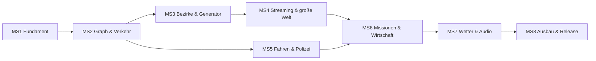

# MTA 6 – Weltkonzept

> Modulares Konzept für eine außergewöhnlich gute Spielwelt von **MTA 6**, einem **eigenständigen**, dystopisch-realistischen Open-World-Fahrspiel (Einzelspieler-Kern, später gemischt mit MMO-Elementen) mit eigener Stadt, eigenen Figuren und eigener Story.
> Version 2 (ergänzt um Realismus/Detailtiefe, Story-Engine mit Entscheidungen, Server/Mehrspieler und dystopische Stadtidentität). Zusammenhang mit der Iterationsplanung: [`ITERATIONSPLAN.md`](ITERATIONSPLAN.md) (Zuordnung in Kapitel 9).
> Stand: 19.11.2026 · Sprache: Deutsch · Ausgangsbasis: Prototyp `index.html` + `game.js` (Three.js, Browser).
>
> **Abgrenzung:** Dieses Dokument verwendet ausschließlich allgemeine Genre-Prinzipien (Open-World-Design, lebendige Städte, Systemik). Karte, Namen, Figuren, Marken und Story-Elemente sind vollständig eigen – nichts davon ist von GTA oder anderen Rockstar-Titeln abgeleitet.

---

## Inhalt

1. [Ist-Zustand des Prototyps](#1-ist-zustand-des-prototyps)
2. [Vision und Designsäulen](#2-vision-und-designsäulen)
3. [Modulübersicht und Schnittstellen](#3-modulübersicht-und-schnittstellen)
4. [Module im Detail (M1–M12)](#4-module-im-detail)
5. [Realismus und Detailtiefe (M13)](#5-realismus-und-detailtiefe-m13)
6. [Story-Engine, Entscheidungen und Fraktionen (M14)](#6-story-engine-entscheidungen-und-fraktionen-m14)
7. [Open World trifft MMO: Server und Mehrspieler (M15)](#7-open-world-trifft-mmo-server-und-mehrspieler-m15)
8. [Die Welt: Kestrel Bay (dystopisch)](#8-die-welt-kestrel-bay)
9. [Roadmap mit Meilensteinen](#9-roadmap-mit-meilensteinen)
10. [Empfohlene Dateistruktur (ES-Module)](#10-empfohlene-dateistruktur-es-module)
11. [Quellen](#11-quellen)
12. [Zusammenfassung und die 5 nächsten Schritte](#12-zusammenfassung-und-die-5-nächsten-schritte)

---

## 1. Ist-Zustand des Prototyps

Gelesen wurde `game.js` (689 Zeilen, eine Datei, globale Variablen). Was vorhanden ist und was es für die Planung bedeutet:

| Bereich | Ist-Zustand | Konsequenz |
|---|---|---|
| Stadt | Raster 8×8 Blöcke, `P = 80 m`, Straßenbreite 16 m → ca. 640 × 640 m. Zufällige Gebäude (Box + Canvas-Fenstertextur), Parks mit Kegel-Bäumen, Berge als Kegel am Horizont | Zu klein und zu gleichförmig; keine Bezirke, kein Terrain, keine Höhen |
| Zufall | `Math.random()` ohne Seed | Welt nicht reproduzierbar → kein Seed, keine Tests, kein Speichern von Weltzustand |
| Rendering | Ein `Mesh` pro Gebäude/Gehweg/Baum, pro Gebäude eigenes Material; `PCFSoftShadowMap`, 2048er Sonnenschatten | Draw Calls wachsen linear mit der Stadt – bei größerer Welt nicht tragbar → Instancing/Merging nötig |
| Fahrzeuge | Arcade-Kinematik (Geschwindigkeit + Lenkwinkel), Box-Modell, Kollision nur gegen Block-AABBs (alle 64 Blöcke je Frame) und Kreisabstand zu NPC-Autos | Spielbar, aber kein Federweg/Gewicht/Drift; Kollision braucht räumlichen Index |
| Agenten | Verkehr (36), Fußgänger (70), Polizei als „Linien-Agenten“: Position entlang einer Achse, an Kreuzungen gewichtete Zufallsabbiegung; Polizei wählt die zum Spieler nächste Option | Gute Basis, aber ohne Spurlogik, Ampeln, Vorfahrt, Wegenetz-Graph, Sim-LOD |
| Polizei/Gesetz | `heat` 0–5, Polizei spawnt 90–200 m entfernt, Festnahme bei Stillstand <3 m/s in 7 m Nähe über 2,5 s | Gutes Spielgefühl-Skelett; es fehlt Sichtlinie/Suchzustand, Straßensperren, Verbrechenstypen |
| Missionen | Ein Marker, zufälliges Ziel >150 m, Zeitbonus | Reine Lieferfahrt; keine Mission-Typen, keine Story, kein Fortschritt außer Geld |
| Tag/Nacht | 1 Spielstunde = 20 s (Tag = 8 min), Himmel/Nebel/Sonne/Fensterlicht, Scheinwerfer | Funktioniert; fehlen Wetter, Straßenlaternen, Himmelskörper |
| Audio | Zwei Oszillatoren als Motor, Mute-Taste | Platzhalter |
| UI | HUD (Geld, Sterne, Tempo, HP, Uhr), runde Minimap per Canvas | Gut als Ausgangspunkt; keine große Karte, Wegpunkte, Menüs |

**Schwächen, die jede Erweiterung blockieren:** globaler Zustand, kein Seed, ein Draw Call je Objekt, Allokationen pro Frame (`concat`, `map` im Update), keine Trennung zwischen Simulation und Darstellung.

---

## 2. Vision und Designsäulen

**Pitch:** *Kestrel Bay* ist eine sonnenverbrannte Küstenmetropole, die von einem Konzern „optimiert“ wird: glänzende Türme voller Kameras, rostige Docks, neonbunte Nächte, ein Highway, der in die Berge schneidet. Der Konzern *Aurelia Holdings* betreibt das Überwachungsnetz **Aegis**, das Kennzeichen, Gesichter und Zahlungen verknüpft und Zugang zu Straßen, Krediten und Wohnungen steuert. Man fährt, entkommt, handelt – und entscheidet, wem die Stadt am Ende gehört. Sie funktioniert auch ohne den Spieler.

**Zielplattform:** PC, Desktop-Browser (Chrome/Edge als Referenz, Firefox/Safari als „soll laufen“). Keine Installation, Start in unter 10 s. Mittelklasse-Notebook (integrierte GPU) als Mindestziel: 60 fps bei 1080p im „Mittel“-Preset, 30 fps im „Niedrig“-Preset.

### Die sieben Designsäulen

1. **Fahren fühlt sich großartig an.** Das Auto ist die Hauptfigur. Wenn eine leere Straße schon Spaß macht, trägt die Welt alles andere.
2. **Jeder Bezirk ist auf einen Blick erkennbar.** Silhouette, Farbpalette, Straßenmuster, Licht, Musik und Verkehr unterscheiden sich so stark, dass man ohne Karte weiß, wo man ist (Orientierung über Landmarken, siehe Quellen [Q7]).
3. **Die Stadt lebt ohne dich.** Verkehr, Passanten, Polizei und Wetter folgen eigenen Regeln. Der Spieler stört ein System, das bereits läuft (Systemik statt Skript, [Q5][Q6]).
4. **Systeme erzeugen Geschichten.** Wenige, saubere Regeln (Verfolgung, Ruf, Geld, Tageszeit, Wetter) kombinieren sich zu unvorhersehbaren Momenten; geschriebene Missionen setzen nur Anker.
5. **Browser-ehrlich gebaut.** Alles wird gegen feste Performance-Budgets entworfen (Instancing, Streaming, Sim-LOD). Eine schöne Welt, die nur auf einer Highend-GPU läuft, ist keine.
6. **Glaubwürdigkeit durch Detail.** Realismus entsteht aus vielen kleinen, konsistenten Dingen (Materialien, Verschleiß, Straßendetails, plausible Stadtstruktur), nicht aus maximaler Polygonzahl. Ziel ist der bestmögliche Look *innerhalb* der Browsergrenzen (Kapitel 5).
7. **Entscheidungen haben Folgen, und die Welt hat eine Haltung.** Dystopie ist kein Anstrich, sondern Spielmechanik: Überwachung (Aegis), Konzernmacht und soziale Gegensätze verändern, wie man fährt, flieht und handelt. Spielerentscheidungen verschieben Fraktionen, Bezirke und Enden (Kapitel 6).

### Alleinstellungsmerkmal (Unique Selling Point)

**„Eine Stadt, die man an der Tageszeit liest.“** Jeder Bezirk hat einen eigenen Tagesrhythmus (Büros leeren sich ab 18 Uhr, der Hafen arbeitet in der Frühschicht, die Promenade lebt nachts). Missionen, Verkehr, Polizeipräsenz und Preise hängen am Rhythmus. Dazu ein **Bezirks-Ruf-System** statt eines einzigen globalen Fahndungslevels: Wer in Saltmarket auffällt, ist dort bekannt, nicht automatisch überall. Zusätzlich das **Aegis-Profil**: Kameras lesen Kennzeichen; wer oft auffällt, wird in überwachten Bezirken schneller erkannt – es sei denn, man hackt Kameras, tauscht Kennzeichen oder fährt durch die „blinden“ Armenviertel. Die Dystopie wird so zu einer Fahrregel, nicht zu Kulisse.

---

## 3. Modulübersicht und Schnittstellen

### 3.1 Architekturdiagramm


### 3.2 Leitprinzipien der Architektur

- **Simulation und Darstellung strikt getrennt.** Die Simulation kennt nur Zahlen (Positionen, Zustände) und läuft mit festem Zeitschritt. Der Renderer liest diese Zustände. Dadurch ist Sim-LOD (ferne Agenten billig simulieren), Worker-Auslagerung und Testen ohne Browser möglich.
- **Ein Datenmodell für die Stadt (`CityData`)**: Straßengraph (Knoten, Kanten mit Spuren), Parzellen, Zonen/Bezirke. Weltgenerierung schreibt es, Streaming, KI, Karte und Missionen lesen es. So gibt es *eine* Wahrheit.
- **Events statt direkter Aufrufe** zwischen Modulen (`bus.emit('crime', {...})`). Polizei, Missionen, Audio und UI abonnieren, ohne sich zu kennen.
- **Alles seedbar:** ein `Rng(seed)` statt `Math.random()`; gleicher Seed = gleiche Stadt.
- **Server-fähig von Anfang an:** Da `sim/` und `world/` ohne Three.js und ohne DOM laufen, kann dieselbe Simulation später im Node-Server laufen. Im Einzelspielermodus läuft sie als **LocalServer** im selben Browser (Web Worker). So gibt es *einen* Code-Pfad für Einzel- und Mehrspieler (Kapitel 7).

### 3.3 Schnittstellentabelle

| Modul | Liefert (Output) | Braucht (Input) |
|---|---|---|
| M1 Weltgenerierung | `CityData` (Straßengraph, Parzellen, Zonen, Landmarken-Slots) | Seed, Bezirksdefinitionen, Heightmap |
| M2 Streaming/LOD | Sichtbare Chunks, Instanz-Buffer, Kollisions-Proxies | `CityData`, Kameraposition |
| M3 Bezirke | `DistrictDef` (Palette, Regeln, Dichte, Musik, Verkehrsprofil) | – (Designdaten) |
| M4 Fahrzeuge | `VehicleState` (Pose, Geschwindigkeit, Schaden), Kollisionsevents | Eingabe/KI-Steuerung, Bodenhöhe, Fahrzeugdaten |
| M5 Verkehrs-/Fußgänger-KI | Agentenzustände, Wahrnehmungsevents („Unfall gesehen“) | Straßengraph, Zeit, Wetter, Spielerposition |
| M6 Polizei/Gesetz | Fahndungsstufe pro Bezirk, Polizeiagenten, Festnahme/Flucht-Events | Verbrechensevents, Sichtlinien, Straßengraph |
| M7 Missionen/Story | Aufträge, Marker, Cutscene-/Dialogtrigger | `CityData`, Spielzustand, Events |
| M8 Wirtschaft | Geld, Ruf, Freischaltungen, Speicherstand | Missionsergebnisse, Verbrechensfolgen |
| M9 Tag/Nacht/Wetter | `Environment` (Sonne, Himmel, Nebel, Nässe, Wind) | Spielzeit, Bezirk |
| M10 Audio | Mix aus Motor-, Umgebungs-, Musik-, UI-Bussen | Fahrzeug-, Umwelt-, KI-Daten |
| M11 UI/Karte | HUD, Vollkarte, GPS-Route, Menüs | Alle Zustände (nur lesend) |
| M12 Performance/Tooling | Budgets, Profiler, Debug-Overlays, Seed-Tests | Alle Module |
| M13 Realismus-Pipeline | Material-Bibliothek (PBR), Decal-/Verschleiß-System, Prop-Sets, Qualitätsstufen | Bezirke (M3), Wetter/Zeit (M9), Streaming (M2) |
| M14 Story-Engine | Entscheidungen, Fraktionsstand, Weltzustand-Tags, Enden | Missions-Events (M7), Verbrechen (M6), Spielzustand (M8) |
| M15 Server/Mehrspieler | Autoritativer Weltzustand, Snapshots, Persistenz, Anti-Cheat-Prüfung | Alle Sim-Module (laufen auch im Server), M14 für Story-Phasen |

---

## 4. Module im Detail

Aufwandsschätzung in **Personentagen (PT)** für eine Entwicklerin/einen Entwickler mit KI-Unterstützung, jeweils pro Stufe; Werte sind grobe Schätzungen mit ±50 % Unsicherheit. Stufen: **MVP** (spielbar, trägt den Meilenstein), **Ausbau** (Qualitätssprung), **Wunschziel** (Politur/Luxus).

### M1 – Weltgenerierung

**Ziel:** Eine reproduzierbare, vielfältige Stadt statt eines zufälligen Rasters; Straßen und Parzellen entstehen aus Regeln, Bezirke formen das Ergebnis.

| Stufe | Umfang |
|---|---|
| MVP | Seed-RNG; Raster wird zu **Straßengraph** (Knoten/Kanten) mit Hierarchie (Hauptstraße, Nebenstraße, Gasse); Blöcke werden rekursiv in Parzellen unterteilt; Gebäudehöhe nach Bezirk statt nur nach Abstand zur Mitte |
| Ausbau | **Tensor-Feld-Straßen**: Raster in der Innenstadt, Radialmuster am Hang, Küstenparallelen an der Promenade, zu einem Feld verblendet; Heightmap-Terrain mit Straßen, die sich dem Gelände anpassen; Brücken/Tunnel; Wasserflächen |
| Wunschziel | Grammatik-basierte Fassaden (Shape Grammar) mit Bezirksstil; Einwohner-/Landnutzungssimulation, aus der Zonen entstehen; handgesetzte „Hero“-Gebiete werden in die generierte Stadt eingefügt |

**Technische Umsetzung:**
- Verfahren in der Reihenfolge der Literatur: Straßennetz → Blöcke → Parzellen → Gebäude ([Q1] Parish & Müller mit L-Systemen; [Q2] Chen et al. mit Tensor-Feldern für Raster/Radial/Küstenmuster; Parzellierung per rekursiver Teilung orientierter Rechtecke, vgl. [Q3]).
- **Hybridansatz empfohlen:** Hauptachsen, Highway, Brücken und Landmarken **handgesetzt** (Designkontrolle, Wiedererkennbarkeit), Füllstraßen und Parzellen **prozedural** (Umfang, Vielfalt). Reine Prozedur erzeugt Beliebigkeit; reine Handarbeit ist nicht zu leisten.
- Terrain als Heightmap-Gitter in Chunks; Straßen als Meshes entlang der Graph-Kanten, die an das Terrain „geschmiegt“ werden.
- Ausgabe ist reine Daten-Struktur (JSON-fähig) → in Worker erzeugbar, cachebar, testbar.

**Abhängigkeiten:** M3 (Bezirksparameter), M12 (Seed-Tests). **Risiken:** Tensor-Felder erzeugen unschöne Kreuzungswinkel/Sackgassen → nachbearbeiten (Segmente verschmelzen, Mindestwinkel); Generator wird zum Zeitgrab → Zeitbox je Stufe, Handarbeit als Fallback. **Aufwand:** MVP 6 PT · Ausbau 14 PT · Wunsch 15 PT+.

---

### M2 – Streaming und LOD

**Ziel:** Eine Welt, die um ein Vielfaches größer ist als das, was gleichzeitig im Speicher/Renderer ist, bei stabilen 60 fps.

| Stufe | Umfang |
|---|---|
| MVP | Welt in **Chunks** (z. B. 160 × 160 m); nur Chunks im Radius laden; **Instancing** für Gebäude/Bäume/Laternen/Fahrzeuge; geteilte Materialien; Frustum-Culling; Nebel als Weitsicht-Kaschierung |
| Ausbau | Chunk-Erzeugung im **Web Worker** (Geometrie in Typed Arrays, per Transfer übergeben); 3 LOD-Stufen für Gebäude (Detail → Kasten mit Textur → Silhouette/Impostor); Kollisions-Proxies getrennt von Render-Meshes; Warteschlange mit Zeitbudget pro Frame (z. B. max. 2 ms Chunk-Upload) |
| Wunschziel | **BatchedMesh** bzw. BVH-basiertes Instanz-Culling; Hierarchical-LOD für Fernstadt; WebGPU-Renderer mit Compute-Culling; Texturatlas/Virtual Texturing |

**Technische Umsetzung:**
- `InstancedMesh` reduziert Draw Calls auf „Anzahl Geometrie×Material-Typen“, verliert aber Culling pro Objekt; deshalb **je Chunk eigene Instanzgruppen**, damit das Frustum-Culling auf Chunk-Ebene greift. `BatchedMesh` erlaubt mehrere Geometrien in einem Draw Call mit Culling je Instanz, ist aber nicht automatisch schneller – immer mit `renderer.info.render` messen [Q8][Q9].
- Richtwert (Heuristik, keine harte Vorgabe): unter ca. 100–200 Draw Calls im Frame anpeilen [Q8].
- Worker-Muster: Metadaten/Heightmap hin, fertige Geometrie-Buffer plus räumlicher Index zurück; Chunk-Noise auf dem Hauptthread kostet schon bei 64×64 grob 10 ms [Q10].
- Fenster-Nachtlicht: statt eigener Emissive-Textur je Gebäude ein **Shader mit Fenstermuster aus Instanzattribut** (ein Material für alle).
- Optional später: `WebGPURenderer` (in aktuellen Three.js-Versionen empfohlen; Browser-Abdeckung bei Firefox/Linux/Android noch lückenhaft) – daher **Renderer-Abstraktion** so bauen, dass WebGL2 Standard bleibt und WebGPU ein Schalter ist [Q11].

**Abhängigkeiten:** M1 (Daten), M12 (Messung). **Risiken:** Pop-in sichtbar → Nebel, Überblendung, Chunk-Vorlauf in Fahrtrichtung; Speicherlecks beim Entladen (Geometrien/Texturen `dispose()`); Worker-Overhead/Transfer. **Aufwand:** MVP 5 PT · Ausbau 12 PT · Wunsch 15 PT+.

---

### M3 – Stadtbezirke und Identität

**Ziel:** Sechs Bezirke, die man an Optik, Licht, Verkehr und Klang erkennt (Details in [Kapitel 8](#8-die-welt-kestrel-bay)).

| Stufe | Umfang |
|---|---|
| MVP | `DistrictDef`-Datenobjekte: Farbpalette der Fassaden, Gebäudehöhen, Straßenbreiten, Baumdichte, Passanten-/Verkehrsdichte, Himmelstönung; je Bezirk 1 Landmarke |
| Ausbau | Eigene Prop-Sets (Container, Palmen, Reklametafeln, Poller …) als Instanzen; Boden-/Asphalttexturen je Bezirk; bezirksspezifische Nachtbeleuchtung (Neon, Natrium, LED); Bezirksname beim Einfahren (UI) |
| Wunschziel | Bezirkstypische NPC-Kleidung/Fahrzeugmix; Zeitrhythmen (Schichtwechsel, Rush Hour); dynamische Details (Baustellen, Märkte, Veranstaltungen) |

**Technische Umsetzung:** Reine Daten (`districts/*.js`), konsumiert von M1 (Generierung), M2 (Props), M5 (Verkehrsprofil), M9 (Licht), M10 (Musik). Orientierung folgt bewährten Prinzipien: **Landmarken-Hierarchie** (1 Hauptlandmarke je Bezirk, kleinere als Wegmarken), Wiedererkennung über Farbe und Silhouette, Leitlinien (Straßen führen auf Landmarken zu) [Q7].
**Abhängigkeiten:** M1, M2. **Risiken:** Bezirke wirken bloß „umgefärbt“ → Unterschiede in *Struktur* (Straßenmuster, Höhenprofil, Prop-Rhythmus) statt nur Farbe. **Aufwand:** MVP 3 PT · Ausbau 10 PT · Wunsch 10 PT+.

---

### M4 – Fahrzeuge und Physik

**Ziel:** Fahrverhalten, das sich nach Gewicht, Grip und Tempo anfühlt; Zerstörung, die Konsequenzen hat.

| Stufe | Umfang |
|---|---|
| MVP | Bestehendes Arcade-Modell sauber in Fixed-Step-Modul auslagern; **Fahrzeugdatenblätter** (Masse, Beschleunigung, Höchsttempo, Grip, Lenkrate); Handbremsendrift (Quer-Schlupf mit Haftgrenze); Kollision über räumliches Gitter statt Schleife über alle Blöcke; Höhenanpassung ans Terrain |
| Ausbau | **Raycast-Fahrzeug**: Feder/Dämpfer je Rad, vereinfachtes Reifenmodell (linear/Bürsten statt vollem Pacejka, der bei niedrigem Tempo numerisch schwierig ist) [Q12]; Nick/Wank sichtbar; 4–6 Fahrzeugklassen (Kompakt, Limousine, Sportler, SUV, Transporter, Motorrad); Schadensmodell (Zonen, Beulen per Vertex-Offset, Rauch, Reifenschaden); Ein-/Aussteigen |
| Wunschziel | Rapier (Rust/WASM) für Rigid-Body-Kollisionen und Kettenreaktionen [Q13]; Anhänger, Boote, Hubschrauber; Fahrzeug-Tuning |

**Technische Umsetzung:**
- Fixed Timestep (z. B. 120 Hz Sub-Steps) mit Interpolation zur Darstellung; deterministisch genug für Replays/Tests.
- Raycast-Fahrzeug nach klassischem Muster („Car Physics for Games“, M. Monster) – eigener Code für Arcade-Gefühl, **Physik-Engine nur für Kollision/Objekte**, nicht für das Fahrverhalten [Q12].
- Kollision: uniformes Gitter (Spatial Hash) über Gebäude-/Props-Proxies und Fahrzeuge; Straßenbegrenzer/Poller zerstörbar später.
- Gefühl vor Realismus: Tuning-Parameter in einer Datei, Live-Slider im Debug-Overlay.

**Abhängigkeiten:** M1/M2 (Boden, Kollision), M12. **Risiken:** Tunneling bei hohem Tempo (→ Sub-Steps, Sweep-Tests); WASM-Physik erhöht Ladezeit/Komplexität → erst wenn Kollision am Gitter nicht mehr reicht; „realistisch“ ≠ „spaßig“ → Playtests. **Aufwand:** MVP 5 PT · Ausbau 15 PT · Wunsch 20 PT+.

---

### M5 – Fußgänger- und Verkehrs-KI

**Ziel:** Eine Stadt, die glaubwürdig wimmelt, ohne die CPU zu fressen – **Simulation-LOD** als Kernidee.

| Stufe | Umfang |
|---|---|
| MVP | Agenten auf dem **Straßengraph** (Kanten mit Spuren, Einbahn, Tempolimit); Ampel-/Vorfahrtlogik an Kreuzungen; Abstandhalten per Vorderfahrzeug-Abfrage über Spurlisten (statt Allpaarvergleich); Fußgänger auf Gehwegen, Überqueren an Zebrastreifen; **Spawn/Despawn am Rand des Aktivradius** |
| Ausbau | **Drei Sim-Stufen**: (A) nah: volle Kollision, Animation, Wahrnehmung; (B) mittel: nur Spur-Bewegung ohne Kollision, niedrige Updaterate; (C) fern: statistische Dichte pro Kante, keine Einzelagenten. Reaktionen: Ausweichen, Hupen, Flucht bei Unfall/Schüssen/Raserei; Tageszeitprofile pro Bezirk; Wetter-Einfluss (weniger Fußgänger bei Regen, langsamerer Verkehr) |
| Wunschziel | Agenten mit Zielen (Zuhause → Arbeit → Café) und Tagesplan; Busse/Bahn mit Haltestellen; Menschenmengen-Verhalten (Gruppen, Warteschlangen); Skinned/Instanz-Animationen per Vertex-Textur |

**Technische Umsetzung:**
- Das Prinzip „**Simulationsblase**“ (Verkehr und Passanten laufen je in einer Blase um den Spieler; am Rand wird gespawnt/entfernt) und das Einhalten von Verkehrsregeln trotz unvorhersehbarer Kollisionen ist aus Open-City-Spielen belegt [Q4]. Gestufte Detailtiefe nach Entfernung (volle KI nah, vereinfachte mittel, statistisch fern) ist ebenfalls etablierte Praxis [Q14].
- Datenorientiert: Agenten als Struct-of-Arrays (Typed Arrays), Rendering über Instanzmatrizen. Hunderte Fahrzeuge/Tausende Fußgänger sind so im Browser realistisch; Einzelobjekte mit je eigener Logik sind es nicht.
- Optional Auslagerung der Sim-Stufen B/C in einen Worker (SharedArrayBuffer nur mit COOP/COEP-Headern; sonst Transfer-Snapshots).
- Systemische Ereignisse (Unfall, Panne, Straßenfest), die auch **ohne** Spielerbeteiligung stattfinden, schaffen die Lebendigkeit [Q5][Q6].

**Abhängigkeiten:** M1 (Straßengraph), M9 (Zeit/Wetter), M6 (Polizei reagiert/teilt Graph). **Risiken:** Staus/Deadlocks an Kreuzungen (→ Timeout + Ghosting, wie der Prototyp es schon macht, aber kontrolliert); Mengenzahl vs. CPU; unnatürliches Pop-in (→ Spawn nur außerhalb der Sicht). **Aufwand:** MVP 8 PT · Ausbau 15 PT · Wunsch 20 PT+.

---

### M6 – Polizei und Gesetz-System

**Ziel:** Verfolgungen, die fair, spannend und lesbar sind; Folgen statt bloßer Strafpunkte.

| Stufe | Umfang |
|---|---|
| MVP | Verbrechens-**Events** mit Gewichtung (Raserei, Unfall mit Zivilfahrzeug, Fußgänger verletzt, Polizeikontakt); Fahndungsstufe 1–5 mit Abklingen; Polizei fährt über Straßengraph (Zielwahl: Spieler/letzte bekannte Position); Festnahme/Flucht wie im Prototyp, aber mit **Sichtlinie** |
| Ausbau | Zustände **Verdacht → Verfolgung → Suche → Verloren** mit Suchradius um die zuletzt gesehene Position; Zeugenmeldung (nur gemeldet, wenn ein NPC das Verbrechen sah); **Bezirks-Ruf**: Fahndungsdruck gilt primär im Bezirk und strahlt abgeschwächt aus; Taktiken je Stufe (PIT-Manöver, Straßensperre, Nagelband, Hubschrauber); Unterschlupf (Garage, Tunnel, Wasser) zum Abschütteln |
| Wunschziel | Polizei als Fraktion mit Revieren, Schichtwechsel, Korruption/Bestechung; Gerichts-/Kautionssystem; Nicht-tödliche Optionen für den Spieler |

**Technische Umsetzung:** Endlicher Automat pro Polizeieinheit + zentraler „Dispatcher“ (verteilt Einheiten, hält Ziel-Wissen). Wahrnehmung über Sichtkegel mit Raycast gegen Gebäude-Proxies, dazu Hörradius. Das Fahndungssystem als „Spielzeug“ mit klaren, ablesbaren Regeln zu gestalten (Spieler versteht, *warum* er gesucht wird) ist wichtiger als Realismus [Q5].
**Abhängigkeiten:** M5 (Graph, Zeugen), M4 (Fahrzeuge), M3 (Bezirke), M1. **Risiken:** Gummiband-KI, die „betrügt“ (Teleport-Spawns) → Spawn nur außerhalb der Sicht, Dichte begrenzen; Frust durch unausweichliche Festnahme → immer einen erkennbaren Fluchtweg. **Aufwand:** MVP 4 PT · Ausbau 12 PT · Wunsch 15 PT+.

---

### M7 – Missionen und Story

**Ziel:** Aufträge, die die Welt zeigen und systemische Zufälle zulassen, getragen von einer eigenen, kleinen, konsistenten Story.

| Stufe | Umfang |
|---|---|
| MVP | Missions-**Framework** als Daten (Schritte: *Gehe zu / Fahre zu / Hole ab / Liefere / Entkomme / Zerstöre / Warte*); Missionstypen: Kurier mit Zeitlimit, Taxi-Passagier, Verfolgung (Ziel fährt ein Ziel an), Flucht; Marker/Wegpunkt-UI; Checkpoints, Fehlschlag-/Erfolgsmeldung |
| Ausbau | **Story-Kampagne** (ca. 12–15 Hauptmissionen) an Bezirke gekoppelt; Nebenaufträge je Bezirk („Bezirksjobs“); Dialoge/Funk als Textboxen mit Sprecherportrait; mehrere Lösungswege (z. B. Flucht über Dach/Tunnel/Wasser); Speicherpunkte |
| Wunschziel | Verzweigende Entscheidungen, Charakterbeziehungen, dynamische Zufallsbegegnungen, Mission-Editor im Browser |

**Technische Umsetzung:** Zustandsautomat/Skript-DSL in JSON (`missions/*.json`), ausgeführt von `MissionRunner`; Missionen **abonnieren Events** (z. B. `vehicle.enteredZone`), statt die Hauptschleife zu kennen. Gestaltungsregel: je Mission Zielbedingung, KI-Rollen, Checkpoint-Abstände und Fehlschlagtext explizit festlegen; einfache KI mit starker Reaktion wirkt besser als komplexe KI [Q15]. Missionen so „öffnen“, dass systemisches Chaos (Verkehr, Polizei) mitspielen darf, statt es auszuschalten [Q5][Q6].
**Abhängigkeiten:** M1 (Orte), M5/M6 (Welt reagiert), M8 (Belohnung), M11 (Marker). **Risiken:** Content-Menge (jede Mission ist Handarbeit) → starke Wiederverwendung von Typen, Story kurz und prägnant; Skript-Brüche bei systemischen Zufällen → Fail-Safes (Neuaufsetzen, Checkpoint). **Aufwand:** MVP 6 PT · Ausbau 20 PT · Wunsch 25 PT+.

**Story-Kern (eigene Erfindung, ca. 5 Sätze):** Mira Voss, ehemalige Rennfahrerin, kehrt nach Kestrel Bay zurück, um die Schulden ihres Bruders bei der Hafenspedition *Calder & Sons* zu begleichen. Aus Kurierfahrten werden Aufträge für drei Fraktionen (Hafen, Finanzviertel, Nachtleben), die jeweils die Stadt anders „besitzen“. Sie entdeckt, dass ein Sanierungsprojekt der *Aurelia Holdings* die Altstadt abreißen und die Docks verkaufen soll. Es folgt ein Balanceakt zwischen Loyalität und Aufstieg. Das Finale spielt auf dem Highway und der Küstenstraße. (Alle Namen und Figuren sind frei erfunden und können beliebig umbenannt werden.)

---

### M8 – Wirtschaft und Fortschritt

**Ziel:** Ein Fortschrittsgefühl, das das Fahren belohnt und die Welt schrittweise öffnet.

| Stufe | Umfang |
|---|---|
| MVP | Geld (vorhanden) mit klaren Einnahmen/Ausgaben; Speichern/Laden (`localStorage`/IndexedDB); Fahrzeugreparatur und -ersatz; Strafen/Verlust bei Festnahme (vorhanden) |
| Ausbau | Garagen/Safehouses je Bezirk (Speichern, Fahrzeuglager); Fahrzeugkauf und Tuning; **Bezirks-Ruf** (Fraktionen schalten Aufträge und Rabatte frei); Immobilien als Einnahmequelle |
| Wunschziel | Dynamische Preise (Tageszeit, Nachfrage), Handel/Schmuggelrouten mit Risiko, Erfolge/Herausforderungen |

**Technische Umsetzung:** Ein zentrales, serialisierbares `GameState` (reine Daten) – Grundlage für Speichern, Tests und Debug. Wirtschaft als kleine Tabellen (Preise, Belohnungen) in Daten-Dateien, nicht im Code.
**Abhängigkeiten:** M7, M6. **Risiken:** Inflation/Balancing → Kennzahlen in einer Tabelle, Playtest-Telemetrie lokal; Speicherstand-Versionierung (Schema-Version von Anfang an). **Aufwand:** MVP 3 PT · Ausbau 8 PT · Wunsch 10 PT+.

---

### M9 – Tag/Nacht/Wetter

**Ziel:** Licht und Wetter als wichtigstes Stimmungswerkzeug – jeder Bezirk sieht zu jeder Tageszeit anders aus.

| Stufe | Umfang |
|---|---|
| MVP | Tageszyklus aus dem Prototyp in Modul auslagern; Sonne/Mond mit Elevation, Dämmerungsfarben; Straßenlaternen und Fensterlicht über Instanzattribut; Spielzeit-API (`env.hour`) |
| Ausbau | **Wetter-Zustandsautomat** (klar, bewölkt, Regen, Nebel, Gewitter) mit weichen Übergängen; nasse Straßen (Roughness/Reflexion, Pfützen-Noise), Regenpartikel, Scheibenwischer; Himmelsshader (Sonne, Wolken, Sterne); Bezirks-Tönung; Wetter wirkt auf Grip (M4), Verkehr (M5), Audio (M10) |
| Wunschziel | Volumetrische Wolken/Nebel, Screen-Space-Reflexionen, Jahreszeiten, Windsimulation für Vegetation |

**Technische Umsetzung:** Ein `Environment`-Objekt hält alle Parameter; Übergänge per Interpolation; Himmel als großer Shader-Dom statt Szenenhintergrundfarbe. Schatten: **Cascaded Shadow Maps** statt einer 200-m-Box, sonst werden Schatten in der größeren Welt unscharf oder zu teuer. Straßenlaternen nicht als echte Lichter (zu teuer), sondern als Emissive-Sprites + wenige echte Lichter um den Spieler.
**Abhängigkeiten:** M2 (Instanzen), M12. **Risiken:** Nachtbeleuchtung kostet viele Lichter → Fake-Licht (Glow-Sprites, Decals), echte Lichter strikt begrenzen; Regen-Shader auf Low-End. **Aufwand:** MVP 3 PT · Ausbau 12 PT · Wunsch 15 PT+.

---

### M10 – Audio

**Ziel:** Eine Welt, die man hört: Motor, Stadt, Wetter, Musik.

| Stufe | Umfang |
|---|---|
| MVP | Audio-Manager mit Bussen (Motor, Umwelt, Musik, UI) und Master-Lautstärke; Motor aus **geloopten Samples** (Leerlauf, Last, Schub) mit Pitch nach Drehzahl statt Oszillatoren; Kollision, Hupe, Sirene; Doppler/Dämpfung für NPC-Fahrzeuge |
| Ausbau | Mehrschicht-Motor mit **Equal-Power-Crossfade** (kein Lautstärkeloch) [Q16]; Reifenquietschen, Wind nach Tempo, Regen; Umgebungs-Layer je Bezirk (Hafenhorn, Möwen, Neonsummen, Brandung); Straßenzug-Hall (Tunnel/Häuserschluchten); Radiosender mit prozeduraler Musik |
| Wunschziel | Dynamische Musik (Intensität folgt Verfolgung/Tageszeit), Sprachausgabe, Mix-Snapshots (z. B. „unter Wasser“, „in der Garage“) |

**Technische Umsetzung:** Web Audio API; `AudioBuffer`-Loops mit sample-genauem Looping; Gain-/Filter-Automation über `AudioParam`; **PannerNode nur für wichtige Quellen** (Kostenpunkt je Panner – mehrere Quellen am selben Emitter teilen sich einen) [Q16][Q17]. Audio-Kontext erst nach Nutzergeste starten (Browserregel; Prototyp macht das schon). Die Racer-Fallstudie von Google zeigt, wie ein Motorklang mit nur wenigen Dateien (Beschleunigung, Verzögerung, Leerlauf) überzeugend wird [Q16].
**Abhängigkeiten:** M4, M5, M9. **Risiken:** Asset-Beschaffung/Lizenzen (→ CC0-Quellen oder selbst synthetisiert, Lizenzliste führen); Dateigröße/Ladezeit (→ Opus/OGG, Streaming nach Bezirk). **Aufwand:** MVP 3 PT · Ausbau 8 PT · Wunsch 10 PT+.

---

### M11 – UI und Karte

**Ziel:** Lesbare, schöne Bedienung; Karte und Navigation, die die Stadt erschließen.

| Stufe | Umfang |
|---|---|
| MVP | HUD modularisiert (DOM); Minimap aus **`CityData`** gezeichnet (Straßengraph statt Blockrechtecke); Zielpfeil und Entfernungsanzeige; Pause-/Optionsmenü (Grafik-Preset, Lautstärke, Tastenbelegung) |
| Ausbau | **Vollkarte** (Zoom/Pan, Bezirksnamen, Landmarken, eigene Wegpunkte); **GPS-Routenlinie** auf Straßengraph (A*), im Spiel als Linie/Pfeile auf der Straße; Bezirksname-Einblendung; Gamepad-Unterstützung; Missions-Tagebuch |
| Wunschziel | Fotomodus, Telefon-UI, Anpassbare HUD, Barrierefreiheit (Farbenblind-Modi, Untertitelgröße) |

**Technische Umsetzung:** Karte als vorab gerenderte **Canvas-Textur** aus `CityData` (einmal gebacken, dann nur Marker darüber); Pfadsuche A* auf dem Straßengraph (derselbe wie KI). Alle UI-Elemente lesen den Zustand, schreiben nie in die Simulation.
**Abhängigkeiten:** M1, M7, M8. **Risiken:** DOM-Updates pro Frame (→ nur bei Änderung schreiben); Eingabegeräte-Matrix. **Aufwand:** MVP 3 PT · Ausbau 10 PT · Wunsch 8 PT+.

---

### M12 – Performance und Tooling

**Ziel:** Messen statt vermuten; Qualität bleibt reproduzierbar und regressionsfrei.

| Stufe | Umfang |
|---|---|
| MVP | **Debug-Overlay** (fps, Frame-ms, `renderer.info` Draw Calls/Dreiecke/Texturen, Agentenzahlen, Chunk-Zahl); `Rng(seed)` + Seed in URL; feste **Budgets** (siehe unten); Qualitäts-Presets (Niedrig/Mittel/Hoch) |
| Ausbau | Automatischer **Benchmark-Flug** (fester Seed, fester Kameraweg, Ergebnis als JSON); Seed-Tests für Generator (z. B. „alle Blöcke erreichbar“, „kein Gebäude auf Straße“) per Node-Skript; Frame-Zeit-Aufschlüsselung je Modul; Speicher-Watch (Geometrien/Texturen) |
| Wunschziel | CI-Lauf mit Headless-Browser, Performance-Regressionsgrenzen; In-Game-Editor für Bezirksparameter und Missionen |

**Performance-Budgets (Zielwerte für „Mittel“-Preset, 1080p, Integrierte GPU der Mittelklasse; bei Abweichung neu kalibrieren):**

| Größe | Budget |
|---|---|
| Frame-Zeit gesamt | ≤ 16,6 ms (60 fps), ≤ 33 ms im Preset „Niedrig“ |
| Draw Calls | ≤ 200 (Richtwert aus Community-Praxis, siehe [Q8]) |
| Dreiecke sichtbar | ≤ 1,5 Mio. |
| Simulation (JS) | ≤ 4 ms pro Frame |
| Chunk-Aufbau (Hauptthread) | ≤ 2 ms pro Frame |
| Aktive Fahrzeuge / Fußgänger | ≤ 120 / ≤ 250 voll simuliert (Stufe A+B), weitere nur statistisch |
| Echte dynamische Lichter | ≤ 4 in „Niedrig/Mittel“, ≤ 8 in „Hoch“ (gepoolt: Spieler-Scheinwerfer, Sonne, nächste Einsatzfahrzeuge/Neonquellen); alles Weitere als Emissive-Sprites/Fake-Licht |
| Texturspeicher | ≤ 512 MB; Atlanten statt Einzeltexturen |
| Erstladezeit bis Spielstart | ≤ 10 s auf 50 Mbit/s |

**Technische Umsetzung:** Eigenes kleines Profiler-Modul (`performance.now()` je Systemblock), Overlay per Taste. Allokationen im Frame vermeiden (Objekt-Pools, wiederverwendete Arrays – der Prototyp erzeugt z. B. pro Frame `concat`-Arrays).
**Abhängigkeiten:** alle. **Risiken:** Messung wird vergessen → Overlay standardmäßig per `F3` und im Benchmark-Skript verankern. **Aufwand:** MVP 2 PT · Ausbau 6 PT · Wunsch 8 PT+.

---

### Gesamtschätzung

| Modul | MVP | Ausbau | Wunsch |
|---|---|---|---|
| M1 Weltgenerierung | 6 | 14 | 15+ |
| M2 Streaming/LOD | 5 | 12 | 15+ |
| M3 Bezirke | 3 | 10 | 10+ |
| M4 Fahrzeuge/Physik | 5 | 15 | 20+ |
| M5 Verkehrs-/Fußgänger-KI | 8 | 15 | 20+ |
| M6 Polizei/Gesetz | 4 | 12 | 15+ |
| M7 Missionen/Story | 6 | 20 | 25+ |
| M8 Wirtschaft | 3 | 8 | 10+ |
| M9 Tag/Nacht/Wetter | 3 | 12 | 15+ |
| M10 Audio | 3 | 8 | 10+ |
| M11 UI/Karte | 3 | 10 | 8+ |
| M12 Performance/Tooling | 2 | 6 | 8+ |
| **Summe (PT)** | **51** | **142** | **171+** |

Alle MVPs zusammen: grob **10–12 Arbeitswochen** (eine Person mit KI-Unterstützung). Alle Ausbaustufen weitere ca. 6 Monate. Die Schätzungen sind Planwerte, keine Zusagen.

---

## 5. Die Welt: Kestrel Bay

**Kestrel Bay** ist eine fiktive Hafenmetropole an einer halbmondförmigen Bucht. Das Meer liegt im Westen, im Osten steigen die **Ashridge-Berge** auf; die Stadt zieht sich vom Strand über Industrie und Zentrum bis in die Hanglagen. Größe: **Stadtgebiet ca. 3 × 3 km**, Umland insgesamt ca. 6 × 6 km (Browser-realistisch mit Chunk-Streaming; der Prototyp hat 0,64 × 0,64 km). Fahrzeit durch die Stadt bei Höchsttempo ca. 2 Minuten, Rundfahrt über Umland ca. 8–10 Minuten.

### 5.1 Karte (schematisch)

```
 N ↑
 ┌──────────────────────────────────────────────────────────┐
 │ ~~ MEER ~~     Ashridge-Berge (Serpentinen, Windpark)    │
 │ ~~ ┌─────────┐  ┌────────────┐          ▲▲▲  Aussichtsp. │
 │ ~~ │ SUNSTRIP│  │ LANTERN    │      ▲▲▲▲▲                │
 │ ~~ │ Strand/ │  │ HILL       │  ┌───────────┐            │
 │ ~~ │ Pier    │  │ Altstadt   │  │ GREENMOOR │            │
 │ ~~ └─────────┘  └────────────┘  │ Vorstadt  │            │
 │ ~~ ┌─────────┐  ┌────────────┐  └───────────┘            │
 │ ~~ │SALTMARKT│  │ KESTREL    │      ║ Route 9 (Highway)  │
 │ ~~ │ Hafen   │  │ CORE       │══════╝ ═════════ → Umland │
 │ ~~ └─────────┘  │ Hochhäuser │                           │
 │ ~~ ┌──────────────────────────┐                          │
 │ ~~ │ RUSTLINE: Industrie/Bahn │  Salzebene, Raffinerie   │
 │ ~~ └──────────────────────────┘                          │
 └──────────────────────────────────────────────────────────┘
```

### 5.2 Die sechs Bezirke

| # | Bezirk | Charakter und Stimmung | Optik und Straßenform | Landmarke | Verkehr / Passanten | Klang |
|---|---|---|---|---|---|---|
| 1 | **Kestrel Core** (Zentrum, Finanzviertel) | Kühl, glänzend, leistungsorientiert; tagsüber geschäftig, nachts leergefegt, Skyline leuchtet | Hochhäuser 60–180 m, Glas/Stahl, kühle Blau-/Grautöne; **orthogonales Raster**, breite Alleen, Einbahnsysteme | **Aurelia Tower** (190 m, Krone aus LED-Streifen, von überall sichtbar) | Dichter Tagesverkehr (Taxis, Limousinen), Anzugpassanten; abends dünn | Gedämpfter Verkehrsteppich, Hupen, ferne Sirenen |
| 2 | **Saltmarket** (alter Hafen) | Rau, ehrlich, nach Salz und Diesel; Schichtarbeit, Schmuggel im Schatten | Container, Kräne, Lagerhallen, Kopfsteinpflaster, rostiges Orange/Grün; **unregelmäßige Straßen, Sackgassen, Kais** | **Die Kranreihe** (drei rote Hafenkräne, nachts Warnlichter) | LKW, Gabelstapler, Arbeiter in Frühschicht; kaum Touristen | Schiffshörner, Möwen, Metall auf Metall |
| 3 | **Lantern Hill** (Altstadt am Hang) | Warm, verwinkelt, nächtliches Leben; Bars, Märkte, Papierlaternen/Glühbirnenketten | 3–6 Geschosse, Terrakotta/Ocker, Balkone, Treppen; **enge, kurvige Gassen am Hang**, Einbahn, steile Rampen | **Glockenturm von St. Merrin** + beleuchtete Treppe | Fußgängerreich, Roller, Lieferwagen, enge Passagen | Gespräche, Musik aus Bars, Kirchenglocke zur vollen Stunde |
| 4 | **Greenmoor** (Vorstadt, Villen) | Ruhig, grün, privilegiert; trügerische Idylle, Streifenwagen häufiger | Einfamilienhäuser, Hecken, Alleebäume, Pastelltöne; **geschwungene Straßen, Sackgassen (Cul-de-Sac), Golfplatz** | **Greenmoor Country Club** mit Wasserturm | Wenig Verkehr, Jogger, Gärtner, Lieferdienste; Polizei patrouilliert dicht | Vögel, Rasenmäher, Sprinkler |
| 5 | **Rustline** (Industrie/Güterbahnhof) | Düster, laut, rückwärtsgewandt; Schrottplätze, Garagenszene, Straßenrennen nachts | Fabrikhallen, Schornsteine, Bahngleise, Schrott, Beton, Natriumlicht (Orange); **große Blöcke, Bahnübergänge** | **Raffinerie** mit Flammenfackel + Wasserturm-Skelett | LKW, Pendlerbusse, kaum Fußgänger; nachts illegale Rennen | Maschinenlärm, Pressluft, Zugpfeifen |
| 6 | **Sunstrip** (Strand/Promenade) | Bunt, entspannt, touristisch; Tag: Surfer/Familien, Nacht: Neon-Party | Palmen, Pastell, Neonreklame, Holzpromenade, Pier; **küstenparallele Boulevards + Fußgängerzonen** | **Riesenrad am Pier** (Kestrel Wheel) | Cabrios, Skater, Fahrräder, dichte Fußgängermengen am Abend | Brandung, Reggae-/Synth-Musik, Jahrmarkt |

**Wiedererkennungsregeln (Designdisziplin):** Jeder Bezirk hat eine **Leitfarbe** (Core: Stahlblau, Saltmarket: Rostorange, Lantern Hill: Ocker/Warmgelb, Greenmoor: Grün/Pastell, Rustline: Orange-Grau/Natrium, Sunstrip: Türkis/Pink), eine **Silhouettenform** am Horizont und ein **eigenes Straßenmuster**. Gewünschtes Ergebnis: Ein Screenshot ohne HUD reicht, um den Bezirk zu benennen.

### 5.3 Umland

| Bereich | Beschreibung | Spielerischer Zweck |
|---|---|---|
| **Küstenstraße „Coast Road“** | 12 km Serpentinenstraße am Wasser, Klippen, Tunnel, Strandabschnitte | Genussfahrt, Rennen, Flucht |
| **Ashridge-Berge** | Gebirgsstraße mit Haarnadelkurven, Aussichtspunkt mit Stadtpanorama, Windpark, Sendemast | Offroad-/Driftgebiet, Schlussszenen, Panorama |
| **Route 9 (Highway)** | 6-spurige Schnellstraße vom Zentrum ostwärts, Brücken, Anschlussstellen, Mautstation | Hochgeschwindigkeits-Verfolgungen, Verkehrsfluss |
| **Salzebene** | Flache, weiße Ebene südlich von Rustline, Salzpfannen | Freies Fahren, Rennstrecken, Verstecke |
| **Bucht & Pier** | Wasserfläche mit Booten, Pier, Leuchtturm | Landmarke, später Boote/Wasserflucht |
| **Tunnel „Ashridge Tube“** | 1,4 km Straßentunnel durch den Berg, Lichtwechsel, Echo | Fluchtweg (Sichtlinie bricht ab), Audio-Showpiece |

**Weltgrenzen:** Statt unsichtbarer Wand → Meer im Westen, Bergkamm im Osten/Norden, Salzebene mit Sperrgebiet im Süden; wer weiterfährt, bekommt eine erzählerische Umkehr-Aufforderung (Sperre, Sandsturm).

### 5.4 Orientierung ohne Karte

Wie in [Q7] beschrieben: Landmarken sind von vielen Punkten sichtbar und geben ein Ziel; eine **Hierarchie** (Aurelia Tower > Kranreihe/Riesenrad/Raffinerie > Bezirksmarken) verhindert Beliebigkeit; Straßen laufen als **Leitlinien** auf Landmarken zu. Nachts leuchten Landmarken stärker (LED-Krone, Fackel, Riesenrad), damit die Orientierung zu jeder Tageszeit trägt.

---

## 6. Roadmap mit Meilensteinen

Alle Meilensteine haben ein **überprüfbares Done-Kriterium**. Messgrößen: `renderer.info` (Draw Calls), Debug-Overlay (fps), Benchmark-Flug (fester Seed).
**Koordinationshinweis:** Solange eine andere Session `game.js` direkt weiterentwickelt, startet M1 erst nach deren Abschluss/Merge, damit keine widersprüchlichen Änderungen entstehen.

### Meilenstein 1 – Fundament auf dem Prototyp *(≈ 1–1,5 Wochen)*
Baut **direkt auf `game.js`** auf, ohne die Spielbarkeit zu verlieren.
- `game.js` in ES-Module zerlegen (Struktur siehe Kapitel 7), Verhalten unverändert.
- `Rng(seed)` statt `Math.random()` für Weltgenerierung; Seed per URL (`?seed=…`).
- Gebäude/Bäume/Gehwege als **Instanzen** mit geteiltem Material (Fenster-Nachtlicht über Shader/Instanzattribut).
- Debug-Overlay (`F3`): fps, Frame-ms, Draw Calls, Dreiecke.
- **Done:** (1) Spielablauf wie vorher (Fahren, Verkehr, Polizei, Mission, Tag/Nacht). (2) Gleicher Seed → pixelgleiche Stadt in zwei Läufen. (3) Draw Calls im Overlay **≤ 150** (statt mehrere Hundert). (4) Kein einzelner Frame > 33 ms im 60-s-Benchmark-Flug.

### Meilenstein 2 – Straßengraph und lebendiger Verkehr *(≈ 2 Wochen)*
- `CityData` mit Straßengraph (Knoten/Kanten/Spuren); alle Agenten fahren auf dem Graph.
- Ampeln/Vorfahrt, Abstandhalten, Spawn am Aktivradius; Minimap aus `CityData`.
- **Done:** 60 s Messlauf mit 120 Fahrzeugen ohne Stillstands-Deadlock > 10 s; kein Fahrzeug überfährt rot (automatisch geloggt: 0 Verstöße); Sim-Zeit ≤ 4 ms/Frame.

### Meilenstein 3 – Bezirke und prozedurale Vielfalt *(≈ 2–3 Wochen)*
- Generator MVP (Parzellen, Bezirksparameter), **vier** Bezirke spielbar (Core, Saltmarket, Sunstrip, Greenmoor), je Landmarke; Bezirksname beim Einfahren.
- **Done:** (1) Blindtest: 5 Screenshots ohne HUD werden von 3 Testpersonen zu ≥ 80 % richtig dem Bezirk zugeordnet. (2) Generator-Test: 100 Seeds ohne Gebäude auf Straße und mit vollständig verbundenem Graph.

### Meilenstein 4 – Streaming und große Welt *(≈ 2–3 Wochen)*
- Chunk-Streaming mit Worker, LOD-Stufen, Terrain mit Höhen; Welt auf 3 × 3 km Stadt + Umland erweitern.
- **Done:** Fahrt von Küste zu Berggipfel (ca. 6 km) im Benchmark-Flug: durchschnittlich ≥ 60 fps im Preset „Mittel“, 1-%-Low ≥ 40 fps, Speicher nach 10 Minuten Fahrt ± 10 % konstant (kein Leck), kein sichtbares Pop-in näher als 300 m.

### Meilenstein 5 – Fahren und Polizei auf Spielniveau *(≈ 2–3 Wochen)*
- Fahrzeugdatenblätter, Drift, Raycast-Rad-Physik, Schaden (MVP); Polizei mit Sichtlinie, Suchzustand, Bezirks-Ruf.
- **Done:** (1) 5 Fahrzeugklassen mit deutlich unterschiedlichem Fahrverhalten (Beschleunigung 0–100, Kurvenfahrt) in Messtabelle. (2) Verfolgung kann ohne Cheat durch Verstecken in Tunnel/Gasse beendet werden (Playtest: ≥ 3 von 5 Testpersonen schütteln die Polizei innerhalb von 3 Minuten ab, ≥ 1 wird festgenommen).

### Meilenstein 6 – Missionen, Wirtschaft, Speichern *(≈ 3 Wochen)*
- Missions-Framework, 4 Missionstypen, 5 Story-Missionen, Garage/Speichern, Vollkarte mit GPS.
- **Done:** Spielstand speichern/laden reproduziert Geld, Position, Fahrzeug, Ruf und Missionsstand exakt (automatischer Test); 5 Story-Missionen von Anfang bis Ende ohne Skript-Blocker (3 Durchläufe protokolliert).

### Meilenstein 7 – Atmosphäre: Wetter, Audio, Nacht *(≈ 2–3 Wochen)*
- Wetter-Zustandsautomat, nasse Straßen, Sirenen/Motoren/Umgebungsklang je Bezirk, Straßenbeleuchtung.
- **Done:** Alle 5 Wetterzustände wechseln ohne fps-Einbruch > 15 %; jeder Bezirk hat eigene Umgebungs-Audiospur (Hörtest: 80 % richtige Zuordnung bei geschlossenen Augen/ohne Bild); Straßenlaternen nachts ohne mehr als 4 echte Lichter.

### Meilenstein 8 – Ausbau, Politur, Release-Kandidat *(≈ 4+ Wochen)*
- Umland komplett (Highway, Coast Road, Tunnel), Story-Kampagne 12–15 Missionen, restliche Bezirke, Tuning-Feinschliff, Barrierefreiheit.
- **Done:** Vollständiger Durchlauf der Kampagne durch 3 Testpersonen ohne Blocker; Benchmark-Flug auf drei Referenzgeräten (Highend, Mittelklasse, Integrierte GPU) erreicht die Budgets aus Kapitel 4 / M12; Ladezeit bis Start ≤ 10 s.

### Abhängigkeitsfolge



MS4 und MS5 können parallel laufen (unterschiedliche Dateibereiche), sofern zwei Personen/Sessions arbeiten und nicht dieselben Dateien berühren.

---

## 7. Empfohlene Dateistruktur (ES-Module)

Ziel: von der einen `game.js` auf **native ES-Module** (`<script type="module">`), ohne Pflicht zu einem Bundler; ab Meilenstein 4 (Worker) optional **Vite** für Dev-Server und Build. Three.js wird per Importmap oder Paket eingebunden (feste Version pinnen).

```
E:\Projekte\GTA 6\
├─ index.html                 # lädt nur src/main.js (type="module"), HUD-DOM
├─ docs/
│  └─ WELTKONZEPT.md          # dieses Dokument
├─ assets/                    # Audio (OGG/Opus), Texturatlanten, Fahrzeugmodelle (glTF)
├─ data/                      # reine Daten, keine Logik
│  ├─ districts/              # core.js, saltmarket.js, lanternHill.js, greenmoor.js, rustline.js, sunstrip.js
│  ├─ vehicles.js             # Datenblätter
│  ├─ missions/               # *.json (Schrittlisten)
│  └─ economy.js              # Preise, Belohnungen
├─ src/
│  ├─ main.js                 # Bootstrap, Game-Loop (Fixed-Step + Render)
│  ├─ core/
│  │  ├─ rng.js               # Seed-RNG
│  │  ├─ events.js            # Event-Bus
│  │  ├─ time.js              # Fixed-Step, Spielzeit
│  │  ├─ math.js              # clamp, lerp, angDiff …
│  │  ├─ spatialHash.js       # Raumgitter für Kollision/Abfragen
│  │  └─ state.js             # GameState (serialisierbar)
│  ├─ world/
│  │  ├─ generator.js         # M1: Straßengraph, Parzellen, Zonen
│  │  ├─ cityData.js          # Datenmodell, Abfragen, A*
│  │  ├─ terrain.js           # Heightmap-Chunks
│  │  ├─ districts.js         # M3: Bezirksauswertung
│  │  └─ landmarks.js
│  ├─ render/
│  │  ├─ renderer.js          # Renderer/Kamera/Presets (WebGL2, optional WebGPU)
│  │  ├─ streaming.js         # M2: Chunk-Verwaltung, LOD
│  │  ├─ instancing.js        # Instanz-Pools, Materialpools
│  │  ├─ buildings.js, roads.js, props.js, vehicleMesh.js, pedMesh.js
│  │  ├─ sky.js               # Himmel/Nachtlicht
│  │  └─ camera.js
│  ├─ sim/
│  │  ├─ vehicles.js          # M4: Fahrmodell, Schaden
│  │  ├─ traffic.js           # M5: Verkehrs-KI
│  │  ├─ pedestrians.js
│  │  ├─ police.js            # M6: Dispatcher, Zustände
│  │  ├─ law.js               # Verbrechen, Ruf
│  │  ├─ missions.js          # M7: Runner
│  │  ├─ economy.js           # M8
│  │  └─ environment.js       # M9: Zeit/Wetter
│  ├─ audio/
│  │  ├─ audioManager.js      # M10: Busse, Kontext
│  │  ├─ engineSound.js
│  │  └─ ambience.js
│  ├─ ui/
│  │  ├─ hud.js, minimap.js, fullmap.js, menu.js, toast.js   # M11
│  │  └─ input.js             # Tastatur/Gamepad
│  ├─ workers/
│  │  └─ chunkWorker.js       # Chunk-Geometrie im Worker
│  └─ tools/
│     ├─ debugOverlay.js      # M12: F3-Overlay
│     ├─ profiler.js
│     └─ benchmark.js         # Benchmark-Flug
└─ tests/
   ├─ generator.test.mjs      # Seed-Tests (Node)
   └─ mission.test.mjs
```

**Migrationsregeln:**
1. `src/sim/*` und `src/world/*` importieren **nie** Three.js (nur `render/` und `ui/` tun das) – sonst ist Sim-LOD/Worker/Test nicht möglich.
2. Kein globaler Zustand: Module bekommen `ctx` (World, State, Bus) übergeben.
3. Jeder Schritt der Zerlegung muss lauffähig bleiben (Strangler-Muster): Funktionen blockweise aus `game.js` herauslösen, `game.js` wird schrittweise zur dünnen `main.js`.
4. Der Prototyp-Code bleibt bis MS1 vollständig im Git/Backup; der Prototyp ist derzeit **nicht** unter Versionskontrolle → **`git init` als allererster Schritt** (Verzeichnis ist kein Repository).

---

## 8. Quellen

Die Recherche wurde per Websuche durchgeführt. Viele Treffer sind Blogs, Foren und Fachartikel unterschiedlicher Qualität; wo eine Quelle nur sekundär oder anekdotisch ist, ist das vermerkt. Konkrete Zahlen (Draw-Call-Budgets, Millisekunden) sind **Richtwerte** und müssen am eigenen Prototyp gemessen werden.

**Prozedurale Stadtgenerierung**
- [Q1] Parish, Y. & Müller, P.: *Procedural Modeling of Cities* (SIGGRAPH 2001) – Grundlagenarbeit (L-Systeme für Straßen, Parzellen, Gebäude). Zusammenfassungen u. a. in der Übersichtsarbeit der Purdue-Gruppe: https://www.cs.purdue.edu/cgvlab/papers/aliaga/uacs18.pdf
- [Q2] Chen, G., Esch, G., Wonka, P., Müller, P., Zhang, E.: *Interactive Procedural Street Modeling* (SIGGRAPH 2008) – Tensor-Felder für Raster-/Radial-/Küstenmuster: https://www.sci.utah.edu/~chengu/street_sig08/street_sig08.pdf
- [Q3] Aliaga, D. et al.: *Procedural generation of … urban analytics and city science* (Parzellen durch rekursive Teilung orientierter Rechtecke): https://www.cs.purdue.edu/cgvlab/papers/aliaga/uacs18.pdf
- [Q3b] *Procedural Urban Modeling of Population, Road Network and Land Use* (Landnutzungs-/Bevölkerungsmodell, Wunschziel M1): https://www.researchgate.net/publication/282283901_Procedural_Urban_Modeling_of_Population_Road_Network_and_Land_Use
- [Q3c] *Procedural generation as an approach for digital representation of a city* (CityEngine-Studie, Grammatik-Kette Straße → Block → Gebäude): https://link.springer.com/article/10.1007/s43762-026-00263-8

**KI-Ökosysteme (Verkehr, Fußgänger, Systemik)**
- [Q4] Game Developer: *AI Madness: Using AI to Bring Open-City Racing to Life* (Simulationsblasen, Verkehrsregeln trotz Kollisionen): https://www.gamedeveloper.com/programming/ai-madness-using-ai-to-bring-open-city-racing-to-life
- [Q5] Game Developer: *Bringing Washington D.C. to Life: The AI of The Division 2* (dynamische, systemische Open-World-KI): https://gamedeveloper.com/design/bringing-washington-d-c-to-life-the-ai-of-the-division-2
- [Q6] Game Developer: *How Watch Dogs: Legion's „Play as Anyone“ simulation works* (Simulation mit Tagesabläufen und Verhaltensvariation): https://gamedeveloper.com/design/how-watch-dogs-legion-s-play-as-anyone-simulation-works · GDC Vault zu Assassin's Creed Unity (nicht spielerzentrierte Systemereignisse): https://www.gdcvault.com/play/1022211/contactUs *(nur Kurzbeschreibung gelesen)*
- [Q14] DEV Community: *Open-World Crowds – tiered simulation* (gestufte Detailtiefe nach Entfernung). **Sekundär/Erklärartikel, keine Entwicklerquelle** – nur als Beleg für das gängige Prinzip verwendet: https://dev.to/saeedjt/gta-6-npc-technology-how-open-world-crowds-are-actually-simulated *(Hinweis: Titel nennt ein kommerzielles Spiel; das Prinzip ist generisch, von dem Spiel wird nichts übernommen.)*

**Level-Design und Orientierung**
- [Q7] Disney-Prinzip „Weenie“/Landmarken im Level-Design, Landmarken-Hierarchie und Leitlinien: Sammlung von Praxisartikeln, u. a. https://tancoque.design.blog/ und https://openskillindex.com/skills/vibeforge1111-vibeship-spawner-skills-level-design *(Blog-/Skill-Niveau, nicht peer-reviewed)*
- [Q15] Mission-Design-Checkliste (Zielbedingung, KI-Rollen, Checkpoints, Fehlschlagtext; „einfache KI, starke Reaktion“): https://app.studyraid.com/en/read/99643/4470902/game-design-document-mechanics-and-systems-outline *(Lehrmaterial)*

**Rendering, Streaming, Performance (Three.js)**
- [Q8] Three.js-Forum: *How to choose between InstancedMesh and BatchedMesh?* https://discourse.threejs.org/t/how-to-choose-between-instancedmesh-and-batchedmesh/81221 · Offizielle Doku `BatchedMesh`: https://threejs.org/docs/pages/BatchedMesh.html
- [Q9] Three.js-Forum: *Significant Performance Drop and High CPU Usage with BatchedMesh* (Warnung, dass BatchedMesh nicht automatisch schneller ist): https://discourse.threejs.org/t/significant-performance-drop-and-high-cpu-usage-with-batchedmesh/67324
- [Q10] Three.js-Forum: *Web worker and texture transfer* und Tutorial *Procedural Worlds* (Chunk-Erzeugung im Worker, ca. 10 ms je 64×64-Chunk auf dem Hauptthread): https://discourse.threejs.org/t/web-worker-and-texture-transfer/44283 · https://masterallarts.pages.dev/learn/threejs-from-zero/s2-10-procedural-worlds/
- [Q11] Three.js-Handbuch *WebGPURenderer*: https://threejs.org/manual/en/webgpurenderer · Übersicht 2026: https://www.utsubo.com/blog/threejs-2026-what-changed *(Sekundärquelle; Firefox/Linux/Android-Abdeckung vor Einsatz prüfen)*

**Fahrphysik**
- [Q12] Monster, M.: *Car Physics for Games* (klassische Grundlage für Fahrzeugphysik; Verfügbarkeit des Originals unsicher) sowie Diskussion zu Pacejka-Reifenmodell und Niedriggeschwindigkeits-Problem: https://www.gamedev.net/forums/topic/612987-pacejka-tire-model-question/ · https://en.wikipedia.org/wiki/Hans_B._Pacejka
- [Q13] Rapier (Rust/WASM-Physik für JavaScript): https://www.npmjs.com/package/@dimforge/rapier3d · Three.js-Beispiel: https://discourse.threejs.org/t/physics-rapier3d-js-three-js/25610

**Audio**
- [Q16] Google web.dev: *Case Study – The Sounds of Racer* (Motorklang aus wenigen Loops, Crossfades, sample-genaues Looping): https://web.dev/case-studies/racer-sound
- [Q17] MDN: *Web audio spatialization basics*: https://developer.mozilla.org/en-US/docs/Web/API/Web_Audio_API/Web_audio_spatialization_basics

**Nicht belegt / ausdrücklich offen:** Detailzahlen zu Fußgängermengen im Browser, Compute-Shader-Reife in Three.js-WebGPU, Rapier-Fahrzeugcontroller-Verfügbarkeit – im Meilenstein 2/4/5 am eigenen Code zu prüfen.

---

## 9. Zusammenfassung und die 5 nächsten Schritte

**Kurzfassung:** MTA 6 wird zu einer eigenen Küstenmetropole (**Kestrel Bay**, sechs klar unterscheidbare Bezirke plus Umland mit Küstenstraße, Bergen, Highway und Tunnel). Die Welt entsteht als **Hybrid aus handgesetzten Landmarken/Hauptachsen und prozeduraler Füllung** über einen gemeinsamen Straßengraph. Technisch tragen **Instancing, Chunk-Streaming mit Worker, Sim-LOD für Verkehr/Passanten** und feste Performance-Budgets. Differenzierung durch **Tagesrhythmus pro Bezirk** und **Bezirks-Ruf-System**. Das Ganze ist in zwölf Module mit klaren Schnittstellen und acht überprüfbare Meilensteine gegliedert; der Prototyp ist der direkte Einstieg (Meilenstein 1).

### Die 5 wichtigsten nächsten Schritte

1. **Versionskontrolle einrichten** (`git init`, erster Commit mit Prototyp) und abwarten, bis die laufende Prototyp-Session ihre Änderungen an `game.js` abgeschlossen hat – danach Meilenstein 1 starten.
2. **`game.js` in ES-Module zerlegen** (Kapitel 7), dabei `Rng(seed)` einführen und `sim/`-Code frei von Three.js halten.
3. **Instancing + Debug-Overlay (F3) einbauen**: Gebäude, Bäume, Gehwege als Instanzen; Draw-Call-Ziel ≤ 150 und Benchmark-Flug als Ausgangsmessung festhalten.
4. **Straßengraph (`CityData`) einführen** und Verkehr/Fußgänger/Polizei darauf umstellen (Meilenstein 2) – er ist die Grundlage für KI, Karte, GPS und Missionen.
5. **Bezirks-Definitionen und Landmarken festlegen** (`data/districts/`), zuerst für vier Bezirke (Core, Saltmarket, Sunstrip, Greenmoor), und den **Blindtest** (Screenshots ohne HUD) als Qualitätsmaßstab für Meilenstein 3 vorbereiten.
