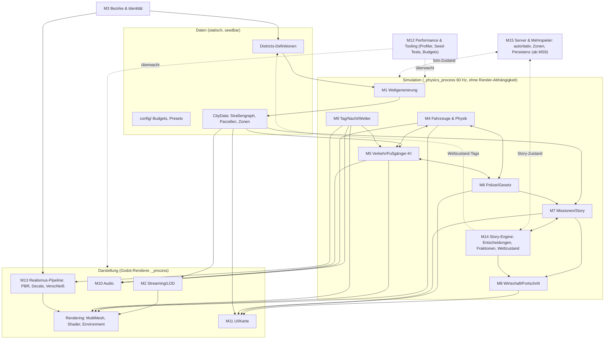
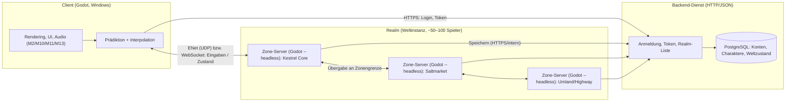
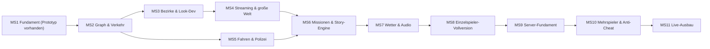

# MTA 6 – Weltkonzept (Godot 4.7)

> Modulares Konzept für eine außergewöhnlich gute Spielwelt von **MTA 6**, einem **eigenständigen**, dystopisch-realistischen Open-World-Fahrspiel (Einzelspieler-Kern, später gemischt mit MMO-Elementen) mit eigener Stadt, eigenen Figuren und eigener Story.
> **Version 3 – Engine: Godot 4.7.2** (GDScript, Forward+/Vulkan, Windows-PC; Zielhardware AMD RX 5700 XT 8 GB, Ryzen 5 3600, 64 GB RAM). Frühere Versionen waren auf Browser/Three.js ausgelegt; der Inhalt (Module, Welt, Story, Meilensteine) ist erhalten und technisch auf Godot übersetzt.
> Stand: 19.11.2026 · Sprache: Deutsch · Ausgangsbasis: Godot-Prototyp in `godot/` (`main.gd`, `main.tscn`, `project.godot`), Iterationsplanung: [`ITERATIONSPLAN.md`](ITERATIONSPLAN.md) (Zuordnung in Kapitel 9).
>
> **Abgrenzung:** Dieses Dokument verwendet ausschließlich allgemeine Genre-Prinzipien (Open-World-Design, lebendige Städte, Systemik). Karte, Namen, Figuren, Marken und Story-Elemente sind vollständig eigen – nichts davon ist von GTA oder anderen Rockstar-Titeln abgeleitet.
>
> **Hinweis zur Recherche:** Die Godot-Dokumentation wurde in den Versionen 4.0–4.6 geprüft; für **4.7.2** sind Verhalten und Einstellungen am Prototyp zu verifizieren (jeweils markiert). Zahlen zu Frame-Zeiten sind **Planwerte**, keine Messungen – sie sind mit dem Profiler auf der Zielhardware zu bestätigen.

---

## Inhalt

1. [Ist-Zustand des Godot-Prototyps](#1-ist-zustand-des-godot-prototyps)
2. [Vision und Designsäulen](#2-vision-und-designsäulen)
3. [Modulübersicht und Schnittstellen](#3-modulübersicht-und-schnittstellen)
4. [Module im Detail (M1–M12)](#4-module-im-detail)
5. [Realismus und Detailtiefe (M13)](#5-realismus-und-detailtiefe-m13)
6. [Story-Engine, Entscheidungen und Fraktionen (M14)](#6-story-engine-entscheidungen-und-fraktionen-m14)
7. [Open World trifft MMO: Server und Mehrspieler (M15)](#7-open-world-trifft-mmo-server-und-mehrspieler-m15)
8. [Die Welt: Kestrel Bay (dystopisch)](#8-die-welt-kestrel-bay-dystopisch)
9. [Roadmap mit Meilensteinen](#9-roadmap-mit-meilensteinen)
10. [Empfohlene Projektstruktur (Godot)](#10-empfohlene-projektstruktur-godot)
11. [Quellen](#11-quellen)
12. [Zusammenfassung und die 5 nächsten Schritte](#12-zusammenfassung-und-die-5-nächsten-schritte)

---

## 1. Ist-Zustand des Godot-Prototyps

Gelesen wurden `godot/main.gd`, `godot/project.godot` und `godot/README.md`. Der Prototyp entwickelt sich parallel weiter; die Tabelle gibt den **Arbeitsstand vom Abend des 19.11.2026** wieder (`main.gd` ≈ 930 Zeilen, dazu `minimap.gd`; der letzte Commit „SDFGI, Volumennebel, Laternen mit Lichtpools, Bäume, Gebäudedetails“ enthält davon nur einen Teil, Polizei/Fußgänger/Mission/Minimap liegen noch als **nicht eingecheckte Änderungen** vor; `README.md` ist veraltet). Der frühere Three.js-Prototyp (`index.html`, `game.js`) bleibt als eingefrorene Referenz erhalten; Audio ist daraus noch **nicht portiert**.

| Bereich | Ist-Zustand (Godot) | Konsequenz |
|---|---|---|
| Projekt | Godot 4.7.2, **Forward+**, MSAA 2×, Direktionalschatten-Atlas 4096; Fenster 1600×900; `main.gd` baut fast alles im Code (`_build_*`) | Gute Basis, aber ein Skript für alles → in Szenen, Autoloads und Ressourcen zerlegen (Kapitel 10) |
| Stadt | Raster 8×8 Blöcke, `P = 80 m`, Straße 16 m → ca. 640 × 640 m. **Boden = eine 4000×4000-PlaneMesh mit Spatial-Shader**, der Straßen, Mittellinien, Randlinien und Zebrastreifen prozedural aus der Weltposition zeichnet (kein Mesh pro Straße) | Sehr effizient; Shader-Konstanten (`P`, `HALF`) sind aber doppelt hartkodiert (GDScript und Shader) → **Global Shader Uniforms** verwenden |
| Gebäude | Je Lot ein `StaticBody3D` + `MeshInstance3D` (BoxMesh) + `CollisionShape3D`, ein gemeinsames `ShaderMaterial` mit `instance uniform tint`; Fenster und Nachtlicht rein im Fragment-Shader aus Weltposition (`night`-Uniform) | Keine Fenstertexturen nötig (gut); Nodes-Zahl wächst mit der Stadt → für größere Welt **MultiMeshInstance3D** und gebündelte Kollision je Chunk |
| Zufall | `RandomNumberGenerator` mit `seed = 6` | Welt ist **reproduzierbar** (Vorteil gegenüber dem alten Prototyp) |
| Fahrzeug | `VehicleBody3D` (1200 kg, Schwerpunkt abgesenkt), 4 × `VehicleWheel3D` (Federhärte 45, Reibung 3,2), Motorkraft 2000 je Antriebsrad bis 42 m/s, geschwindigkeitsabhängige Lenkung, Verfolgerkamera, `SpotLight3D` als Scheinwerfer; Optik aus Boxen | Spielbar; Godot-Doku warnt, dass `VehicleBody3D` nicht für realistische Fahrphysik gedacht ist [Q22] → Tuning im MVP, eigenes Raycast-Fahrzeug im Ausbau |
| Verkehr/Spielsysteme | 28 Verkehrs- und 60 Fußgänger-`Agent`-Objekte (RefCounted) als **Linien-Agenten** (Achse, Linie, Richtung, Position) mit gewichteter Zufallsabbiegung; Abstandhalten (`_blocked`), Stun/Ghost-Timer; **Polizei-Agenten** mit Fahndungswert (`heat`), Festnahme (`_bust`), Missionsmarker mit Zeitbonus, Geld, Toasts (Arbeitskopie) | Portierung des Browser-Prototyps läuft; weiterhin Linien statt Straßengraph, keine Ampeln, keine Sichtlinien; alles in einem Skript → in Autoloads/Szenen überführen |
| Umwelt | `WorldEnvironment` mit `ProceduralSkyMaterial`, ACES, **SSAO, SSR, Glow, Volumennebel (Dichte 0,004, GI-Inject), SDFGI (3 Cascades, Occlusion)**, Adjustment (Kontrast 1,08, Sättigung 1,12), Nebel; 1 `DirectionalLight3D` (Schatten bis 260 m); Tag/Nacht: 1 Stunde = 20 s | SDFGI und Volumennebel sind bereits aktiv (im Konzept erst für „Hoch“ vorgesehen) → Kosten auf der RX 5700 XT messen (Kapitel 5.1); `--fps`-Modus gibt die FPS nach 6 s aus |
| UI/Eingabe | HUD mit Geld, Fahndung, Mission, Toasts; **Minimap** (`minimap.gd`, `Control` mit `_draw`, Weltausschnitt dreht sich mit); `InputMap` im Code; `--test`- und `--fps`-Modus für Headless-/Messläufe | Gute Basis; Vollkarte, Menüs, Optionen fehlen |
| Beleuchtung/Details | **Laternen** als zwei `MultiMeshInstance3D` (Masten, Köpfe) plus **Pool aus 8 `OmniLight3D`**, die alle 0,25 s den nächsten Laternen zugewiesen werden (derzeit Sortierung *aller* Laternenpositionen → Spatial Hash nötig); **Bäume** (Parks, 14 % der Blöcke) als zwei MultiMeshes; Dachaufbauten/Antennen als Einzel-Nodes | Gutes Muster für Props (Kapitel 5.3); Pool-Prinzip beibehalten |
| Nicht vorhanden | Audio, Speichern, Chunk-Streaming, LOD, Straßengraph, Vollkarte, Story, Wetter | Alles Weitere in den Modulen M1–M15 |

**Schwächen, die Erweiterungen blockieren:** alles in einer Datei, Zufall nicht zentralisiert, Gebäude als Einzel-Nodes, NPC-Autos ohne Kollisionskörper, Kamera/Fahrzeug/Welt vermischt, kein Profiler-Overlay.

---

## 2. Vision und Designsäulen

**Pitch:** *Kestrel Bay* ist eine sonnenverbrannte Küstenmetropole, die von einem Konzern „optimiert“ wird: glänzende Türme voller Kameras, rostige Docks, neonbunte Nächte, ein Highway, der in die Berge schneidet. Der Konzern *Aurelia Holdings* betreibt das Überwachungsnetz **Aegis**, das Kennzeichen, Gesichter und Zahlungen verknüpft und Zugang zu Straßen, Krediten und Wohnungen steuert. Man fährt, entkommt, handelt – und entscheidet, wem die Stadt am Ende gehört. Sie funktioniert auch ohne den Spieler.

**Zielplattform:** Windows-PC, Godot 4.7.2 (Forward+/Vulkan), ausgelegt auf **AMD RX 5700 XT (8 GB, ohne Hardware-Raytracing) + Ryzen 5 3600 + 64 GB RAM**. Läuft ohne Konto-Zwang und ohne Launcher; Start in unter 15 s von SSD. Ziel: 60 fps bei 1080p im Preset „Mittel“, 1440p über FSR 2.2 im Preset „Hoch“ nach Messung. Mehrspieler optional über einen eigenen Dedicated Server.

### Die sieben Designsäulen

1. **Fahren fühlt sich großartig an.** Das Auto ist die Hauptfigur. Wenn eine leere Straße schon Spaß macht, trägt die Welt alles andere.
2. **Jeder Bezirk ist auf einen Blick erkennbar.** Silhouette, Farbpalette, Straßenmuster, Licht, Musik und Verkehr unterscheiden sich so stark, dass man ohne Karte weiß, wo man ist (Orientierung über Landmarken, siehe Quellen [Q7]).
3. **Die Stadt lebt ohne dich.** Verkehr, Passanten, Polizei und Wetter folgen eigenen Regeln. Der Spieler stört ein System, das bereits läuft (Systemik statt Skript, [Q5][Q6]).
4. **Systeme erzeugen Geschichten.** Wenige, saubere Regeln (Verfolgung, Ruf, Geld, Tageszeit, Wetter) kombinieren sich zu unvorhersehbaren Momenten; geschriebene Missionen setzen nur Anker.
5. **Hardware-ehrlich gebaut.** Alles wird gegen feste Performance-Budgets der Zielhardware entworfen (MultiMesh, Streaming, Visibility Ranges, Sim-LOD). Eine schöne Welt, die nur auf einer Highend-GPU läuft, ist keine.
6. **Glaubwürdigkeit durch Detail.** Realismus entsteht aus vielen kleinen, konsistenten Dingen (Materialien, Verschleiß, Straßendetails, plausible Stadtstruktur), nicht aus maximaler Polygonzahl. Ziel ist der bestmögliche Look *innerhalb* der Hardwaregrenzen (Kapitel 5).
7. **Entscheidungen haben Folgen, und die Welt hat eine Haltung.** Dystopie ist kein Anstrich, sondern Spielmechanik: Überwachung (Aegis), Konzernmacht und soziale Gegensätze verändern, wie man fährt, flieht und handelt. Spielerentscheidungen verschieben Fraktionen, Bezirke und Enden (Kapitel 6).

### Alleinstellungsmerkmal (Unique Selling Point)

**„Eine Stadt, die man an der Tageszeit liest.“** Jeder Bezirk hat einen eigenen Tagesrhythmus (Büros leeren sich ab 18 Uhr, der Hafen arbeitet in der Frühschicht, die Promenade lebt nachts). Missionen, Verkehr, Polizeipräsenz und Preise hängen am Rhythmus. Dazu ein **Bezirks-Ruf-System** statt eines einzigen globalen Fahndungslevels: Wer in Saltmarket auffällt, ist dort bekannt, nicht automatisch überall. Zusätzlich das **Aegis-Profil**: Kameras lesen Kennzeichen; wer oft auffällt, wird in überwachten Bezirken schneller erkannt – es sei denn, man hackt Kameras, tauscht Kennzeichen oder fährt durch die „blinden“ Armenviertel. Die Dystopie wird so zu einer Fahrregel, nicht zu Kulisse.

---

## 3. Modulübersicht und Schnittstellen

### 3.1 Architekturdiagramm



### 3.2 Leitprinzipien der Architektur (Godot)

- **Szenen als Bausteine, Autoloads als Dienste.** Jede wiederverwendbare Einheit ist eine **Szene** (`scenes/vehicles/car.tscn`, `scenes/world/chunk.tscn`, `scenes/ui/hud.tscn`). Systeme, die es genau einmal gibt (Zeit/Wetter, Ereignisse, Spielzustand, Audio-Manager, Chunk-Manager), sind **Autoloads** (Singletons). Alles andere wird instanziert, nicht global gehalten.
- **Daten als Ressourcen.** Statische Inhalte (Bezirke, Fahrzeugdatenblätter, Fraktionen, Materialien) sind eigene `Resource`-Klassen (`class_name DistrictDef extends Resource`, `.tres`) oder JSON; Story-Inhalte in JSON (diffbar, prüfbar). **Gespeichert wird ausschließlich als JSON**, nie als `.tres/.res`, weil Godot-Ressourcen eingebetteten Skriptcode enthalten können (Sicherheitsrisiko bei fremden Dateien, vgl. Mehrspieler-Kapitel).
- **Simulation und Darstellung trennen – soweit sinnvoll.** Simulationslogik (Verkehr, Polizei, Story, Wirtschaft) läuft in `_physics_process` (fester Takt, 60 Hz) und kennt **keine** Meshes/Materialien; die Darstellung liest den Zustand. Das ermöglicht Sim-LOD, Auslagerung in Threads und – wichtig – den **Dedicated Server im Headless-Modus**, der dieselbe Simulation ohne Rendering ausführt.
- **Signale statt direkter Aufrufe.** Ein Autoload `EventBus` bündelt Signale (`crime_committed`, `mission_completed`, `district_entered`); Polizei, Missionen, Audio und UI abonnieren, ohne sich zu kennen.
- **Ein Datenmodell für die Stadt (`CityData`):** Straßengraph (Knoten, Kanten, Spuren), Parzellen, Zonen/Bezirke als Ressourcen/Objekte, geschrieben von der Weltgenerierung, gelesen von Streaming, KI, Karte und Missionen.
- **Alles seedbar:** ein zentraler `Rng`-Dienst (`RandomNumberGenerator` mit Seed je Aufgabe/Chunk: `seed = hash(world_seed, chunk_x, chunk_z)`); gleicher Seed = gleiche Stadt, **unabhängig von der Ladereihenfolge**.
- **Globale Shader-Parameter statt Doppelpflege:** Welt-Konstanten, Tageszeit (`night`), Nässe (`wetness`), Wetter, Verschmutzung als **Global Shader Uniforms** (`RenderingServer.global_shader_parameter_set`), die alle Materialien lesen – ersetzt die doppelt hartkodierten Konstanten des Prototyps.
- **GDScript zuerst, C#/GDExtension nur nach Messung.** Rechenintensive Schleifen (Verkehrs-Update für Hunderte Agenten, Generator-Mathematik, A*) werden zuerst in GDScript (typisiert!) gebaut und mit dem Profiler gemessen; erst bei nachgewiesenem Engpass auf **C#** (erfordert die .NET-Variante von Godot) oder **GDExtension** (C++/Rust) umstellen – dann nur dieses Modul.
- **Server-fähig von Anfang an:** Dieselbe Simulation läuft im Einzelspieler lokal und im Mehrspielerbetrieb auf dem Server. Der Einzelspieler nutzt die Godot-Multiplayer-API im **Offline-Modus** (`OfflineMultiplayerPeer`), sodass RPC-Code in beiden Modi identisch ist (Kapitel 7).

### 3.3 Schnittstellentabelle


| Modul | Liefert (Output) | Braucht (Input) |
|---|---|---|
| M1 Weltgenerierung | `CityData` (Straßengraph, Parzellen, Zonen, Landmarken-Slots) | Seed, Bezirksdefinitionen, Heightmap |
| M2 Streaming/LOD | Geladene Chunk-Szenen (MultiMesh, Kollisionsformen), Sichtbarkeitsbereiche | `CityData`, Kameraposition |
| M3 Bezirke | `DistrictDef` (Palette, Regeln, Dichte, Musik, Verkehrsprofil) | – (Designdaten) |
| M4 Fahrzeuge | `VehicleState` (Pose, Geschwindigkeit, Schaden), Kollisionsevents | Eingabe/KI-Steuerung, Bodenhöhe, Fahrzeugdaten |
| M5 Verkehrs-/Fußgänger-KI | Agentenzustände, Wahrnehmungsevents („Unfall gesehen“) | Straßengraph, Zeit, Wetter, Spielerposition |
| M6 Polizei/Gesetz | Fahndungsstufe pro Bezirk, Polizeiagenten, Festnahme/Flucht-Events | Verbrechensevents, Sichtlinien, Straßengraph |
| M7 Missionen/Story | Aufträge, Marker, Cutscene-/Dialogtrigger | `CityData`, Spielzustand, Events |
| M8 Wirtschaft | Geld, Ruf, Freischaltungen, Speicherstand | Missionsergebnisse, Verbrechensfolgen |
| M9 Tag/Nacht/Wetter | `Environment` (Sonne, Himmel, Nebel, Nässe, Wind) | Spielzeit, Bezirk |
| M10 Audio | Mix aus Motor-, Umgebungs-, Musik-, UI-Bussen | Fahrzeug-, Umwelt-, KI-Daten |
| M11 UI/Karte | HUD, Vollkarte, GPS-Route, Menüs | Alle Zustände (nur lesend) |
| M12 Performance/Tooling | Budgets, Profiler, Debug-Overlays, Seed-Tests | Alle Module |
| M13 Realismus-Pipeline | Material-Bibliothek (PBR), Decal-/Verschleiß-System, Prop-Sets, Qualitätsstufen | Bezirke (M3), Wetter/Zeit (M9), Streaming (M2) |
| M14 Story-Engine | Entscheidungen, Fraktionsstand, Weltzustand-Tags, Enden | Missions-Events (M7), Verbrechen (M6), Spielzustand (M8) |
| M15 Server/Mehrspieler | Autoritativer Weltzustand, Snapshots, Persistenz, Anti-Cheat-Prüfung | Alle Sim-Module (laufen auch im Server), M14 für Story-Phasen |

---

## 4. Module im Detail

Aufwand in **Personentagen (PT)** für eine Entwicklerin/einen Entwickler mit KI-Unterstützung, pro Stufe; grobe Schätzung, ±50 %. Stufen: **MVP** (spielbar, trägt den Meilenstein), **Ausbau** (Qualitätssprung), **Wunschziel** (Politur/Luxus). Godot liefert vieles fertig (Physik, Navigation, Multiplayer-API, Audio-Busse, UI, Profiler); der Aufwand ist deshalb gegenüber der Browser-Version bei einigen Modulen kleiner.

### M1 – Weltgenerierung

**Ziel:** Eine reproduzierbare, vielfältige Stadt statt eines zufälligen Rasters; Straßen und Parzellen entstehen aus Regeln, Bezirke formen das Ergebnis.

| Stufe | Umfang |
|---|---|
| MVP | Zentraler Seed; Raster wird zu **Straßengraph** (Knoten/Kanten) mit Hierarchie (Hauptstraße, Nebenstraße, Gasse); Blöcke werden rekursiv in Parzellen unterteilt; Gebäudehöhe nach Bezirk statt nur nach Abstand zur Mitte (im Prototyp: `lerpf(80, 16, dist)`) |
| Ausbau | **Tensor-Feld-Straßen**: Raster in der Innenstadt, Radialmuster am Hang, Küstenparallelen an der Promenade, zu einem Feld verblendet; Heightmap-Terrain; Straßen passen sich dem Gelände an; Brücken/Tunnel; Wasserflächen |
| Wunschziel | Grammatik-basierte Fassaden mit Bezirksstil; Einwohner-/Landnutzungssimulation; handgesetzte „Hero“-Gebiete (eigene Szenen) werden in die generierte Stadt eingefügt |

**Technische Umsetzung (Godot):**
- Verfahren nach der Literatur: Straßennetz → Blöcke → Parzellen → Gebäude ([Q1] Parish & Müller, L-Systeme; [Q2] Chen et al., Tensor-Felder; Parzellierung durch rekursive Teilung orientierter Rechtecke [Q3]).
- **Hybridansatz:** Hauptachsen, Highway, Brücken und Landmarken **handgesetzt** (als `.tscn`-Szenen im Editor), Füllstraßen und Parzellen **prozedural**. Reine Prozedur erzeugt Beliebigkeit, reine Handarbeit ist nicht zu leisten.
- Ausgabe ist eine reine Datenstruktur `CityData` (`RefCounted`/`Resource`, JSON-serialisierbar) → in einem **Worker-Thread** (`WorkerThreadPool`) erzeugbar, cachebar und per Skript headless testbar.
- Terrain: Heightmap-Gitter je Chunk (`ArrayMesh` bzw. `HeightMapShape3D` für Kollision); Straßen als Mesh-Bänder entlang der Graph-Kanten **oder** – wie im Prototyp – im Boden-Shader (für gerade, ebene Raster am billigsten); gemischt: Shader im Raster-Kern, Mesh-Bänder für Kurven/Hang. Für fertige Terrain-Werkzeuge existieren Community-Add-ons (z. B. Terrain3D); Eignung und Lizenz vor Einsatz prüfen *(nicht recherchiert)*.
- Rechenintensive Generatorteile (Tensor-Feld, Straßenintegration) sind Kandidaten für **C#/GDExtension**, falls GDScript zu langsam ist (messen).

**Abhängigkeiten:** M3 (Bezirksparameter), M12 (Seed-Tests). **Risiken:** Tensor-Felder erzeugen unschöne Kreuzungswinkel/Sackgassen → nachbearbeiten (Segmente verschmelzen, Mindestwinkel); Generator wird zum Zeitgrab → Zeitbox je Stufe, Handarbeit als Fallback; GDScript-Laufzeit. **Aufwand:** MVP 6 PT · Ausbau 14 PT · Wunsch 15+ PT.

---

### M2 – Streaming und LOD

**Ziel:** Eine Welt, die um ein Vielfaches größer ist als das, was gleichzeitig geladen/gerendert wird, bei stabilen 60 fps auf der RX 5700 XT.

| Stufe | Umfang |
|---|---|
| MVP | Welt in **Chunks** (z. B. 160 × 160 m); nur Chunks im Radius geladen; Gebäude/Bäume/Laternen je Chunk als **`MultiMeshInstance3D`**; geteilte Materialien; **Visibility Ranges** (`visibility_range_begin/end`, Fade) für Detailobjekte; Kollision je Chunk gebündelt; Nebel/Environment kaschiert Weitsicht |
| Ausbau | Chunk-Erzeugung im **Worker-Thread** (`WorkerThreadPool`), Instanziierung auf dem Hauptthread mit Zeitbudget pro Frame; **HLOD** (Visibility-Parent: viele Häuser → ein Fernmesh); automatische **Mesh-LODs** für importierte Modelle; **Occlusion Culling** mit zur Laufzeit erzeugten `OccluderInstance3D`/`BoxOccluder3D` je Gebäude; Chunk-Vorlauf in Fahrtrichtung |
| Wunschziel | Impostor-Billboards für Ferngebäude; Streaming per `ResourceLoader.load_threaded_request` für handgebaute Hero-Szenen; Texture-Streaming je Bezirk; **Floating-Origin** nur falls die Welt die Einzel-Präzisionsgrenze sprengt (siehe unten) |

**Technische Umsetzung (Godot):**
- `MultiMesh` zeichnet tausende Instanzen in einem Draw Call; Nachteil: **einzelne Instanzen werden nicht gecullt** – das gesamte MultiMesh ist sichtbar oder nicht. Deshalb **ein MultiMesh je Chunk (und je Geometrie)**, sodass das Culling auf Chunk-Ebene greift. Per-Instanz-Daten (Farbe, `wear`, Fensterlicht-Variante) über `INSTANCE_CUSTOM`/Instanzfarbe im Shader [Q23].
- **Visibility Ranges (HLOD)** sind der eingebaute LOD-Mechanismus: nahe Detail-Nodes blenden aus, wenn der Fern-Stellvertreter (`visibility_parent`) sichtbar ist. Godot unterstützt für Visibility Ranges nur alphabasiertes Fading; Dithering bleibt Workaround über getrennte Materialien [Q24].
- **Occlusion Culling** (CPU-Software-Rasterizer) braucht eingeschaltetes Projektsetting und `OccluderInstance3D`; für prozedurale Chunks müssen Occluder zur Laufzeit gebaut werden (Box-Occluder je Hochhaus sind billig). Nutzen hängt von der Kameraperspektive ab (hohe Verfolgerkamera = geringerer Gewinn) [Q25].
- **Größe der Welt:** Godot rechnet standardmäßig mit **Einzelpräzision**. Die Dokumentation nennt „Large World Coordinates“ nur für Raumschiff-/Planetensimulationen; moderne Open-World-Spiele kommen mit Einzelpräzision aus, mit einer Orientierungsgröße von etwa 8 × 8 km um den Ursprung [Q26]. **Kestrel Bay (Stadt ≈ 3 × 3 km, Umland ≈ 6 × 6 km)** liegt darunter → **keine Large-World-Coordinates** (sie kosten Performance und Speicher). Falls später doch nötig: Origin-Shifting, das aber Mehrspielerlogik verkompliziert.
- Chunk-Lebenszyklus: `UNLOADED → GENERATING (Thread) → READY (Daten) → INSTANTIATING (Hauptthread, ≤ 2 ms/Frame) → ACTIVE → UNLOADING`; `queue_free` verteilt über Frames (Hitches vermeiden).
- **Kollision:** Gebäude eines Chunks teilen sich eine `StaticBody3D` mit mehreren `CollisionShape3D` (oder einer `ConcavePolygonShape3D` für Terrain); Boden im Raster-Kern bleibt eine Ebene.

**Abhängigkeiten:** M1 (Daten), M12 (Messung). **Risiken:** Pop-in sichtbar → Nebel, Visibility-Fade, Chunk-Vorlauf; Speicherlecks/Hitches beim Entladen; Thread-Sicherheit (Szenenbaum nur auf dem Hauptthread ändern → `call_deferred`); Verhalten von Occlusion Culling und HLOD in 4.7.2 am Prototyp prüfen. **Aufwand:** MVP 4 PT · Ausbau 10 PT · Wunsch 12+ PT.

---

### M3 – Stadtbezirke und Identität

**Ziel:** Sechs Bezirke, die man an Optik, Licht, Verkehr und Klang erkennt (Details in [Kapitel 8](#8-die-welt-kestrel-bay-dystopisch)).

| Stufe | Umfang |
|---|---|
| MVP | `DistrictDef`-Ressourcen: Farbpalette der Fassaden, Gebäudehöhen, Straßenbreiten, Baumdichte, Passanten-/Verkehrsdichte, Himmelstönung, Aegis-Dichte; je Bezirk 1 Landmarke (Szene) |
| Ausbau | Eigene Prop-Sets (Container, Palmen, Reklametafeln, Poller …) als MultiMesh-Gruppen; Boden-/Asphaltvarianten je Bezirk (Shader-Parameter); bezirksspezifische Nachtbeleuchtung (Neon, Natrium, LED); Bezirksname beim Einfahren (UI, `Area3D`-Zonen) |
| Wunschziel | Bezirkstypische NPC-Kleidung/Fahrzeugmix; Zeitrhythmen (Schichtwechsel, Rush Hour); dynamische Details (Baustellen, Märkte, Veranstaltungen) |

**Technische Umsetzung (Godot):** Reine Daten (`data/districts/*.tres`), konsumiert von M1 (Generierung), M2 (Props), M5 (Verkehrsprofil), M9 (Licht), M10 (Musik). Bezirkszugehörigkeit je Position über eine **Bezirkskarte** (niedrig aufgelöste Textur/Voronoi-Gitter, O(1)-Abfrage) statt Geometrietests. Orientierung folgt bewährten Prinzipien: **Landmarken-Hierarchie**, Wiedererkennung über Farbe und Silhouette, Leitlinien [Q7].
**Abhängigkeiten:** M1, M2. **Risiken:** Bezirke wirken bloß „umgefärbt“ → Unterschiede in *Struktur* (Straßenmuster, Höhenprofil, Prop-Rhythmus) statt nur Farbe. **Aufwand:** MVP 3 PT · Ausbau 10 PT · Wunsch 10+ PT.

---

### M4 – Fahrzeuge und Physik

**Ziel:** Fahrverhalten, das sich nach Gewicht, Grip und Tempo anfühlt; Zerstörung, die Konsequenzen hat.

| Stufe | Umfang |
|---|---|
| MVP | Bestehendes `VehicleBody3D` in eine **Fahrzeugszene** mit Datenblatt-Ressource (`VehicleDef`: Masse, Motorkraft, Grip, Lenkung, Federung) auslagern; Drift über Reibungs-/Handbremsen-Tuning; Verfolgerkamera als eigene Szene; Ein-/Aussteigen vorbereiten; Boden-Höhenanpassung durch Terrainkollision |
| Ausbau | **Eigenes Raycast-Fahrzeug** auf `RigidBody3D` (Feder/Dämpfer je Rad, vereinfachtes Reifenmodell – linear/Bürste statt vollem Pacejka [Q12]); 4–6 Fahrzeugklassen (Kompakt, Limousine, Sportler, SUV, Transporter, Motorrad); Schadensmodell (Zonen, Beulen per Vertex-Offset/Shader, Rauch, Reifenschaden); NPC-Autos wechseln bei Kollision von **Kinematik zu Physik** (RigidBody) |
| Wunschziel | Anhänger, Boote, Hubschrauber; Tuning; Gelenkte Hinterachse, Differenzial/Traktionskontrolle; Force-Feedback für Lenkräder |

**Technische Umsetzung (Godot):**
- **`VehicleBody3D`** ist ein Raycast-Fahrzeug, laut Dokumentation aber **nicht** für realistische 3D-Fahrphysik gedacht; für fortgeschrittenes Verhalten empfiehlt die Doku eine eigene Umsetzung auf `RigidBody3D` [Q22]. Der Prototyp zeigt, dass es als Start trägt.
- **Physik-Engine:** Seit Godot **4.6** ist **Jolt** für neue 3D-Projekte der Standard (in 4.4 als Alternative eingeführt, in 4.6 ohne „experimentell“-Label); bestehende Projekte behalten ihre Einstellung, die Simulationsergebnisse unterscheiden sich [Q27]. Das Projekt (`config/features` „4.7“) prüft in `Project Settings → Physics → 3D`, welche Engine aktiv ist; **früh beide testen**, weil Fahrverhalten und Kollisionsstabilität unterschiedlich ausfallen können. Ob `VehicleBody3D` unter Jolt in 4.7.2 gleich robust ist wie unter Godot Physics, ließ sich nicht belegen → am Prototyp messen.
- Physik läuft mit festem Takt (`physics_ticks_per_second`, Standard 60; für schnelle Fahrzeuge 120 erwägen); Kollisionsformen vereinfachen (Box/Konvex), Karosserie getrennt von Kollision.
- Fahrzeuge als **`CollisionLayer`/`Mask`-Schema** (Welt, Fahrzeug, Fußgänger, Trigger) von Beginn an.
- Gefühl vor Realismus: Tuning-Parameter in `VehicleDef`, Live-Tuning über Debug-Panel (Slider via `Control`-Nodes).

**Abhängigkeiten:** M1/M2 (Boden, Kollision), M12. **Risiken:** Tunneling bei hohem Tempo (→ höherer Physiktakt, CCD-Option am RigidBody); Instabilitäten von `VehicleBody3D` beim Überschlag; „realistisch“ ≠ „spaßig“ → Playtests; Jolt/Godot-Physics-Unterschiede. **Aufwand:** MVP 4 PT · Ausbau 12 PT · Wunsch 18+ PT.

---

### M5 – Fußgänger- und Verkehrs-KI

**Ziel:** Eine Stadt, die glaubwürdig wimmelt, ohne die CPU zu fressen – **Simulation-LOD** als Kernidee (Ryzen 5 3600: 6 Kerne/12 Threads, gute Single-Thread-Leistung, aber begrenzt).

| Stufe | Umfang |
|---|---|
| MVP | Agenten auf dem **Straßengraph** (Kanten mit Spuren, Einbahn, Tempolimit) statt Linien-Agenten; Ampel-/Vorfahrtlogik; Abstandhalten per Vorderfahrzeug-Abfrage je Spur (statt Allpaarvergleich); Fußgänger auf Gehweg-Graph, Überqueren an Zebrastreifen; **Spawn/Despawn am Rand des Aktivradius** |
| Ausbau | **Drei Sim-Stufen**: (A) nah: volle Kollision (Physikkörper), Animation, Wahrnehmung, ggf. `NavigationAgent3D`-Avoidance; (B) mittel: nur Spur-Bewegung ohne Kollision, niedrige Updaterate; (C) fern: statistische Dichte je Kante, keine Einzelagenten. Reaktionen: Ausweichen, Hupen, Flucht bei Unfall/Schüssen/Raserei; Tageszeit-/Wetterprofile je Bezirk |
| Wunschziel | Agenten mit Zielen und Tagesplan; Busse/Bahn mit Haltestellen; Gruppen, Warteschlangen; Skelett-Animation per Vertex-Textur/`AnimationTree`-LOD; Crowd-Rendering per `MultiMesh` |

**Technische Umsetzung (Godot):**
- Das Prinzip der **Simulationsblase** (Verkehr und Passanten laufen in einer Blase um den Spieler, am Rand wird gespawnt/entfernt) und das Einhalten von Verkehrsregeln trotz unvorhersehbarer Kollisionen ist aus Open-City-Spielen belegt [Q4]; Detailtiefe gestuft nach Entfernung ist etablierte Praxis [Q14].
- **Straßenwege:** eigener Graph (`AStar3D` ist unabhängig vom NavigationServer und eignet sich für Straßengraphen, GPS und Polizei-Routing). **`NavigationServer3D`/NavMesh** für freie Fußgängerbewegung auf Plätzen; Avoidance und Pfadabfragen sind teuer → nur für nahe Agenten (Stufe A), Pfade nicht pro Frame neu berechnen, unerreichbare Ziele vermeiden (bekannter Performance-Einbruch) [Q28].
- **Daten statt Nodes:** Agenten als Struktur-Arrays (`PackedFloat32Array`/`PackedVector3Array`) in einem `TrafficSystem`-Autoload; Darstellung über **ein `MultiMeshInstance3D` je Fahrzeugtyp** (Transform pro Frame setzen), echte `VehicleBody3D`/`RigidBody3D`-Körper nur für Stufe A und bei Kollisionen. Hunderte Fahrzeuge sind so realistisch, 28 einzelne Node-Autos mit eigener Logik skalieren nicht.
- Rechenschleifen für Hunderte Agenten zuerst typisiertes GDScript, bei Engpass **C#** oder GDExtension; Updates über `WorkerThreadPool` auf mehrere Kerne verteilen (Ergebnisse auf dem Hauptthread übernehmen).
- Systemische Ereignisse (Unfall, Panne, Straßenfest), die **ohne** Spielerbeteiligung stattfinden, erzeugen Lebendigkeit [Q5][Q6].

**Abhängigkeiten:** M1 (Straßengraph), M9 (Zeit/Wetter), M6 (Polizei teilt den Graphen). **Risiken:** Staus/Deadlocks (→ Timeout und Ghosting wie im Prototyp, aber kontrolliert); Mengenzahl vs. CPU (Ryzen 5 3600); unnatürliches Pop-in (→ Spawn nur außerhalb der Sicht). **Aufwand:** MVP 7 PT · Ausbau 14 PT · Wunsch 18+ PT.

---

### M6 – Polizei und Gesetz-System

**Ziel:** Verfolgungen, die fair, spannend und lesbar sind; Folgen statt bloßer Strafpunkte.

| Stufe | Umfang |
|---|---|
| MVP | Verbrechens-**Signale** mit Gewichtung (Raserei, Unfall mit Zivilfahrzeug, Fußgänger verletzt, Polizeikontakt); Fahndungsstufe 1–5 mit Abklingen; Polizei fährt über Straßengraph (Ziel: Spieler/letzte bekannte Position); Festnahme/Flucht, aber mit **Sichtlinie** (Raycast) |
| Ausbau | Zustände **Verdacht → Verfolgung → Suche → Verloren** mit Suchradius um die zuletzt gesehene Position; Zeugenmeldung; **Bezirks-Ruf**: Fahndungsdruck primär im Bezirk; Taktiken je Stufe (PIT-Manöver, Straßensperre, Nagelband, Hubschrauber); Unterschlupf (Garage, Tunnel, Wasser) zum Abschütteln; **Aegis-Kennzeichenerfassung** (Kameras) |
| Wunschziel | Polizei als Fraktion mit Revieren, Schichtwechsel, Korruption/Bestechung; Gerichts-/Kautionssystem; nicht-tödliche Optionen |

**Technische Umsetzung (Godot):** Zustandsautomat je Einheit (`Node`-basiert oder Enum-Klasse) + zentraler Dispatcher-Autoload (verteilt Einheiten, hält Ziel-Wissen). Wahrnehmung über Sichtkegel mit `PhysicsRayQueryParameters3D` gegen Gebäude-Kollisionen (Strahlen budgetiert: wenige pro Frame, reihum), dazu Hörradius via `Area3D`. Das Fahndungssystem als „Spielzeug“ mit klaren, ablesbaren Regeln zu gestalten ist wichtiger als Realismus [Q5].
**Abhängigkeiten:** M5 (Graph, Zeugen), M4 (Fahrzeuge), M3 (Bezirke), M1. **Risiken:** Gummiband-KI, die „betrügt“ (Teleport-Spawns) → Spawn nur außerhalb der Sicht; Frust durch unausweichliche Festnahme → immer ein erkennbarer Fluchtweg; Raycast-Kosten. **Aufwand:** MVP 4 PT · Ausbau 12 PT · Wunsch 15+ PT.

---

### M7 – Missionen und Story-Runner

**Ziel:** Aufträge, die die Welt zeigen und systemische Zufälle zulassen. Die Haupthandlung selbst steht in [Kapitel 6 (M14)](#6-story-engine-entscheidungen-und-fraktionen-m14); M7 liefert den Runner, den M14 mit Inhalten füttert.

| Stufe | Umfang |
|---|---|
| MVP | Missions-**Framework** als Daten (Schritte: *Gehe zu / Fahre zu / Hole ab / Liefere / Entkomme / Zerstöre / Warte*); Typen: Kurier mit Zeitlimit, Taxi-Passagier, Verfolgung, Flucht; Marker (der Prototyp hat Marker aus Zylinder-Mesh) und Wegpunkt-UI; Checkpoints, Erfolg/Fehlschlag |
| Ausbau | Kampagne an Bezirke gekoppelt; Nebenaufträge je Bezirk; Dialoge/Funk als UI-Boxen mit Sprecherportrait; mehrere Lösungswege; Speicherpunkte |
| Wunschziel | Verzweigende Entscheidungen, Beziehungen, dynamische Zufallsbegegnungen, Mission-Editor als Godot-Editor-Plugin (`EditorPlugin`) |

**Technische Umsetzung (Godot):** Zustandsautomat/Skript-DSL in JSON (`data/missions/*.json`), ausgeführt vom `MissionRunner` (Autoload). Missionen **abonnieren Signale** des `EventBus` (z. B. `vehicle_entered_zone`) statt die Hauptschleife zu kennen; Zielzonen sind `Area3D`. Gestaltungsregel: je Mission Zielbedingung, KI-Rollen, Checkpoint-Abstände und Fehlschlagtext explizit festlegen; einfache KI mit starker Reaktion wirkt besser als komplexe KI [Q15]; Missionen „öffnen“, damit systemisches Chaos mitspielen darf [Q5][Q6].
**Abhängigkeiten:** M1 (Orte), M5/M6 (Welt reagiert), M8 (Belohnung), M11 (Marker). **Risiken:** Content-Menge → Wiederverwendung der Typen; Skript-Brüche bei systemischen Zufällen → Fail-Safes (Neuaufsetzen, Checkpoint). **Aufwand:** MVP 5 PT · Ausbau 18 PT · Wunsch 22+ PT.

---

### M8 – Wirtschaft und Fortschritt

**Ziel:** Ein Fortschrittsgefühl, das das Fahren belohnt und die Welt schrittweise öffnet.

| Stufe | Umfang |
|---|---|
| MVP | Geld mit klaren Einnahmen/Ausgaben; Speichern/Laden; Fahrzeugreparatur/-ersatz; Strafen bei Festnahme |
| Ausbau | Garagen/Safehouses je Bezirk; Fahrzeugkauf und Tuning; **Fraktions-/Bezirks-Ruf**; Immobilien als Einnahmequelle |
| Wunschziel | Dynamische Preise (Tageszeit, Nachfrage), Handel/Schmuggelrouten mit Risiko, Erfolge |

**Technische Umsetzung (Godot):** Ein zentraler, serialisierbarer `GameState`-Autoload (reine Daten als `Dictionary`/Klassen mit `to_dict()`/`from_dict()`); **Speichern als JSON** (`user://saves/…`, mit Schema-Version, Atomic-Write über temporäre Datei); **keine** `.tres/.res`-Speicherstände (Skript-Einbettung, Sicherheit). Preise und Belohnungen als Daten.
**Abhängigkeiten:** M7, M6. **Risiken:** Inflation/Balancing → Kennzahlen in Tabelle; Speicherstand-Migration (Schema-Version von Anfang an). **Aufwand:** MVP 3 PT · Ausbau 7 PT · Wunsch 10+ PT.

---

### M9 – Tag/Nacht/Wetter

**Ziel:** Licht und Wetter als wichtigstes Stimmungswerkzeug – jeder Bezirk sieht zu jeder Tageszeit anders aus.

| Stufe | Umfang |
|---|---|
| MVP | Tageszyklus aus dem Prototyp (`_process` mit `ProceduralSkyMaterial`, Sonnenwinkel, Dämmerung) in Autoload `Clock`/`WeatherSystem` auslagern; globale Shader-Parameter (`night`); Straßenlaternen als Emissive-Props + wenige echte Lichter; Spielzeit-API |
| Ausbau | **Wetter-Zustandsautomat** (klar, bewölkt, Regen, Nebel, Gewitter) mit weichen Übergängen; nasse Straßen (`wetness` global), Regen via `GPUParticles3D`, Nebel via `FogVolume`/Environment; physikalischer Himmel (`PhysicalSkyMaterial` oder eigener Sky-Shader mit Wolken/Sternen); Bezirks-Tönung; Wetter wirkt auf Grip (M4), Verkehr (M5), Audio (M10) |
| Wunschziel | Volumetrische Wolken, Jahreszeiten, Windsimulation für Vegetation, Blitz-Beleuchtung |

**Technische Umsetzung (Godot):** `WorldEnvironment` + `Environment`-Ressource (alle Parameter animiert per Code/`Tween`); **Cascaded Shadow Maps** der `DirectionalLight3D` (`directional_shadow_mode` PSSM 4 Splits; Schattenweite pro Qualitätsstufe) statt einer festen Box; Nachtbeleuchtung: Forward+ nutzt einen **Cluster-Renderer** für viele Lichter, die Kosten steigen aber mit Schattenwerfern → nur wenige schattenwerfende Lichter (Kapitel 5.1).
**Abhängigkeiten:** M2, M12. **Risiken:** Nachtbeleuchtung (viele Lichter) → Fake-Licht (Emissive, Glow, Decals), Schattenwerfer strikt begrenzen; Regen-Shader. **Aufwand:** MVP 2 PT · Ausbau 8 PT · Wunsch 12+ PT.

---

### M10 – Audio

**Ziel:** Eine Welt, die man hört: Motor, Stadt, Wetter, Musik.

| Stufe | Umfang |
|---|---|
| MVP | `AudioManager`-Autoload mit **Audio-Bussen** (Motor, Umwelt, Musik, UI, Master) im `AudioBusLayout`; Motor aus **geloopten Samples** (Leerlauf, Last, Schub) mit Pitch nach Drehzahl; Kollision, Hupe, Sirene; Doppler/Dämpfung für NPC-Fahrzeuge (`AudioStreamPlayer3D`) |
| Ausbau | Mehrschicht-Motor mit **Equal-Power-Crossfade** (kein Lautstärkeloch) [Q16]; Reifenquietschen, Wind nach Tempo, Regen; Umgebungs-Layer je Bezirk; Hall in Tunneln/Häuserschluchten (Reverb-Bus-Effekt, per Bezirk/`Area3D` umgeschaltet); Radiosender mit prozeduraler Musik |
| Wunschziel | Dynamische Musik (Intensität folgt Verfolgung/Tageszeit), Sprachausgabe, Mix-Snapshots (z. B. „in der Garage“) |

**Technische Umsetzung (Godot):** `AudioStreamPlayer3D` mit Dämpfung/Doppler; Pitch über `pitch_scale`; Equal-Power-Crossfade über zwei Player und `Tween` (Gains in dB ableiten); Effekte (Reverb, Lowpass, Kompressor) auf **Bussen**. Anzahl gleichzeitiger 3D-Player begrenzen (Pool). Die Racer-Fallstudie von Google zeigt, wie Motorklang mit wenigen Dateien überzeugend wird [Q16].
**Abhängigkeiten:** M4, M5, M9. **Risiken:** Asset-Beschaffung/Lizenzen (→ CC0 oder selbst synthetisiert, Lizenzliste); Dateigröße; Loop-Klicks bei Samples (Loop-Punkte sauber setzen). **Aufwand:** MVP 2 PT · Ausbau 7 PT · Wunsch 10+ PT.

---

### M11 – UI und Karte

**Ziel:** Lesbare, schöne Bedienung; Karte und Navigation, die die Stadt erschließen.

| Stufe | Umfang |
|---|---|
| MVP | HUD als Szene (`CanvasLayer` + `Control`-Nodes mit Theme); Minimap (aus `CityData` gezeichnet oder `SubViewport` mit Top-Down-Kamera); Zielpfeil und Entfernung; Pause-/Optionsmenü (Grafik-Preset, Lautstärke, Tastenbelegung via `InputMap`) |
| Ausbau | **Vollkarte** (Zoom/Pan, Bezirksnamen, Landmarken, Wegpunkte); **GPS-Route** per A* auf Straßengraph, im Spiel als Linienmesh/Pfeile; Bezirksname-Einblendung; Gamepad (Godot-Eingabe nativ); Missions-Tagebuch |
| Wunschziel | Fotomodus, Telefon-UI, anpassbares HUD, Barrierefreiheit (Farbenblind-Modi, Untertitelgröße) |

**Technische Umsetzung (Godot):** `Control`-Nodes, `Theme`-Ressource, `CanvasLayer`; Karte als **einmal gebackene Textur** aus `CityData` (SubViewport-Render oder `Image`), darüber nur Marker; Pfadsuche A* auf dem Straßengraph (derselbe wie KI). UI liest nur Zustand (Signale), schreibt nie in die Simulation.
**Abhängigkeiten:** M1, M7, M8. **Risiken:** Textupdates pro Frame (→ nur bei Änderung), Eingabegeräte-Matrix, Auflösungs-/Skalierungsverhalten (Stretch-Modus `canvas_items`). **Aufwand:** MVP 3 PT · Ausbau 8 PT · Wunsch 8+ PT.

---

### M12 – Performance und Tooling

**Ziel:** Messen statt vermuten; Qualität bleibt reproduzierbar und regressionsfrei.

| Stufe | Umfang |
|---|---|
| MVP | **Debug-Overlay** (F3): fps, Frame-ms, `Performance`-Monitore (Draw Calls, Objekte, Primitive, Video-Speicher, Physik-Objekte), Agentenzahlen, Chunk-Zahl; zentraler Seed (URL-Ersatz: Kommandozeilenargument `-- --seed=…`); Budgets (siehe Tabelle); Qualitäts-Presets (Niedrig/Mittel/Hoch) |
| Ausbau | Automatischer **Benchmark-Flug** (fester Seed, fester Kameraweg, Ergebnis als JSON); Seed-Tests für Generator (z. B. „alle Blöcke erreichbar“) als Headless-Skript; Frame-Zeit je System; Speicher-Watch |
| Wunschziel | CI-Lauf (Headless-Tests, Import/Export), Performance-Regressionsgrenzen; In-Game-Editor für Bezirksparameter |

**Performance-Budgets (Zielwerte „Mittel“, 1080p nativ bzw. 1440p mit FSR, RX 5700 XT + Ryzen 5 3600; Planwerte):**

| Größe | Budget |
|---|---|
| Frame-Zeit gesamt | ≤ 16,6 ms (60 fps), Niedrig: ≤ 33 ms |
| GPU-Zeit je Frame | ≤ 14 ms (Reserve für Spitzen) |
| Main-Thread CPU (Skripte + Physik) | ≤ 6 ms |
| Draw Calls | ≤ 2500 (CPU-seitig; per Profiler am Ryzen 5 3600 zu bestätigen) |
| Dreiecke sichtbar | ≤ 5 Mio. |
| Aktive Fahrzeuge / Fußgänger | ≤ 150 / ≤ 300 simuliert (Stufe A+B); davon ≤ 30 Fahrzeuge mit echtem Physikkörper |
| Echte Lichter | ≤ 128 sichtbar im Cluster (Mittel), davon **≤ 6 mit Schatten** |
| Videospeicher | ≤ 6 GB von 8 GB (Reserve für Treiber/Fenster); Texturen ≤ 4 GB |
| Ladezeit bis Spielstart | ≤ 15 s (SSD) |

**Technische Umsetzung (Godot):** `Performance.get_monitor(...)` für Overlay, eingebauter Profiler/Monitore und **Visual Profiler** (GPU-Zeit je Render-Pass) im Editor; eigener Benchmark-Modus als Szene + Kommandozeilenflag; Tests mit **GUT/gdUnit4**-Add-ons oder eigenen `--headless --script`-Läufen *(Auswahl zu prüfen)*; Objekt-Pools (`Node` wiederverwenden statt `instantiate`/`queue_free`); typisierte Arrays/`Packed*Array` in heißen Pfaden.
**Abhängigkeiten:** alle. **Risiken:** Messung wird vergessen → Overlay standardmäßig per F3, Benchmark im Plan verankert. **Aufwand:** MVP 1 PT · Ausbau 4 PT · Wunsch 6+ PT.

---

### Gesamtschätzung (M1–M15)

| Modul | MVP | Ausbau | Wunsch |
|---|---|---|---|
| M1 Weltgenerierung | 6 | 14 | 15+ |
| M2 Streaming/LOD | 4 | 10 | 12+ |
| M3 Bezirke | 3 | 10 | 10+ |
| M4 Fahrzeuge/Physik | 4 | 12 | 18+ |
| M5 Verkehrs-/Fußgänger-KI | 7 | 14 | 18+ |
| M6 Polizei/Gesetz | 4 | 12 | 15+ |
| M7 Missionen (Runner) | 5 | 18 | 22+ |
| M8 Wirtschaft | 3 | 7 | 10+ |
| M9 Tag/Nacht/Wetter | 2 | 8 | 12+ |
| M10 Audio | 2 | 7 | 10+ |
| M11 UI/Karte | 3 | 8 | 8+ |
| M12 Performance/Tooling | 1 | 4 | 6+ |
| M13 Realismus/Detailtiefe | 6 | 18 | 22+ |
| M14 Story-Engine | 8 | 20 | 25+ |
| M15 Server/Mehrspieler | 10 | 22 | 35+ |
| **Summe (PT)** | **68** | **184** | **238+** |

Alle MVPs zusammen: grob **13–15 Arbeitswochen** (eine Person mit KI-Unterstützung, ca. 5 PT/Woche); davon ca. 58 PT für den **Einzelspieler-Kern** (M1–M14), 10 PT für den Server. Alle Ausbaustufen kosten weitere ca. 7–9 Monate. Gegenüber der Browser-Version (80/212/261+) sinkt der Aufwand vor allem bei Streaming, Physik, Navigation, Audio, UI, Profiling und Netzwerk, weil Godot diese Bausteine mitbringt. **Nicht enthalten:** Einarbeitung in Godot/GDScript, Content (Missionen, Assets, Audio, Vertonung) nur teilweise. Die Schätzungen sind Planwerte mit ±50 % Unsicherheit, keine Zusagen.

---

## 5. Realismus und Detailtiefe (M13)

**Ziel:** Eine Stadt, die glaubwürdig *benutzt* aussieht – Asphalt mit Flicken, Gullideckel mit Dampf, abgenutzte Fassaden, nasse Straßen, die Neon spiegeln. Maßstab ist der **bestmögliche Look auf der Zielhardware** (RX 5700 XT, ohne Hardware-Raytracing), nicht Konsolen-Fotorealismus.

### 5.1 Die Zielhardware und ihre Grenzen

**AMD RX 5700 XT** (RDNA 1, 8 GB GDDR6, Vulkan-fähig, **kein Hardware-Raytracing**, keine Mesh Shader) + **Ryzen 5 3600** (6 Kerne/12 Threads). Godot-Forward+ läuft laut Nutzer nachweislich per Vulkan darauf. Konsequenz: Alles, was Raytracing braucht, entfällt; Godots Screen-Space- und Voxel/SDF-Verfahren sind die Mittel der Wahl. **Hinweis:** Der Prototyp hat SDFGI und Volumennebel bereits aktiviert; die Budgettabelle ist deshalb gegen eine Messung zu prüfen – fällt „Mittel“ unter 60 fps, werden SDFGI und Volumennebel zuerst abgeschaltet.

**Frame-Budget bei 60 fps (16,6 ms), 1080p – Planwerte (Schätzung, per Visual Profiler zu bestätigen):**

| Posten | Mittel | Hoch | Bemerkung |
|---|---|---|---|
| Opake Geometrie + Depth-Prepass | 3,5 ms | 4,5 ms | MultiMesh, Visibility Ranges, Occlusion Culling halten es klein |
| Direktionalschatten (4 Kaskaden) | 2,0 ms | 3,0 ms | Schattenweite 150/250 m; Atlas 4096 (Prototyp) |
| Weitere Schatten (Spot/Omni) | 0,5 ms (≤ 4) | 1,0 ms (≤ 6) | Jeder Schattenwerfer kostet extra Durchgänge |
| **SDFGI** | **aus** | 3,0 ms (Cascades 3–4, halbe Auflösung) | Teuerstes Einzelfeature; siehe unten |
| SSAO | 1,0 ms | 1,5 ms | Halbe Auflösung in „Mittel“ |
| SSR | 0,8 ms | 1,2 ms | Nur für nasse Flächen sinnvoll (nur bei Regen aktiv) |
| Volumetrischer Nebel | aus | 1,0 ms | Kleines Volumen, grobe Froxel |
| Transparenz/Partikel/Glow/Tonemapping | 1,2 ms | 1,5 ms | Regen, Rauch, Neon-Glow |
| Skripte/Physik (Main-Thread CPU, parallel zur GPU) | ≤ 6 ms | ≤ 6 ms | Muss unter dem GPU-Budget bleiben, sonst CPU-limitiert |
| **Summe GPU (Richtwert)** | **≈ 9–11 ms** | **≈ 14–16 ms** | Reserve für Spitzen |

**Was sich lohnt (Reihenfolge nach Nutzen pro Kosten):**
1. **Tonemapping/Farbpipeline, Himmel, Nebel, Glow** – fast kostenlos, größter Stimmungsgewinn.
2. **MultiMesh + Visibility Ranges + Occlusion Culling** – senkt die Kosten *aller* Passes, ist Voraussetzung für alles andere.
3. **Materialqualität** (PBR, Detail-Normal, ORM, Decals) – kostet Speicher statt Rechenzeit.
4. **SSAO** (Boden-/Fassaden-Kontakt) und **SSR nur bei Nässe** – Realismus für Neon-Nächte im Regen.
5. **Reflection Probes** (je Bezirk/Straßenzug, statisch gebacken) für Metall-/Glasreflexe.
6. **SDFGI** nur im Preset „Hoch“ und nach Messung: Es liefert Raumlicht/Bounce, ist aber das anspruchsvollste GI-Verfahren; die Doku empfiehlt weniger Cascades bei schneller Kamera (≤ 4), Halbauflösungs-GI, höheren „Frames to converge“ bei statischem Licht und deaktivierte „Use Occlusion“-Option, wenn nicht nötig; SDFGI gilt nur für Forward+ [Q29]. **Zu klären am Prototyp:** Wie verhält sich SDFGI bei zur Laufzeit gestreamten Chunk-Meshes (Neuberechnung, Flackern)? Fallback: kein GI, dafür Himmels-Ambient + Reflection Probes + SSAO.
7. **Volumetrischer Nebel** nur für Hero-Momente (Nachtregen, Industrienebel) – kleine Volumen.

**Was sich nicht lohnt / zu vermeiden ist:** Echtzeit-Raytracing (nicht verfügbar), SDFGI in „Mittel“, mehr als ~6 schattenwerfende Lichter, SSR dauerhaft auf der ganzen Stadt, hochauflösende Schatten für alle Props (nur große Objekte werfen Schatten), tausende individuelle `MeshInstance3D` statt MultiMesh, Transparenz-Overdraw (Glas, Partikel) ohne Begrenzung, 4K-Texturen für Kleinteile.

**Auflösung und Skalierung:** Zielvorgabe **1080p nativ** (MSAA 2× wie im Prototyp, oder TAA) bzw. **1440p über Upscaling**: `Viewport.scaling_3d_mode = FSR 2.2` mit `scaling_3d_scale` ≈ 0,67 („Quality“) bis 0,59. FSR 2.2 gibt es seit Godot 4.2, ist die qualitativ beste, aber langsamste Skalierungsoption; bei FSR 2 wird TAA ignoriert; der Skalierungsfaktor wirkt **pro Achse** (0,5 = ein Viertel der Pixel) [Q30]. Dazu eine **dynamische Skalierung**, die `scaling_3d_scale` bei Frame-Einbruch absenkt (Qualität adaptiv).

**Compositor/Post-Processing:** Godot 4.3+ bietet `Compositor`/`CompositorEffect` für eigene Compute-Post-Effekte (z. B. Schärfung, Film-Grain, Aegis-Scan-Overlay). Das ist ein **Wunschziel** und in dieser Recherche nicht verifiziert; für den MVP genügen `Environment`-Effekte (Tonemapping, Glow, Adjustment/Color-Correction).

**Threads/CPU:** Der Ryzen 5 3600 hat 6 Kerne. Godot trennt Render- und Hauptthread (Threading-Modell in den Projekteinstellungen prüfen); Generierung/KI-Rechnung wandert in den **`WorkerThreadPool`**. Der Main-Thread (Skripte + Physik) ist der typische Engpass – deshalb GDScript typisieren, Batch-Verarbeitung, C#/GDExtension nur für gemessene Hotspots.

### 5.2 Materialien (PBR)

- **Standard:** `StandardMaterial3D` (PBR, Metallic/Roughness) für die Masse, eigene **Spatial-Shader** für Boden, Fassade, Nässe; Godots `BaseMaterial3D` kann Albedo, Normal, ORM (Occlusion/Roughness/Metallic gepackt), Clearcoat und Detail-Texturen.
- **Material-Bibliothek** in `data/materials/` (`.tres`): Asphalt (neu/alt/nass), Beton, Backstein, Blech/Rost, Glas/Stahl-Fassade, Putz, Holz, Kopfsteinpflaster, Gummi, Lack. Jedes Material: Albedo, Normal, ORM, UV-Skalierung in Metern, Wear-Parameter. **Texel-Dichte** nah ca. 256–512 px/m für Boden, 128–256 px/m für Fassaden (Richtwerte).
- **Texturformate:** Godot importiert Texturen als **VRAM-komprimiert (BPTC/S3TC auf dem Desktop)** mit Mipmaps (Import-Voreinstellung „VRAM Compressed“); Normal-Maps mit passendem Import-Typ; so sinkt der VRAM-Bedarf deutlich. Texturspeicher-Ziel ≤ 4 GB.
- **Mixed Prozedural/Textur:** Wie im Prototyp zeichnet ein Shader Straßenmarkierungen und Fenster prozedural – ein Vorteil: keine Texturen, unendliche Auflösung. Für Realismus ergänzen: **Detail-Normal-Map** (Asphaltkorn), Triplanar-Mapping für Terrain/Fels, Werte-Rauschen für Verschmutzung.
- **Quellen für Texturen:** CC0-Bibliotheken wie [ambientCG](https://ambientcg.com) und [Poly Haven](https://polyhaven.com); Lizenzliste in `assets/LICENSES.md`.

### 5.3 Straßendetails und Props

Dichte-Budgets je Bezirk legen fest, *wie viel* Detail ein Chunk bekommt (Chunk-Generator streut Props regelbasiert, seed-stabil).

| Detailklasse | Beispiele | Umsetzung in Godot |
|---|---|---|
| Boden-Decals | Gullideckel, Risse, Flickstellen, Ölflecken, Reifenspuren, abgenutzte Markierungen, Laub | Godots **`Decal`-Node** (projiziert Albedo/Normal/ORM, geclusterte Decals begrenzt) für wenige, wichtige Stellen; **MultiMesh-Quads** mit Decal-Atlas und `depth_bias`/Offset für die Masse; Markierungen weiter im Boden-Shader |
| Straßenmöblierung | Hydranten, Poller, Mülltonnen, Ampeln, Schilder, Laternen, Kabelmasten, Parkuhren | MultiMesh je Chunk und Typ; Varianten je Bezirk (Prop-Sets) |
| Fassadendetails | Klimageräte, Feuerleitern, Wasserspeicher, Regenrohre, Sat-Schüsseln, Reklame, Graffiti | Fassaden-Shader (Gittermuster, wie bei den Fenstern im Prototyp) + Dach-/Anbau-MultiMesh |
| Dystopie-Props | Aegis-Kameras (drehen sich, rote LED), Drohnenstationen, Checkpoint-Schranken, „Social-Zone“-Schilder, Konzern-Werbewände, Zäune um Gated Areas | Gleiche MultiMesh-Pipeline; Kameras sind zugleich **Spielobjekte** (M6/M14, eigene Szene mit `Area3D`-Sichtkegel) |
| Lebendigkeit | Dampf aus Gullis, Müll im Wind, flackernde Neonröhren, Tauben, Pfützen-Ringe | Wenige `GPUParticles3D` nahe der Kamera (Visibility Range), Rest per Shader-Animation |
| Beschilderung/Text | Straßennamen, Ladenschilder, Werbetexte (fiktiv, eigene Marken) | `Label3D`/Textur-Atlas; keine Realmarken |

### 5.4 Verschleiß und Wetter

- **Wear-Attribut:** Jede Gebäude-/Straßeninstanz bekommt einen Verschleißwert `wear` (0–1) aus Bezirk (Rustline hoch, Core niedrig), Alter und Zufall (per MultiMesh-`INSTANCE_CUSTOM`). Der Shader mischt damit Schmutz am Sockel, Regenstreifen unter Fensterbänken, Rost an Metall, abplatzenden Putz.
- **Fahrzeuge:** Dreck-Level wächst mit Fahrstrecke/Regen (Shader-Parameter am Material), Waschanlage setzt zurück; Kratzer/Beulen aus dem Schadensmodell (M4).
- **Nasse Oberflächen (Shader):** `wetness` als **Global Shader Uniform**: Roughness sinkt, Albedo dunkler, ein World-Space-Rauschen erzeugt Pfützen-Masken (dort Roughness ≈ 0, glatte Normalen), Regenringe als animierte Normal-Map; Reflexion über **SSR (nur bei Regen aktivieren)** und Reflection Probes. *(Eigenes Design; zu Nässe-Shadern lieferte die Recherche keine belastbare Quelle – früh als Prototyp prüfen.)*
- **Wettereinfluss auf Welt:** Beleuchtung, Sicht (Nebel), Verkehr/Passanten (M5), Grip (M4), Klang (M10).
- **Tageszeit:** Straßenbeleuchtung natriumorange in Rustline, kaltweiß im Core, warm in Lantern Hill – Beleuchtung gehört zur Bezirksidentität (M3).

### 5.5 Glaubwürdige Stadtstruktur

Realismus ist auch *Plan*: Die Stadt muss aussehen, als wäre sie über Jahrzehnte gewachsen.
- **Straßenhierarchie und Maße:** Hauptstraßen 3–4 Spuren, Nebenstraßen 2, Gassen 1; Gehwegbreite, Bordsteinhöhe (≈ 15 cm), Kreuzungsradien und Parkbuchten sind Parameter je Bezirk.
- **Blockgrößen nach Bezirk:** Core 100–140 m, Altstadt 30–60 m, Vorstadt gewunden mit Sackgassen, Industrie große Blöcke (nach Verfahren in [Q1][Q2][Q3]).
- **Landnutzungslogik:** Gewerbe und Läden an Hauptstraßen, Wohnen in Nebenstraßen, Tankstellen/Supermärkte an Einfallstraßen, Lager/Industrie in Hafennähe; Gebäudefront und Eingänge zur Straße gerichtet, Hinterhöfe und Zufahrten.
- **Gelände:** Straßen folgen Höhenlinien (Terrassierung, Serpentinen, Stützmauern, Treppen), Brücken/Tunnel an echten Hindernissen.
- **Infrastruktur sichtbar:** Strommasten und Leitungen, Brunnen, U-Bahn-Zugänge, Bushaltestellen, Baustellen.
- **Soziale Gegensätze lesbar machen:** Gehwegzustand, Beleuchtung, Sauberkeit und Kameradichte unterscheiden reiche und arme Viertel (Kapitel 8).

### 5.6 Stufen, Technik, Risiken

| Stufe | Umfang |
|---|---|
| MVP | Material-Bibliothek (12 Materialien, PBR, VRAM-Kompression), einheitliche Farbpipeline (ACES oder Filmic, Glow), Himmelsanimation, Direktionalschatten mit 4 Kaskaden, Reflection Probes je Bezirk, Decal-Atlas (20 Decals), 30 Props, `wear`-Attribut, Qualitäts-Presets |
| Ausbau | Nässe-Shader mit Pfützen, Gebäude-Verschleiß, Bezirks-Prop-Sets, Text-Atlas/`Label3D`, Aegis-Kameras als Props, SSAO-Feinschliff, dynamische Auflösung mit FSR 2.2, Fahrzeuglack mit Clearcoat, SDFGI-Test für „Hoch“ |
| Wunschziel | `CompositorEffect`-Pipeline (Schärfung, Grain, Scan-Overlay), volumetrischer Nebel an Hero-Orten, Fensterinterieurs per Parallax-Cubemap-Shader, Photogrammetrie-Hero-Assets, Jahreszeiten |

**Technische Umsetzung:** Asset-Pipeline in Godot (Import-Presets; Texturen/Modelle `.glb` über den Importer, automatische Mesh-LODs); Chunk-Generator (M2) erzeugt Props/Decals regelbasiert; alle Qualitätsstufen über **eine** Preset-Ressource (M12), die Environment-, Viewport- und Projekteinstellungen setzt.
**Abhängigkeiten:** M2, M3, M9, M12. **Risiken:** (1) Asset-Menge und Lizenzen → CC0 + Prozeduralmaterialien, Lizenzliste; (2) Videospeicher (8 GB) → Textur-Budget, Kompression, Streaming nach Bezirk; (3) „Look-Drift“ zwischen Bezirken → eine Material- und Farbpipeline, zentrale Look-Dev-Szene; (4) Performance-Einbruch → Presets, dynamische Auflösung; (5) SDFGI/Streaming-Wechselwirkung (siehe oben). **Aufwand:** MVP 6 PT · Ausbau 18 PT · Wunsch 22+ PT (ohne Kunstproduktion).

---

## 6. Story-Engine, Entscheidungen und Fraktionen (M14)

**Ziel:** Eine ausgereifte Haupthandlung, deren Wendungen vom Verhalten des Spielers abhängen – über Entscheidungen, Ruf, Fraktionen und Beziehungen – mit mehreren Enden. Das Missions-Framework (M7) führt Aufträge aus; M14 entscheidet, *welche* Aufträge, Wendungen und Enden es gibt.

### 6.1 Gestaltungsprinzipien (damit der Umfang beherrschbar bleibt)

1. **Perlenketten-Struktur (Bottleneck):** Eine feste Kette von *Hauptknoten* (alle Spieler erreichen sie), dazwischen **verzweigte Abschnitte**, die wieder zusammenlaufen. Das verhindert die kombinatorische Explosion: Entscheidungen ändern *Inhalt, Verbündete, Schauplatz und Ausgang*, nicht den gesamten Handlungsbaum.
2. **Konsequenzen sichtbar in der Welt**, nicht nur im Dialog: Bezirke verändern sich (Weltzustand-Tags, 6.5).
3. **Keine Gut/Böse-Anzeige.** Statt eines Moralbalkens zählen **konkrete Taten** (Flags) und **Beziehungen**; Fraktionen belohnen und bestrafen unterschiedlich.
4. **Wendungen entstehen aus Daten:** Wer verrät, wer überlebt, wer hilft – ergibt sich aus Vertrauenswerten und Flags, nicht aus einem Würfelwurf.
5. **Test per Simulation:** Ein Skript spielt die Entscheidungsgraphen durch und beweist, dass jedes Ende erreichbar ist und es keine Sackgassen gibt (6.6).

### 6.2 Fraktionen

| Fraktion | Rolle in der Dystopie | Zentrum | Will | Gibt dem Spieler |
|---|---|---|---|---|
| **Aurelia Holdings** | Konzern; betreibt das Überwachungsnetz Aegis und die Konzernpolizei | Kestrel Core | Aegis „Phase Zwei“ einführen (Zugang zu Straßen, Kredit, Wohnen an einen Verhaltens-Score koppeln) | Geld, Kennzeichen-Löschung, Aufstieg, Schutz vor Aegis |
| **Kestrel Civil Guard (KCG)** | Private Sicherheitspolizei, vom Konzern finanziert (M6) | Core, Greenmoor | Ordnung und Konzerninteressen | (Gegner/Zwangsmittel; über Bestechung beeinflussbar) |
| **Dockers' Union** | Hafenarbeiter, Streikbewegung | Saltmarket | Hafenautonomie, faire Löhne | Schmuggel-/Fahrerjobs, Verstecke, Muskeln |
| **Lantern Collective** | Hacker, Aktivisten, Anwohner der Altstadt | Lantern Hill | Aegis stoppen, Beweise veröffentlichen | Hacking-Fähigkeiten (Kameras, Ampeln), Informationen |
| **Rustline Wrenchers** | Garagen-/Rennszene, Schrottkönige | Rustline | Eigenständigkeit, Geld, Respekt | Fahrzeuge, Tuning, Straßenrennen, Fluchtwege |

Zusätzlich Greenmoor als „Fraktion ohne Stimme“: Anwohner, die auf Sicherheit pochen; sie lenken die Polizeipräsenz.

### 6.3 Ruf- und Entscheidungssystem

Vier getrennte Werte (jede Größe hat einen eigenen Zweck):

| Wert | Skala | Wirkung |
|---|---|---|
| **Fraktionsstand** (je Fraktion) | −100 … +100, Schwellen: Feind / Misstrauisch / Neutral / Verbündet / Vertraut | Schaltet Aufträge, Preise, Fluchthilfe, Fraktionsfinale frei; Feinde greifen an |
| **Bezirks-Heat** (je Bezirk, M6) | 0 … 5 | Polizeidruck und Wachsamkeit im Bezirk |
| **Aegis-Profil** (global) | 0 … 100 | Wie schnell Kameras einen erkennen; sinkt durch Kennzeichentausch, Hacks, Untertauchen; steigt durch Kennzeichen-Treffer bei Verbrechen |
| **NPC-Vertrauen** (je Schlüsselfigur) | −3 … +3 | Bestimmt Wendungen (Verrat, Hilfe, Opfer) |

Dazu **Tat-Flags** (Boolesche Werte wie `killedCivilians`, `betrayedUnion`, `savedJonas`, `leakedLedger`), die Bedingungen für Missionen, Dialoge und Enden bilden.
Konsequenzen laufen über **Effekte** (Datenmodell 6.5): Standard ändern, Flag setzen, Weltzustand-Tag setzen, Mission freischalten/sperren, Gegenstand geben.

### 6.4 Haupthandlung: „Nullstunde“

**Protagonistin:** *Mira Voss*, ehemalige Rennfahrerin und Fluchtwagenfahrerin. Die Namen sind fiktiv und frei änderbar.
**Setup:** Mira kehrt nach sieben Jahren zurück, weil ihr Bruder *Jonas Voss*, Datenanalyst bei Aurelia, verschwunden ist. Bei der Einreise am Highway-Checkpoint registriert Aegis ihr Kennzeichen – sie ist ab jetzt im Netz. In 14 Spieltagen geht Aegis „Phase Zwei“ live (Countdown „Nullstunde“).

| Akt | Inhalt | Wendepunkt | Spielerabhängigkeit |
|---|---|---|---|
| **Prolog – Rückkehr** | Tutorial-Kurierfahrten, Checkpoint, erste Kontakte in Saltmarket und Rustline | – | Erste Loyalität: Wer hilft Mira zuerst (Union oder Wrenchers)? Startstände +20/+10 |
| **Akt I – Schuldner** | Aufträge für Union und Wrenchers, Spur zu Jonas; Aegis-Kameras prägen das Fahren | **W1 – „Der Fund“:** Jonas lebt und hat einen Datenträger („Ledger-Kern“) mit Beweisen gegen Aurelia versteckt | Wem Mira den Fund zeigt, bestimmt die Hauptallianz (Union, Collective oder Konzern); sie bekommt zwei Verbündete |
| **Akt II – Netz** | Kampf um Informationen; Heat-Bezirke; Kamera-Hacks; Konzern lockt mit Angeboten | **W2 – „Verrat“:** Eine Vertrauensperson verrät Mira an die KCG. **Wer** verrät, hängt vom NPC-Vertrauen ab (höchstes Vertrauen = Verrat wiegt am schwersten; niedriges Vertrauen = Verrat erwartet, früher) | Verhalten in Akt I wirkt unmittelbar; ein Spieler mit konsequent hohem Vertrauen aller wird *nicht* verraten (dafür andere Wendung) |
| | | **W3 – „Der Preis“:** Aurelia bietet Mira Jonas’ Freiheit, Kennzeichenlöschung und eine Position an – gegen Verrat an ihren Verbündeten | Annehmen/Ablehnen/Vortäuschen (Doppelspiel möglich, wenn Vertrauen und Aegis-Profil niedrig) |
| **Akt III – Nullstunde** | Kampf um die Bezirke; Fraktionen stehen auf den Barrikaden; Welt sichtbar verändert | **W4 – „Der Vorabend“:** Jonas’ Schicksal (gerettet / Doppelagent / tot) | Ergibt sich aus Flags (`savedJonas`, `betrayedX`) und Vertrauen |
| **Finale – Uplink** | Mission auf Route 9 und am Ashridge-Sendemast („Aegis Uplink“) | **W5 – „Die Entscheidung“:** Aegis übernehmen, abschalten, verkaufen oder fliehen | Verfügbare Optionen hängen von Allianzen und Flags ab |

**Mehrere Enden** (Bedingungen als Daten in 6.5):

| Ende | Titel | Bedingung (vereinfacht) | Folge für die Welt |
|---|---|---|---|
| E1 | **Goldener Käfig** | Konzernstand ≥ Vertraut, W3 angenommen | Aegis geht live; Mira wird Teil des Systems; Welt behält die Überwachung, nur der Spieler profitiert |
| E2 | **Hafenrepublik** | Union ≥ Vertraut, Konzern ≤ Feind | Docks autonom, Stadt gespalten; Core bleibt unter Aurelia |
| E3 | **Blackout** | Collective ≥ Vertraut, Uplink zerstört | Netz fällt, Stadt dunkel und chaotisch; Hoffnung und Anarchie |
| E4 | **Exil** | Fluchtroute gewählt oder kein Allianz-Schwellwert erreicht | Mira und Jonas verlassen die Stadt; Stadt bleibt unverändert; Kurz-Ende |
| E5 *(geheim)* | **Offene Bücher** | Alle drei Fraktionen ≥ Verbündet, `savedJonas`, kein `killedCivilians` | Beweise werden veröffentlicht; Aegis wird gerichtlich gestoppt; fragile Reform |

**Umfang (Richtwert):** 14 Hauptknoten, je Fraktionsroute 4 Zweigmissionen (Union, Collective, Wrenchers, Konzern), 4–6 Entscheidungsszenen, 5 Wendepunkte, 5 Enden → ca. **28–32 Missionen** plus ca. 10–15 Nebenaufträge je Bezirk-Fraktion.

**Hinweis zur Originalität:** Handlung, Figuren, Fraktionen und Schauplätze sind frei erfunden; es werden nur allgemeine Dystopie-Motive (Überwachung, Konzernmacht, soziale Spaltung) verwendet.

### 6.5 Datenmodell

Alle Story-Inhalte sind **Daten** (JSON bzw. `Resource` in `data/story/`), kein Code. Die Engine (Autoload `story.gd`) wertet Bedingungen aus und wendet Effekte an.

```text
// data/story/ – Schema als Pseudocode (Umsetzung: GDScript-Klassen mit to_dict()/from_dict(), Speicherung als JSON)

/** Dauerhafter Story-Zustand, wird gespeichert (M8) und – online – serverseitig geführt (M15). */
GameStory = {
  schema: 3,                        // Speicherstand-Version
  day: 4, hour: 17.5,               // Spielzeit (Countdown Nullstunde)
  standing: { aurelia: -10, union: 35, collective: 5, wrenchers: 20, kcg: -25 },
  npcTrust: { jonas: 2, brann: 1, nox: -1, ravn: -2 },   // −3..+3
  flags: { savedJonas: false, betrayedUnion: false, killedCivilians: 0 },
  worldTags: { saltmarket: ['strike'], lantern: ['aegis_dense'] }, // Bezirks-Tags (M3/M5/M6/M9)
  completed: ['p1', 'a1_dockjob', 'w1_find'],
  active: ['a2_hack_cams'],
  decisions: [{ id: 'w1_show_ledger', choice: 'union', at: 1730 }], // für Rückblick/Statistik
  aegis: 42                         // Aegis-Profil
}

/** Ein Missionsknoten. Hauptknoten haben main: true. */
Mission = {
  id: 'w2_betrayal', title: 'Verrat', main: true, act: 2,
  requires: [Cond],                 // wann verfügbar
  excludes: [Cond],                 // wann gesperrt
  variants: [                       // inhaltliche Varianten je Zustand
    { when: [{ npcTrust: ['brann', '>=', 2] }], script: 'w2_brann_betrays' },
    { when: [{ npcTrust: ['nox', '>=', 2] }],   script: 'w2_nox_betrays' },
    { when: [],                                  script: 'w2_ravn_ambush' }  // Fallback
  ],
  steps: [ /* Schritte des Runners (M7) */ ],
  choices: [Choice],                // Entscheidungen innerhalb der Mission
  onSuccess: [Effect], onFail: [Effect]
}

Choice = {
  id: 'w3_offer', text: 'Aurelias Angebot…',
  options: [
    { id: 'accept', text: 'Annehmen',   when: [],                         effects: [Effect] },
    { id: 'refuse', text: 'Ablehnen',   when: [],                         effects: [Effect] },
    { id: 'fake',   text: 'Vortäuschen', when: [{ aegis: ['<', 30] }, { npcTrust: ['nox', '>=', 1] }], effects: [Effect] }
  ]
}

Cond   = { standing: ['union', '>=', 50] } | { flag: ['savedJonas', '==', true] }
       | { npcTrust: ['nox', '>=', 2] }    | { done: 'a1_dockjob' }
       | { tag: ['saltmarket', 'has', 'strike'] } | { aegis: ['<', 30] }
       | { any: [Cond] } | { all: [Cond] } | { not: Cond }

Effect = { standing: ['union', +15] } | { npcTrust: ['nox', -1] } | { flag: ['betrayedUnion', true] }
       | { tag: ['saltmarket', 'add', 'strike'] } | { unlock: 'a3_union_blockade' } | { lock: 'a3_collective_hack' }
       | { money: +500 } | { aegis: +10 } | { heat: ['saltmarket', +1] }

Ending = { id: 'E2', title: 'Hafenrepublik', priority: 20,
           when: [{ standing: ['union', '>=', 70] }, { standing: ['aurelia', '<=', -50] }],
           epilogue: 'epilogue_e2', worldTagsAfter: { saltmarket: ['free_port'] } }
```

**Auswertung:** Ende = das Ende mit der höchsten `priority`, dessen `when` erfüllt ist; `E4 Exil` ist Fallback. Bedingungen sind rein deklarativ → serverseitig prüfbar (wichtig für Anti-Cheat, Kapitel 7) und im Story-Simulator testbar.

### 6.6 Weltzustand, Konsequenzen und Test

- **Weltzustand-Tags** (z. B. `strike`, `aegis_dense`, `blackout`, `free_port`, `gentrified`) wirken als Parameter-Überschreibungen auf `DistrictDef` (M3): andere Verkehrsprofile (M5), mehr/weniger Kameras und KCG (M6), geschlossene Docks, Lichter, Graffiti (M13), Ambient-Klang (M10).
- **Story-Simulator** (`tests/story_sim.gd`, läuft headless: `godot --headless --script …`): erzeugt zufällig alle Entscheidungskombinationen (oder eine feste Stichprobe von mehreren Tausend), spielt den Graph durch und meldet: nicht erreichbare Missionen/Enden, Sackgassen (keine aktive/verfügbare Mission vor einem Hauptknoten), widersprüchliche Flags. Wird in CI/Skript ausgeführt.
- **Rückblick:** Entscheidungsprotokoll (`decisions`) speist ein „Was wäre gewesen“-Menü nach dem Ende (Wiederspielwert).

### 6.7 Stufen, Technik, Risiken

| Stufe | Umfang |
|---|---|
| MVP | Datenmodell + Engine (Bedingungen/Effekte), 2 Fraktionsstände, 1 Entscheidungsszene, 1 Wendung (W1), 2 Enden, Speichern; Story-Simulator-Grundversion |
| Ausbau | Alle 5 Fraktionen, 4 NPC-Vertrauenswerte, W1–W5, E1–E4, Weltzustand-Tags mit sichtbaren Bezirksänderungen, Dialog-UI mit Entscheidungsoptionen, Rückblick-Menü |
| Wunschziel | Geheimes Ende E5, Beziehungsszenen, dynamische Nebenaufträge je Weltzustand, Lokalisierung (DE/EN), Editor-Werkzeug für Story-Graphen |

**Technische Umsetzung:** reine Daten + deterministische Engine; kein Zufall in Story-Entscheidungen; Ereignisse über Signale des `EventBus`-Autoloads (`mission.completed`, `crime`, `district.entered`); Texte in `data/story/text.de.json` (später Godots Übersetzungssystem/`tr()`).
**Abhängigkeiten:** M7 (Runner), M6 (Verbrechen/Heat), M3/M5/M9/M13 (Weltzustand-Wirkung), M8 (Speichern). **Risiken:** (1) Content-Umfang → Perlenkette und Variantentexte statt vollständiger Verzweigung; (2) Soft-Locks → Story-Simulator, Notfall-Reset „Mission neu starten“; (3) Konsistenzfehler in Dialogen → Bedingungen zentral prüfen, Review-Checkliste; (4) Mehrspieler: globale Story-Spoiler → Story bleibt **pro Spieler** (Kapitel 7.8). **Aufwand:** MVP 8 PT · Ausbau 20 PT · Wunsch 25+ PT (ohne Texte/Vertonung).

---

## 7. Open World trifft MMO: Server und Mehrspieler (M15)

**Ziel:** Eine geteilte, persistente Stadt für viele Spieler *zusätzlich* zu einem vollwertigen Einzelspielermodus. **Reihenfolge ist verbindlich:** erst Einzelspieler stabil (bis Meilenstein 8), dann Server und Mehrspieler (ab Meilenstein 9).

### 7.1 Ehrliche Einordnung

- „MMO“ heißt hier realistisch: **ein Realm mit ca. 50–100 gleichzeitigen Spielern** (Richtwert, per Lasttest zu bestimmen), nicht Tausende in einer Szene. Mehrere Realms skalieren die Gesamtzahl.
- Ein MMO braucht **Dauerbetrieb**: Server, Datenbank, Backups, Moderation, Datenschutz (DSGVO), Kosten. Das ist ein eigenes Projekt neben dem Spiel. Mehrspieler bleibt **optional**; das Spiel muss ohne Server voll funktionieren.
- Auch ein **nativer Godot-Client ist manipulierbar** (Speicher, Dateien, Netzwerkverkehr). Es gibt keine absolute Cheat-Freiheit; Ziel ist Schadensbegrenzung durch Serverautorität (7.7).
- Godots eingebaute Multiplayer-API ist für kleinere Sessions gedacht; für ein persistentes MMO braucht es zusätzlich Backend-Dienste (Konten, Datenbank). Das Verhalten bei 50–100 Spielern mit Fahrzeugen ist **nicht belegt** → früh per Lasttest mit Bots prüfen.

### 7.2 Architektur (Godot)



**Grundentscheidungen**
- **Godot High-Level-Multiplayer-API** (`MultiplayerAPI`/`SceneMultiplayer`): Transport **`ENetMultiplayerPeer`** (UDP, Standard, geringe Latenz) für Windows-Clients; **`WebSocketMultiplayerPeer`** (TCP) als Alternative, falls UDP blockiert ist oder später eine Web-Version entsteht. Der Server hat immer die Peer-ID 1 [Q31][Q32].
- **Autoritativer Dedicated Server:** Godot-Projekt läuft auf dem Server **headless** (`--headless` bzw. Export mit Feature-Tag `dedicated_server`, Abfrage `OS.has_feature("dedicated_server")`), ohne Fenster/Rendering, aber mit derselben Simulation (`sim/`-Skripte) wie der Client [Q32]. Dazu die Regel aus Kapitel 3.2: Simulationslogik kennt keine Meshes/Materialien.
- **Clients senden nur Eingaben** (Gas, Lenkung, Bremse, Aktion), nie Positionen. `@rpc`-Funktionen mit `any_peer` validieren **immer** `multiplayer.get_remote_sender_id()` und die Parameter; Objekte werden **nie** aus Netzwerkdaten deserialisiert (kein `bytes_to_var_with_objects`/Objekt-Decoding).
- **`MultiplayerSynchronizer`/`MultiplayerSpawner`** eignen sich für einfache Replikation (Spieler-Szenen spawnen, Zustände). Für Fahrzeuge und Massenobjekte besser **eigene Snapshots** (kompakt, quantisiert, gefiltert nach Interessenbereich) – ein reiner Synchronizer-Einsatz kann in großen Szenen die Bandbreite sprengen [Q32].
- **Einzelspieler = derselbe Pfad:** Der Einzelspieler nutzt `OfflineMultiplayerPeer` (Spieler ist „Server“); RPC-/Autoritätscode ist in beiden Modi identisch.
- **Persistenz über einen Backend-Dienst** (HTTP/JSON, beliebige Sprache), weil Godot keinen nativen Datenbanktreiber für PostgreSQL mitbringt; Server und Backend sprechen per `HTTPRequest`. Alternative für lokale Entwicklung: SQLite-Add-on *(Eignung prüfen)*.

### 7.3 Zonen und Sharding

| Begriff | Bedeutung |
|---|---|
| **Realm** | Eine vollständige Weltinstanz mit eigener Spielerliste, Weltzustand und Wirtschaft; maximal ca. 50–100 Spieler (Richtwert). Weitere Spieler → weiterer Realm (Shard). |
| **Zone** | Räumlicher Teil des Realms (6 Bezirke plus Umland ≈ 8 Zonen). **Ein Godot-Prozess pro Zone** (mehrere Welten parallel im selben SceneTree sind nicht vorgesehen); Prozesse sprechen untereinander über ENet/Backend. |
| **Interessenbereich (Area of Interest)** | Ein Spieler bekommt nur Entitäten innerhalb von ca. 300–400 m (Gitter = Chunks); in Godot über eigene Snapshot-Filter (Synchronizer-Sichtbarkeit für wenige Objekte). |
| **Grenzübergang (Handoff)** | Nähert sich eine Entität der Zonengrenze, wird sie in der Nachbarzone als „Geist“ gespiegelt und beim Überschreiten übergeben (Zustand + Sequenznummer); Überlappung ca. 100 m. Client verbindet sich dabei mit dem nächsten Zonenprozess. |
| **Phase** | Privater Story-Ausschnitt eines Spielers (7.8): Story-NPCs und Missionsobjekte existieren nur für ihn/seine Gruppe (Sichtbarkeitsfilter). |

*Hinweis:* Zu zonenbasiertem Sharding mit Grenz-Handoff fand die Recherche **keine belastbare Quelle**; die Konzeption folgt allgemeinen Praktiken (Instanzen, Interessenmanagement). **Anfangs genau eine Zone pro Realm**, geteilt wird erst nach Lasttest.

### 7.4 Was synchronisiert wird

| Objekt | Autorität | Rate | Methode |
|---|---|---|---|
| Spielerfigur / eigenes Fahrzeug | Server validiert, Client sagt voraus | Eingaben 30–60 Hz, Snapshots 15–20 Hz | Client-Prädiktion + Server-Korrektur (Reconciliation) [Q20] |
| Fremde Spieler und Fahrzeuge | Server | 15–20 Hz (nach Entfernung gestaffelt) | Interpolation (ca. 100–150 ms Zeitversatz) [Q21] |
| Kollisionen zwischen Spielern | Server | ereignisbasiert | Server entscheidet, Client zeigt Effekt |
| Ambient-Verkehr/Passanten | **Nahe an Spielern: Server (Sim-Stufe A)**; fern: lokal deterministisch (Seed + Spielzeit) | 5–10 Hz nah | Wichtige Fahrzeuge (Polizei, Missionsziele) immer serverseitig; Hintergrundverkehr darf je Client leicht abweichen |
| Polizei/Fahndung | Server | ereignisbasiert + 10 Hz Positionen | Server-Dispatcher; Sichtlinie serverseitig (Raycast) |
| Geld, Inventar, Fahrzeugbesitz, Standing, Flags | **Nur Server** | bei Änderung | Transaktional im Backend |
| Missionsfortschritt | Server (pro Spieler) | bei Ereignis | Server prüft Bedingungen (Position, Zeit, Zustand) |
| Weltzustand (Bezirks-Tags, Fraktionskontrolle) | Server (pro Realm) | langsam (Minuten) | Aggregation aus Spieleraktionen mit Dämpfung |
| Tageszeit/Wetter | Server (pro Realm) | 1 Hz | Client interpoliert lokal |
| Chat/Ping/Emotes | Server | Ereignis | Rate-Limit, Filter |

**Bandbreitenbudget (Überschlag):** 20 sichtbare Fahrzeuge × ca. 24 Byte × 15 Hz ≈ 7 KB/s je Client abwärts, plus Weltereignisse; mit Quantisierung (Position in cm, Winkel in 1/256) und Deltakompression darunter. Zielwert < 30 KB/s je Client.

### 7.5 Netzcode

- **Kompakte Pakete:** `PackedByteArray` mit eigener Kodierung (`encode_*`/`decode_*`) für Snapshots; `@rpc("unreliable_ordered")` für Positionsdaten, `@rpc("reliable")` für Ereignisse/Transaktionen; versionierte Nachrichten, `tick`/`seq`-Nummern.
- **Client-Prädiktion und Reconciliation:** Client wendet Eingaben sofort an, merkt sich unbestätigte Eingaben mit Sequenznummer; bei Server-Snapshot setzt er zurück und wiederholt ausstehende Eingaben. Für andere Spieler **Interpolation** [Q20][Q21]. Bei physikbasierten Fahrzeugen (`RigidBody3D`) ist exakte Wiederholung schwierig → Fahrzeug-Prädiktion wird am Prototyp erprobt; Fallback: Server-autoritatives Fahrzeug mit Glättung.
- **Tick-Raten:** Physik 60 Hz (`physics_ticks_per_second`), Netzwerk-Snapshots 15–20 Hz [Q33].
- **Lag-Kompensation** nur für Trefferprüfungen (später).
- **Verbindungsabbruch:** Fahrzeug bleibt kurz „Geist“ (5 s), Wiederverbinden mit Sitzungstoken.

### 7.6 Persistenz

| Daten | Speicher | Anmerkung |
|---|---|---|
| Konten, Anmeldung | Backend + PostgreSQL | E-Mail-Login mit Magic Link oder OAuth; keine Klartext-Passwörter, ggf. Passkeys |
| Charaktere (`GameStory`, Geld, Fahrzeuge, Standing, Flags) | PostgreSQL (JSONB + relationale Kerne) | Schema-Versionierung und Migrationen von Anfang an |
| Weltzustand je Realm | PostgreSQL | Periodisch (alle 1–5 min) und bei Ereignissen („write-behind“) |
| Sitzungen/Warteschlangen/Realm-übergreifender Chat | Backend (Redis optional) | Flüchtig |
| Einzelspieler-Speicher | JSON-Dateien in `user://saves/` | **Gleiches Schema wie online** → ein Pfad im Code; **kein** `.tres/.res`-Speichern (Skripteinbettung) |

**Regeln:** Wirtschaftliche Änderungen (Kauf, Belohnung) als Transaktion; tägliche Backups; Löschkonzept für personenbezogene Daten (DSGVO: Auskunft, Löschung; Hosting in der EU bevorzugen).

### 7.7 Anti-Cheat – Grundlagen (realistisch)

Ein nativer Client lässt sich ebenfalls nicht „absichern“. Strategie ist **Serverautorität plus Plausibilitätsprüfung**:

1. **Never trust the client:** Geld, Fahrzeuge, Standing, Flags, Missionsabschluss und Schaden entscheidet nur der Server.
2. **Eingaben statt Zustände:** Client sendet Lenkung/Gas/Bremse, nie Positionen. Der Server simuliert mit denselben `VehicleDef`-Daten; Abweichungen führen zu Korrektur (Rubber-Banding), nicht zum Vertrauen.
3. **Plausibilitätsgrenzen:** maximale Beschleunigung/Geschwindigkeit je Fahrzeug, Teleport-Erkennung, Sprunghöhen, Schussrate; Verstöße zählen auf ein Konto-Risiko-Konto.
4. **Rate-Limits und Größenlimits** je RPC und Verbindung; Validierung aller Parameter (Typ, Bereich); `any_peer`-RPCs nur dort, wo nötig.
5. **Authentifizierung:** kurzlebige, signierte Tokens; Sitzungsbindung; keine Geheimnisse im Client/PCK (PCK-Verschlüsselung erschwert nur das Auslesen, bietet keine echte Sicherheit).
6. **Deterministische Story-Prüfung:** Missions-Bedingungen (6.5) sind deklarativ → Server wertet sie selbst aus.
7. **Protokolle und Replays:** Eingabeprotokolle in Ringpuffer; auffällige Sitzungen nachträglich analysierbar; Melde-Funktion und Moderationswerkzeuge.
8. **Ehrlichkeit nach außen:** Kein Client-seitiger „Anti-Cheat“ als Sicherheitsversprechen; Schutz vor Bots über Verhaltensanalyse und Rate-Limits. Offline-Charaktere sind **nicht** in den Online-Modus übertragbar (Cheat-Risiko), Ausnahme: reine Story-Flags ohne Geld/Fahrzeuge.

### 7.8 Einzelspieler-Story und gemeinsame Welt zusammenbringen

Drei Modi, ein Spiel:

| Modus | Welt | Story | Persistenz |
|---|---|---|---|
| **Offline** | Lokale Simulation (`OfflineMultiplayerPeer`) | Vollständig, einziger Spieler | JSON-Speicher lokal |
| **Online – Story** | Geteilter Realm | **Pro Spieler privat (Phasen):** Story-NPCs, Missionsobjekte, Entscheidungen existieren nur für ihn/seine Gruppe; Mitspieler sehen nur die gemeinsame Welt | Server (Charakter) |
| **Online – Freispiel** | Geteilter Realm | Keine Hauptstory; Nebenaufträge, Fraktionskonflikte, Rennen, Events | Server |

**Verzahnung:**
- **Persönliche Entscheidungen bleiben persönlich.** Ein Spieler, der E3 „Blackout“ erreicht, verändert nicht den Realm für alle (keine globalen Spoiler, keine „verbrannte“ Welt).
- **Gemeinsame Welt reagiert langsam auf Gemeinschaftsverhalten:** Aggregierte Spieleraktionen (Kameras gehackt, Docks beschützt, Straßenrennen) verschieben die **Fraktionskontrolle der Bezirke** im Realm (Zähler mit Zerfall, z. B. wöchentlich bilanziert) – eine dystopische Metaspiel-Ebene.
- **Weltzustand-Tags (6.6)** gibt es zweimal: *persönliche* (Phase) und *Realm-weite* (Gemeinschaft); persönliche überlagern für den Spieler.
- **Gruppen:** Eine Gruppe (2–4) teilt eine Missionsphase; Entscheidungen per Abstimmung oder Gruppenführer.
- **Aegis als Mehrspielermechanik:** Spieler können Kameras hacken (zeitlich begrenzt für alle im Umkreis sichtbar), KCG-Einsätze auslösen oder abfangen; Heat gilt je Bezirk **pro Spieler**.

### 7.9 Stufen, Technik, Risiken

| Stufe | Umfang |
|---|---|
| MVP (MS9) | Lokaler/Online-Pfad über dieselbe API (`OfflineMultiplayerPeer` ↔ `ENetMultiplayerPeer`); Dedicated Server (`--headless`) mit 1 Realm, 1 Zone; einfache Anmeldung; Prädiktion/Interpolation für Fahrzeuge; Charakter-Persistenz über Backend; 2 Clients fahren gleichzeitig sichtbar |
| Ausbau (MS10) | Mehrere Zonen mit Handoff; Interessenverwaltung; serverseitiger Ambient-Verkehr in Spielernähe; Polizei-Dispatcher serverseitig; Anti-Cheat-Plausibilitätsprüfung; Lasttest mit simulierten 50–100 Bots; Chat; Moderationswerkzeug |
| Wunschziel (MS11) | Mehrere Realms, Matchmaking, Fraktionskontrolle der Bezirke, Events/Saisons, Gruppen mit gemeinsamer Story-Phase, Replays, Telemetrie-Dashboard |

**Abhängigkeiten:** Setzt eine saubere Trennung von Sim und Darstellung (M1–M12), ein serialisierbares `GameState` (M8) und die Story-Engine (M14) voraus. **Risiken:** (1) **Betrieb und Kosten** → klein starten, ein Realm, Kosten vorab kalkulieren; (2) **Latenz/Fahrzeugsynchronisation** bei hoher Geschwindigkeit und Physikfahrzeugen → früh prototypen; (3) **Zonenübergabe** komplex → anfangs eine Zone; (4) **Cheater** → Serverautorität von Beginn an; (5) **DSGVO/Jugendschutz/Moderation** → vor Öffnung klären; (6) **Doppelter Content-Pfad** → ein gemeinsamer Daten- und Codepfad; (7) **Deterministik:** Godot-Physik ist nicht garantiert deterministisch zwischen Clients/Server → Server-Autorität statt Lockstep. **Aufwand:** MVP 10 PT · Ausbau 22 PT · Wunsch 35+ PT (ohne Betrieb).

---

## 8. Die Welt: Kestrel Bay (dystopisch)

**Kestrel Bay** ist eine fiktive, dystopische Hafenmetropole an einer halbmondförmigen Bucht: Der Konzern *Aurelia Holdings* hält die Innenstadt und das Überwachungsnetz **Aegis**, an den Rändern leben Hafenarbeiter, Schrotthändler und Aktivisten in „blinden“ Vierteln. Die Stadt ist komplett erfunden; Namen, Fraktionen und Orte stammen aus keinem bestehenden Spiel. Das Meer liegt im Westen, im Osten steigen die **Ashridge-Berge** auf; die Stadt zieht sich vom Strand über Industrie und Zentrum bis in die Hanglagen. Größe: **Stadtgebiet ca. 3 × 3 km**, Umland insgesamt ca. 6 × 6 km (mit Chunk-Streaming in Godot machbar und unterhalb der Einzelpräzisions-Orientierungsgröße von ca. 8 km [Q26]; der Prototyp hat 0,64 × 0,64 km). Fahrzeit durch die Stadt bei Höchsttempo ca. 2 Minuten, Rundfahrt über Umland ca. 8–10 Minuten.

### 8.1 Karte (schematisch)

```
 N ↑
 ┌──────────────────────────────────────────────────────────┐
 │ ~~ MEER ~~     Ashridge-Berge (Serpentinen, Windpark)    │
 │ ~~ ┌─────────┐  ┌────────────┐          ▲▲▲  Aussichtsp. │
 │ ~~ │ SUNSTRIP│  │ LANTERN    │      ▲▲▲▲▲                │
 │ ~~ │ Strand/ │  │ HILL       │  ┌───────────┐            │
 │ ~~ │ Pier    │  │ Altstadt   │  │ GREENMOOR │            │
 │ ~~ └─────────┘  └────────────┘  │ Vorstadt  │            │
 │ ~~ ┌─────────┐  ┌────────────┐  └───────────┘            │
 │ ~~ │SALTMARKT│  │ KESTREL    │      ║ Route 9 (Highway)  │
 │ ~~ │ Hafen   │  │ CORE       │══════╝ ═════════ → Umland │
 │ ~~ └─────────┘  │ Hochhäuser │                           │
 │ ~~ ┌──────────────────────────┐                          │
 │ ~~ │ RUSTLINE: Industrie/Bahn │  Salzebene, Raffinerie   │
 │ ~~ └──────────────────────────┘                          │
 └──────────────────────────────────────────────────────────┘
```

### 8.2 Die sechs Bezirke – dystopisch

Leitgedanke: Kestrel Bay ist **vertikal und sozial geteilt**. Je näher am Konzernturm, desto sauberer, heller und überwachter; je weiter weg, desto verfallener, dunkler und „blind“ – aber freier. Jeder Bezirk hat eine Rolle im Machtgefüge, eine eigene Optik und eine eigene Spielregel.

| # | Bezirk | Rolle in der Dystopie | Optik und Straßenform | Landmarke | Überwachung und Macht (Spielregel) | Verkehr / Passanten | Klang |
|---|---|---|---|---|---|---|---|
| 1 | **Kestrel Core** (Zentrum, Konzernviertel) | Sitz von Aurelia Holdings; Fassade von Ordnung und Wohlstand; Zugang nur mit „sauberem“ Profil | Hochhäuser 60–180 m, Glas/Stahl, Stahlblau/Weiß, makellos; orthogonales Raster, breite Alleen, Drohnen am Himmel | **Aurelia Tower** (190 m, LED-Krone, in der Stadt allgegenwärtig) | **Aegis maximal:** Kamera-Dichte hoch, Kennzeichen-Treffer sofort, KCG-Streifen dicht; Sperrzonen für niedriges Profil | Dichter Tagesverkehr (Limousinen, Taxis), Anzugträger; nachts leer | Gedämpftes Rauschen, Drohnenbrummen, Lautsprecher-Durchsagen |
| 2 | **Saltmarket** (alter Hafen) | Arbeiterviertel, Hafenlogistik; Union gegen Konzern; Streikgefahr | Container, Kräne, Kopfsteinpflaster, rostiges Orange/Grün; unregelmäßige Straßen, Sackgassen, Kais | **Die Kranreihe** (drei rote Hafenkräne mit Warnlichtern) | Mittel: Kameras nur an Toren; Union kontrolliert Schichtwechsel; Schmuggelrouten | LKW, Gabelstapler, Frühschicht-Arbeiter | Schiffshörner, Möwen, Metall auf Metall |
| 3 | **Lantern Hill** (Altstadt am Hang) | Widerstandsnest und Nachtleben; vom Konzern als „Sanierungsgebiet“ vorgesehen | 3–6 Geschosse, Terrakotta/Ocker, Balkone, Treppen; enge, kurvige Gassen am Hang | **Glockenturm St. Merrin** + beleuchtete Treppe | **Aegis lückenhaft:** viele Kameras gehackt/verdeckt; Collective betreibt Untergrundnetz; Abrisskommandos als Gefahr | Fußgängerreich, Roller, Lieferwagen | Bars, Musik, Kirchenglocke |
| 4 | **Greenmoor** (Gated Vorstadt) | Wohlhabende Enklave hinter Zäunen; privat finanzierte KCG-Patrouillen; Angst vor „den anderen“ | Villen, Hecken, Zäune, Schranken, Pastell, Golfplatz; geschwungene Straßen, Cul-de-Sacs | **Country-Club-Wasserturm** | **Aegis privat:** Kennzeichen-Leser an Toren; Fremde werden sofort gemeldet; Polizei reagiert schnell | Wenig Verkehr, Jogger, Gärtner, Lieferdrohnen | Sprinkler, Vögel, Rasenmäher |
| 5 | **Rustline** (Industrie / Schrott) | Vergessener Gürtel; Garagenszene, Straßenrennen, illegale Werkstätten; Umweltverschmutzung | Fabrikhallen, Schornsteine, Gleise, Schrott, Natriumlicht (Orange); große Blöcke, Bahnübergänge | **Raffinerie** mit Flammenfackel | **Aegis fast blind:** wenige Kameras, KCG meidet das Gebiet; Fluchtraum, aber kaum Schutz | LKW, Pendlerbusse, nachts Rennen | Maschinen, Pressluft, Zugpfeifen |
| 6 | **Sunstrip** (Promenade / Strand) | Fassade der Freizeit; Touristen und Influencer, darunter Armut im Hinterland; Werbung allgegenwärtig | Palmen, Neon, Promenade, Pier, Pastell; küstenparallele Boulevards und Fußgängerzonen | **Kestrel Wheel** (Riesenrad am Pier) | **Aegis als Werbung:** Gesichtserkennung für personalisierte Anzeigen, viele Kameras an Hotspots; lockeres Polizeiverhalten, strenge Wegweisung | Cabrios, Skater, dichte Abendmengen | Brandung, Synth-Musik, Jahrmarkt |

**Soziale Gegensätze (sichtbar machen):** Gehwegzustand, Beleuchtung, Sauberkeit, Werbung vs. Graffiti, Müll, Barrikaden und die **Kameradichte** unterscheiden Bezirke (Kapitel 5.5). Wer sich in Core mit hohem Aegis-Profil bewegt, wird verfolgt; in Rustline ist man unsichtbar – aber ohne Hilfe.

**Wiedererkennungsregeln (Designdisziplin):** Jeder Bezirk hat eine **Leitfarbe** (Core: Stahlblau, Saltmarket: Rostorange, Lantern Hill: Ocker/Warmgelb, Greenmoor: Grün/Pastell, Rustline: Orange-Grau/Natrium, Sunstrip: Türkis/Pink), eine **Silhouettenform** am Horizont, ein **eigenes Straßenmuster** und eine **Aegis-Dichte** als spielbare Eigenschaft. Gewünschtes Ergebnis: Ein Screenshot ohne HUD reicht, um den Bezirk zu benennen.

### 8.2a Dystopie-Mechaniken (Kurzüberblick)

| Mechanik | Beschreibung | Module |
|---|---|---|
| **Aegis-Kameras** | Spielobjekte: erfassen Kennzeichen/Gesicht im Sichtkegel, erhöhen Aegis-Profil bei Verbrechen; hackbar (Minispiel), blendbar, zerstörbar | M6, M13, M14 |
| **Kennzeichen-System** | Kennzeichen tauschen, fälschen, löschen (Fraktionsdienst); gestohlene Fahrzeuge „heiß“ | M4, M6 |
| **Sperrzonen und Checkpoints** | Core und Greenmoor kontrollieren niedrige Profile; Zugang über Schranken, Dienstleistungen oder Umgehung | M5, M6 |
| **Aegis „Phase Zwei“** | Story-Countdown; verändert Welt: neue Kameras, Straßensperren, Score-Anzeige für NPCs | M14 |
| **Soziale Zonen** | Bezirke haben Zugangsregeln; Reichtum/Profil bestimmt, wo man nicht auffällt | M3, M6 |
| **Wirtschaft der Ungleichheit** | Preise und Löhne unterscheiden sich je Bezirk; Schwarzmarkt in Rustline | M8 |

### 8.3 Umland

| Bereich | Beschreibung | Spielerischer Zweck |
|---|---|---|
| **Küstenstraße „Coast Road“** | 12 km Serpentinenstraße am Wasser, Klippen, Tunnel, Strandabschnitte | Genussfahrt, Rennen, Flucht |
| **Ashridge-Berge** | Gebirgsstraße mit Haarnadelkurven, Aussichtspunkt mit Stadtpanorama, Windpark, **Aegis-Uplink-Sendemast** (Finale) | Offroad-/Driftgebiet, Schlussszenen, Panorama |
| **Route 9 (Highway)** | 6-spurige Schnellstraße vom Zentrum ostwärts, Brücken, Anschlussstellen, **Aegis-Checkpoint mit Kennzeichenerfassung** (Stadteingang, Prolog) | Hochgeschwindigkeits-Verfolgungen, Verkehrsfluss, Kennzeichen-Mechanik |
| **Salzebene** | Flache, weiße Ebene südlich von Rustline, Salzpfannen | Freies Fahren, Rennstrecken, Verstecke |
| **Bucht & Pier** | Wasserfläche mit Booten, Pier, Leuchtturm | Landmarke, später Boote/Wasserflucht |
| **Tunnel „Ashridge Tube“** | 1,4 km Straßentunnel durch den Berg, Lichtwechsel, Echo | Fluchtweg (Sichtlinie bricht ab), Audio-Showpiece |

**Weltgrenzen:** Statt unsichtbarer Wand → Meer im Westen, Bergkamm im Osten/Norden, Salzebene mit Sperrgebiet im Süden; wer weiterfährt, bekommt eine erzählerische Umkehr-Aufforderung (Sperre, Sandsturm).

### 8.4 Orientierung ohne Karte

Wie in [Q7] beschrieben: Landmarken sind von vielen Punkten sichtbar und geben ein Ziel; eine **Hierarchie** (Aurelia Tower > Kranreihe/Riesenrad/Raffinerie > Bezirksmarken) verhindert Beliebigkeit; Straßen laufen als **Leitlinien** auf Landmarken zu. Nachts leuchten Landmarken stärker (LED-Krone, Fackel, Riesenrad), damit die Orientierung zu jeder Tageszeit trägt.

---

## 9. Roadmap mit Meilensteinen

Alle Meilensteine haben ein **überprüfbares Done-Kriterium**. Messgrößen: `Performance`-Monitore im Debug-Overlay (fps, Frame-ms, Draw Calls, Videospeicher), Visual Profiler, Benchmark-Flug (fester Seed). Referenzgerät für alle Messungen: **RX 5700 XT + Ryzen 5 3600**, 1080p, Preset „Mittel“, sofern nicht anders angegeben.
**Reihenfolge-Regel:** Meilensteine 1–8 machen den **Einzelspieler stabil und vollständig**; erst danach folgen Server und Mehrspieler (MS9–MS11). Die Reihenfolge entspricht der bisherigen Planung; geändert haben sich Technik und Aufwände.

### Teil A – Einzelspieler

#### Meilenstein 1 – Fundament auf dem Godot-Prototyp *(≈ 1–1,5 Wochen Restarbeit)*

**Bereits vorhanden (Stand Godot-Prototyp, nicht neu zu bauen):**
- ✔ Projekt `godot/` (Godot 4.7.2, Forward+), Start per `godot --path …`
- ✔ 8×8-Stadt mit Boden-Shader (Straßen/Markierungen) und Gebäuden mit Fenster-/Nachtlicht-Shader
- ✔ Auto (`VehicleBody3D`, 4 Räder, Verfolgerkamera, Scheinwerfer), Steuerung W/S/A/D/Leertaste/R
- ✔ 28 Verkehrsautos und 60 Fußgänger auf Linien-Agenten; Polizei mit Fahndungswert und Festnahme; Missionsmarker mit Zeitbonus; Minimap (Arbeitskopie, noch nicht committed)
- ✔ Laternen als MultiMesh mit 8-Lichter-Pool, Bäume als MultiMesh, Parks, Gebäude-Details
- ✔ SDFGI (3 Cascades) und Volumennebel bereits aktiviert (noch ohne Messung)
- ✔ Tag/Nacht (20 s/Stunde), SSAO, SSR, Glow, ACES-Tonemapping
- ✔ Reproduzierbarer Seed (`rng.seed = 6`), Headless-Test (`-- --test`)

**Zu tun in MS1:**
- `main.gd` in **Szenen und Autoloads** zerlegen (Kapitel 10): `World`, `Vehicle`, `TrafficSystem`, `Clock`, `HUD`, `EventBus`; Verhalten unverändert.
- Seed als Kommandozeilenargument (`-- --seed=…`); Weltkonstanten als **Global Shader Uniforms** statt doppelter Konstanten.
- Gebäude je Chunk als **`MultiMeshInstance3D`** (Shader-Tint über Instanzdaten), Kollision je Chunk gebündelt.
- **Debug-Overlay (F3)** mit `Performance`-Monitoren; Qualitäts-Presets (Niedrig/Mittel/Hoch) als Ressource.
- Bereits portierte Spielsysteme (Polizei, Fußgänger, Mission, Minimap) in eigene Szenen/Autoloads überführen (`PoliceDispatcher`, `TrafficSystem`, `MissionRunner`, `minimap.tscn`); ihr Ausbau bleibt in MS2/MS5/MS6.
- **Erste Messung:** `--fps`-Lauf auf der RX 5700 XT dokumentieren (mit und ohne SDFGI/Volumennebel); Ergebnis ersetzt die Planwerte aus Kapitel 5.1.
- **Done:** (1) Spiel startet und läuft wie vorher (Fahren, Verkehr, Tag/Nacht, Reset-Taste). (2) Gleicher Seed → identische Stadt in zwei Läufen (Gebäudepositionen im Test verglichen). (3) Draw Calls im Overlay **≤ 600** (Basis: je Chunk ein MultiMesh) bei 64 Blöcken; **Frame-Zeit ≤ 8 ms** im Benchmark-Flug auf dem Referenzgerät. (4) `godot --headless -- --test` meldet Erfolg.

#### Meilenstein 2 – Straßengraph und lebendiger Verkehr *(≈ 2 Wochen)*
- `CityData` mit Straßengraph (Knoten/Kanten/Spuren); Verkehr, Fußgänger und Polizei fahren auf dem Graph (`AStar3D` für Routing).
- Ampeln/Vorfahrt, Abstandhalten, Spawn am Aktivradius; Verkehr als MultiMesh, nahe Autos mit Physikkörper; Minimap aus `CityData`.
- **Done:** 60-s-Messlauf mit 120 Fahrzeugen (Stufe A+B) ohne Stillstands-Deadlock > 10 s; 0 geloggte Rotlichtverstöße; Main-Thread-Zeit der Verkehrs-Simulation ≤ 3 ms/Frame.

#### Meilenstein 3 – Bezirke, dystopische Identität, Look-Dev *(≈ 3 Wochen)*
- Generator MVP (Parzellen, Bezirksparameter), **vier** Bezirke spielbar (Core, Saltmarket, Sunstrip, Greenmoor) mit Landmarken, Bezirksname beim Einfahren.
- **Look-Dev-Szene** und Realismus-MVP (M13): 12 PBR-Materialien, Farbpipeline, Reflection Probes, 20 Decals, 30 Props, `wear`-Attribut.
- Aegis-Kameras als erste Props (Optik und Sichtkegel).
- **Done:** (1) Blindtest: 5 Screenshots ohne HUD werden von 3 Testpersonen zu ≥ 80 % richtig dem Bezirk zugeordnet. (2) Generator-Test: 100 Seeds ohne Gebäude auf Straße und mit vollständig verbundenem Graph. (3) Preset „Mittel“ hält ≥ 60 fps im Benchmark-Flug durch alle vier Bezirke.

#### Meilenstein 4 – Streaming und große Welt *(≈ 2–3 Wochen)*
- Chunk-Streaming mit Worker-Threads, Visibility Ranges/HLOD, Terrain mit Höhen; Welt auf ca. 3 × 3 km Stadt + Umland erweitern.
- **Done:** Fahrt von Küste zu Berggipfel (ca. 6 km) im Benchmark-Flug: durchschnittlich ≥ 60 fps im Preset „Mittel“, 1-%-Low ≥ 40 fps; Videospeicher nach 10 Minuten Fahrt ± 10 % konstant (kein Leck); kein Hitch > 50 ms durch Chunk-Laden; kein sichtbares Pop-in näher als 300 m.

#### Meilenstein 5 – Fahren und Polizei auf Spielniveau *(≈ 2–3 Wochen)*
- Fahrzeugdatenblätter, Drift, Raycast-Rad-Physik (eigener Controller, Vergleich Jolt/Godot Physics), Schaden (M4); Polizei mit Sichtlinie, Suchzustand, Bezirks-Heat und Aegis-Kennzeichenerfassung (M6).
- **Done:** (1) 5 Fahrzeugklassen mit deutlich unterschiedlichem Fahrverhalten (Messtabelle 0–100 km/h, Kurvenradius). (2) Verfolgung kann ohne Cheat beendet werden (Playtest: ≥ 3 von 5 Testpersonen schütteln die Polizei innerhalb von 3 Minuten ab, ≥ 1 wird festgenommen). (3) Überschlag-/Kollisionstest: 100 Zufallskollisionen ohne Physik-Explosion (kein Objekt > 100 m/s).

#### Meilenstein 6 – Missionen, Story-Engine, Speichern *(≈ 3–4 Wochen)*
- Missions-Framework (M7), Story-Engine MVP (M14: Datenmodell, Fraktionsstand, Entscheidung, Flags), Prolog + Akt I (ca. 6 Missionen) mit Wendepunkt W1; Garage/Speichern (M8), Vollkarte mit GPS (M11).
- **Done:** (1) Speichern/Laden (JSON) reproduziert Geld, Position, Fahrzeug, Standing, Flags und Missionsstand exakt (automatischer Test). (2) Story-Simulator läuft grün: alle Entscheidungen von Prolog bis W1 durchspielbar, keine Sackgasse. (3) Zwei verschiedene Entscheidungen bei W1 führen nachweislich zu unterschiedlichen Folgemissionen und Weltzustand-Tags.

#### Meilenstein 7 – Atmosphäre: Wetter, Audio, Nacht, Nässe *(≈ 2–3 Wochen)*
- Wetter-Zustandsautomat, Nässe-Shader, Verschleiß-Look (M13 Ausbau), Motor-/Sirenen-/Umgebungsklang je Bezirk, Straßenbeleuchtung nach Bezirk; SDFGI-Test für „Hoch“.
- **Done:** Alle 5 Wetterzustände wechseln ohne fps-Einbruch > 15 %; jeder Bezirk hat eine eigene Audio-Umgebung (Hörtest: ≥ 80 % richtige Zuordnung ohne Bild); nachts nie mehr als 6 schattenwerfende Lichter; Preset „Hoch“ (mit SDFGI, falls bestanden) hält ≥ 45 fps, sonst wird SDFGI aus „Hoch“ gestrichen.

#### Meilenstein 8 – Einzelspieler-Vollversion (Release-Kandidat) *(≈ 5+ Wochen)*
- Alle 6 Bezirke und Umland (Highway, Coast Road, Tunnel), Story komplett: Akt II–III, W2–W5, Enden E1–E4, Nebenaufträge, Weltzustand-Tags sichtbar, Aegis-Mechaniken (Kameras hacken, Kennzeichen), Tuning-Feinschliff; Windows-Export (Export-Templates, Installer/Zip).
- **Done:** (1) Vollständiger Durchlauf der Kampagne durch 3 Testpersonen ohne Blocker; jedes Ende E1–E4 mindestens einmal erreicht. (2) Story-Simulator: 5000 zufällige Entscheidungsläufe, 0 Sackgassen, jedes Ende erreichbar. (3) Benchmark-Flug auf dem Referenzgerät erfüllt die Budgets aus M12 (Preset „Mittel“ 60 fps; „Niedrig“ ≥ 60 fps bei reduzierter Dichte). (4) Ladezeit bis Spielstart ≤ 15 s. (5) **Stabilitätstest:** 2 Stunden Dauerlauf ohne Absturz, Videospeicher/RAM stabil.

### Teil B – Mehrspieler (erst nach Meilenstein 8)

#### Meilenstein 9 – Server-Fundament *(≈ 3 Wochen)*
- Einzelspieler läuft über `OfflineMultiplayerPeer`; **Dedicated Server** (`--headless`, Linux/Windows) mit 1 Realm und 1 Zone; ENet-Verbindung; Anmeldung und Charakter-Persistenz über Backend-Dienst; Prädiktion/Interpolation für Fahrzeuge.
- **Done:** (1) Einzelspieler-Regressionstest aus MS8 besteht unverändert über den Offline-Peer. (2) Zwei Clients fahren im selben Realm und sehen sich gegenseitig flüssig (≤ 150 ms Interpolationsverzug, keine Sprünge > 1 m bei 100 ms simulierter Latenz und 2 % Paketverlust). (3) Server-Neustart verliert keinen Charakterstand (Geld, Fahrzeuge, Standing, Flags).

#### Meilenstein 10 – Mehrspieler-Welt und Anti-Cheat *(≈ 5 Wochen)*
- Mehrere Zonenprozesse mit Handoff, Interessenverwaltung, serverseitiger Ambient-Verkehr in Spielernähe, Polizei-Dispatcher serverseitig, Story-Phasen pro Spieler, Plausibilitätsprüfungen, Rate-Limits, Chat.
- **Done:** (1) Lasttest mit 50 simulierten Spielern (headless Bots): Server-Tickzeit ≤ 30 ms (95. Perzentil), Bandbreite < 30 KB/s je Client. (2) Cheat-Testsuite: manipulierte Clients, die Teleport, Geld-Zuwachs oder Missionsabschluss melden, werden zu 100 % abgelehnt (automatische Tests). (3) Zwei Spieler spielen **verschiedene** Story-Stände im selben Realm ohne gegenseitige Spoiler.

#### Meilenstein 11 – Live-Ausbau *(≈ 5+ Wochen, offen)*
- Mehrere Realms, Fraktionskontrolle der Bezirke, Events/Saisons, Gruppen mit gemeinsamer Story-Phase, Telemetrie, Moderation, Datenschutz-/Betriebskonzept.
- **Done:** 100 Spieler im Realm stabil (Lasttest 2 h), Backups und Wiederherstellung getestet, DSGVO-Auskunft und -Löschung funktionieren.

### Abhängigkeitsfolge



MS4 und MS5 können parallel laufen (unterschiedliche Dateibereiche/Szenen), sofern zwei Personen/Sessions arbeiten und nicht dieselben Dateien berühren. **Vorarbeit für den Server** (Trennung Sim/Darstellung, serialisierbarer `GameState`, deklarative Story-Bedingungen) fällt bereits in MS1–MS6 an und kostet dort kaum Mehraufwand.

### Zuordnung zum Iterationsplan

| Iteration ([`ITERATIONSPLAN.md`](ITERATIONSPLAN.md)) | Entspricht Meilenstein |
|---|---|
| 1 – Prototyp lauffähig | Voraussetzung (erledigt) und Teil von MS1 |
| 2 – Spielgefühl und Details | MS5 (Fahren), Teile von MS7 (Sound, Licht) |
| 3 – Welt: Bezirke, Küste, Landmarken | MS3 und MS4 |
| 4 – Zu Fuß, Polizei, Missionen | MS5 und MS6 (Zu-Fuß-Spielen ist im Konzept ein **Ausbau** von M4/M5 und noch nicht eingeplant → als eigener Posten ergänzen, ca. 8–10 PT) |
| 5 – Modularisierung | MS1 (jetzt: Szenen/Autoloads statt Module; **vorziehen**, weil alle weiteren Meilensteine davon abhängen) |

**Empfehlung:** Iteration 5 (Struktur) vor Iteration 2–4 ziehen, sonst wird jede neue Funktion in `main.gd` gebaut und später doppelt angefasst.

---

## 10. Empfohlene Projektstruktur (Godot)

Ziel: von der einen `main.gd` auf eine **Szenen-/Autoload-Struktur** mit klar getrennten Ordnern. Der Projektordner ist `godot/` (`res://`); der Rest des Repositories (`docs/`, alter Browser-Prototyp) bleibt außerhalb. Die Struktur ist ein Vorschlag; Namen nach GDScript-Konvention (`snake_case` für Dateien).

```
E:\Projekte\GTA 6\
├─ docs/                          # WELTKONZEPT.md, ITERATIONSPLAN.md
├─ index.html, game.js            # eingefrorener Browser-Prototyp (Referenz)
└─ godot/                         # res://  (project.godot liegt hier)
   ├─ project.godot               # Autoloads, Input-Map, Physik-/Render-Einstellungen, Global Shader Uniforms
   ├─ main.tscn                   # Einstiegsszene: lädt World, HUD, Kamera (dünn!)
   ├─ autoload/                   # Singletons (Project Settings → Autoload)
   │  ├─ event_bus.gd             # Signale: crime_committed, mission_completed, district_entered …
   │  ├─ game_state.gd            # GameState (serialisierbar), Speichern/Laden (JSON)
   │  ├─ config.gd                # Qualitäts-Preset, Budgets, Seed (aus Kommandozeile)
   │  ├─ rng.gd                   # Seed-Dienst (Seed je Chunk/Aufgabe)
   │  ├─ clock.gd                 # Tageszeit, Wetter-Zustandsautomat, Global Shader Uniforms
   │  ├─ audio_manager.gd         # Busse, Pools
   │  ├─ chunk_manager.gd         # M2: Chunk-Lebenszyklus, Worker-Threads
   │  ├─ traffic_system.gd        # M5: Agenten (Struktur-Arrays), MultiMesh-Anbindung
   │  ├─ police_dispatcher.gd     # M6
   │  ├─ aegis.gd                 # Kameras, Kennzeichen, Aegis-Profil
   │  ├─ mission_runner.gd        # M7
   │  ├─ story.gd                 # M14: Bedingungen/Effekte, Fraktionsstand, Enden
   │  ├─ net.gd                   # M15: Peer-Auswahl (Offline/ENet), Sitzung
   │  └─ debug_overlay.gd         # M12: F3-Overlay, Performance-Monitore
   ├─ scenes/                     # .tscn (Instanzierbare Bausteine)
   │  ├─ world/                   # world.tscn, chunk.tscn, district_zone.tscn, landmarks/*.tscn
   │  ├─ vehicles/                # car_player.tscn, car_npc.tscn, police_car.tscn, camera_rig.tscn
   │  ├─ characters/              # pedestrian.tscn, player_onfoot.tscn (später)
   │  ├─ props/                   # camera_aegis.tscn, traffic_light.tscn, …
   │  ├─ ui/                      # hud.tscn, minimap.tscn, fullmap.tscn, menu.tscn, dialog.tscn
   │  └─ dev/                     # look_dev.tscn (Materialien/Beleuchtung), benchmark_flight.tscn
   ├─ scripts/                    # .gd (nach Modul gruppiert; sim/ ohne Mesh-/Material-Abhängigkeit)
   │  ├─ world/                   # generator.gd, city_data.gd, road_graph.gd, terrain.gd, districts.gd
   │  ├─ sim/                     # traffic.gd, pedestrians.gd, police.gd, law.gd, economy.gd, validation.gd
   │  ├─ vehicles/                # vehicle_body.gd, raycast_vehicle.gd, damage.gd
   │  ├─ render/                  # multimesh_builder.gd, decal_scatter.gd, quality_presets.gd
   │  ├─ ui/                      # hud.gd, minimap.gd, fullmap.gd
   │  ├─ net/                     # protocol.gd, prediction.gd, snapshots.gd (geteilt mit dem Server)
   │  └─ util/                    # math_utils.gd, spatial_hash.gd, pool.gd
   ├─ shaders/                    # .gdshader + .gdshaderinc
   │  ├─ ground.gdshader          # Straßen/Markierungen (aus dem Prototyp)
   │  ├─ building.gdshader        # Fassade, Fenster, Nachtlicht, wear
   │  ├─ wet_surface.gdshaderinc  # Nässe/Pfützen (include)
   │  ├─ sky.gdshader, water.gdshader, vehicle_paint.gdshader
   │  └─ common.gdshaderinc       # Konstanten über Global Shader Uniforms
   ├─ data/                       # reine Daten (Resources/JSON), keine Logik
   │  ├─ districts/               # core.tres, saltmarket.tres, lantern_hill.tres, greenmoor.tres, rustline.tres, sunstrip.tres
   │  ├─ vehicles/                # vehicle_def_*.tres (Datenblätter)
   │  ├─ materials/               # PBR-Materialbibliothek (.tres)
   │  ├─ missions/                # *.json (Schrittlisten)
   │  ├─ story/                   # factions.json, npcs.json, missions/*.json, endings.json, text.de.json
   │  └─ economy.json             # Preise, Belohnungen
   ├─ assets/                     # Importquellen (nicht im Code referenziert, nur über Szenen/Ressourcen)
   │  ├─ audio/                   # OGG: Motorloops, Ambience, Musik
   │  ├─ textures/                # PNG/ORM-Maps, Decal-Atlas, Text-Atlas
   │  ├─ models/                  # .glb: Fahrzeuge, Props, Landmarken
   │  └─ LICENSES.md
   ├─ tests/                      # Headless-Tests (--headless --script oder GUT/gdUnit4)
   │  ├─ test_generator.gd        # Seed-Tests: kein Gebäude auf Straße, Graph verbunden
   │  ├─ test_savegame.gd
   │  ├─ story_sim.gd             # M14: alle Enden erreichbar, keine Sackgassen
   │  └─ test_cheat.gd            # M15: manipulierte Eingaben werden abgelehnt
   ├─ server/                     # M15 (ab MS9): Einstieg und Konfiguration des Dedicated Servers
   │  ├─ server_main.tscn / .gd   # läuft headless, lädt nur sim/, world/, net/ (keine Render-Szenen)
   │  ├─ realm.gd, zone.gd        # Weltinstanz, Zonen, Handoff
   │  └─ persistence_client.gd    # HTTPRequest zum Backend (Charakter, Weltzustand)
   ├─ addons/                     # Drittanbieter-Add-ons (z. B. Test-Framework, Terrain3D – nach Prüfung)
   └─ export_presets.cfg          # Windows Desktop, Dedicated Server (Linux)
```

**Autoloads in `project.godot` (Reihenfolge = Ladereihenfolge):** `EventBus`, `Config`, `Rng`, `GameState`, `Clock`, `AudioManager`, `ChunkManager`, `TrafficSystem`, `PoliceDispatcher`, `Aegis`, `MissionRunner`, `Story`, `Net`, `DebugOverlay`. Autoloads, die Szenen/Rendering benötigen (Audio, Debug), werden im Server-Export weggelassen oder durch Stubs ersetzt (`OS.has_feature("dedicated_server")`).

**Wichtige Projekteinstellungen (zu setzen/prüfen):**
- `Rendering → Renderer`: **Forward+** (Voraussetzung für SDFGI, Cluster-Beleuchtung); `Rendering → Occlusion Culling`: an.
- `Physics → 3D → Physics Engine`: **Jolt** (Standard in neuen 4.6+-Projekten) vs. Godot Physics – bewusst entscheiden und am Fahrzeug testen; `physics_ticks_per_second`: 60 (ggf. 120).
- `Rendering → Global Shader Uniforms`: `world_half`, `block_pitch`, `night`, `wetness`, `time_of_day`, `wear_bias`.
- `Display → Window → Stretch`: Modus `canvas_items` für UI-Skalierung; V-Sync an.
- `Input Map`: nicht im Code anlegen, sondern im Projekt (der Prototyp legt sie in `_setup_input()` an; auslagern).
- **Export:** Windows-Desktop-Export mit Export-Templates; für den Server ein Export mit Feature-Tag `dedicated_server` (Linux) [Q32].

**Migrationsregeln:**
1. `scripts/sim/*`, `scripts/world/*` und `scripts/net/*` nutzen **keine** Mesh-/Material-/Kamera-/UI-Klassen, damit sie unverändert im headless Dedicated Server laufen.
2. **Kein Gott-Skript:** Die Wurzel von `main.tscn` enthält nur Instanzen und Verdrahtung; neue Funktionen kommen als Szene + Skript, nicht in `main.gd`.
3. **Strangler-Muster:** Funktionen blockweise aus `main.gd` herauslösen (zuerst Uhr/Umwelt → `clock.gd`, dann Fahrzeug → `car_player.tscn`, dann Verkehr, dann Stadt), jeder Schritt bleibt lauffähig; `main.gd` wird zur dünnen Verdrahtung.
4. **Typisierung:** GDScript-Typen (`var x: float`, `Array[Agent]`, `-> void`) verwenden – schneller und fehlerärmer.
5. **Versionskontrolle besteht bereits** (`.git`; `.gitignore` enthält `.godot/` und `*.import`). Konvention: ein Commit je abgeschlossenem Teilschritt; Exportordner und große Binärassets ausschließen bzw. später per Git-LFS (`assets/`).

---

## 11. Quellen

Die Recherche wurde per Websuche durchgeführt. Viele Treffer sind Blogs, Foren und Fachartikel unterschiedlicher Qualität; wo eine Quelle nur sekundär oder anekdotisch ist, ist das vermerkt. Godot-Dokumentationsseiten wurden in den Versionen 4.0–4.6 gefunden; die verlinkten „stable“-Adressen zeigen die aktuelle Version, Inhalte sind für **4.7.2** am Prototyp zu verifizieren. Konkrete Zahlen (Frame-Zeiten, Draw-Call-Budgets) sind **Richtwerte** und müssen auf der Zielhardware gemessen werden.

**Prozedurale Stadtgenerierung**
- [Q1] Parish, Y. & Müller, P.: *Procedural Modeling of Cities* (SIGGRAPH 2001) – Grundlagenarbeit (L-Systeme für Straßen, Parzellen, Gebäude). Zusammenfassungen u. a. in der Übersichtsarbeit der Purdue-Gruppe: https://www.cs.purdue.edu/cgvlab/papers/aliaga/uacs18.pdf
- [Q2] Chen, G., Esch, G., Wonka, P., Müller, P., Zhang, E.: *Interactive Procedural Street Modeling* (SIGGRAPH 2008) – Tensor-Felder für Raster-/Radial-/Küstenmuster: https://www.sci.utah.edu/~chengu/street_sig08/street_sig08.pdf
- [Q3] Aliaga, D. et al.: *Procedural generation of … urban analytics and city science* (Parzellen durch rekursive Teilung orientierter Rechtecke): https://www.cs.purdue.edu/cgvlab/papers/aliaga/uacs18.pdf
- [Q3b] *Procedural Urban Modeling of Population, Road Network and Land Use*: https://www.researchgate.net/publication/282283901_Procedural_Urban_Modeling_of_Population_Road_Network_and_Land_Use
- [Q3c] *Procedural generation as an approach for digital representation of a city* (Grammatik-Kette Straße → Block → Gebäude): https://link.springer.com/article/10.1007/s43762-026-00263-8

**KI-Ökosysteme (Verkehr, Fußgänger, Systemik)**
- [Q4] Game Developer: *AI Madness: Using AI to Bring Open-City Racing to Life* (Simulationsblasen, Verkehrsregeln trotz Kollisionen): https://www.gamedeveloper.com/programming/ai-madness-using-ai-to-bring-open-city-racing-to-life
- [Q5] Game Developer: *Bringing Washington D.C. to Life: The AI of The Division 2* (dynamische, systemische Open-World-KI): https://gamedeveloper.com/design/bringing-washington-d-c-to-life-the-ai-of-the-division-2
- [Q6] Game Developer: *How Watch Dogs: Legion's „Play as Anyone“ simulation works*: https://gamedeveloper.com/design/how-watch-dogs-legion-s-play-as-anyone-simulation-works · GDC Vault zu Assassin's Creed Unity (nicht spielerzentrierte Systemereignisse): https://www.gdcvault.com/play/1022211/contactUs *(nur Kurzbeschreibung gelesen)*
- [Q14] DEV Community: *Open-World Crowds – tiered simulation* (gestufte Detailtiefe nach Entfernung). **Sekundär/Erklärartikel, keine Entwicklerquelle** – nur als Beleg für das gängige Prinzip: https://dev.to/saeedjt/gta-6-npc-technology-how-open-world-crowds-are-actually-simulated *(Titel nennt ein kommerzielles Spiel; das Prinzip ist generisch, von dem Spiel wird nichts übernommen.)*

**Level-Design und Orientierung**
- [Q7] Disney-Prinzip „Weenie“/Landmarken im Level-Design, Landmarken-Hierarchie und Leitlinien: https://tancoque.design.blog/ und https://openskillindex.com/skills/vibeforge1111-vibeship-spawner-skills-level-design *(Blog-/Skill-Niveau, nicht peer-reviewed)*
- [Q15] Mission-Design-Checkliste (Zielbedingung, KI-Rollen, Checkpoints, Fehlschlagtext; „einfache KI, starke Reaktion“): https://app.studyraid.com/en/read/99643/4470902/game-design-document-mechanics-and-systems-outline *(Lehrmaterial)*

**Fahrphysik**
- [Q12] Monster, M.: *Car Physics for Games* (klassische Grundlage; Original-Verfügbarkeit unsicher) sowie Diskussion zu Pacejka-Reifenmodell und Niedriggeschwindigkeits-Problem: https://www.gamedev.net/forums/topic/612987-pacejka-tire-model-question/ · https://en.wikipedia.org/wiki/Hans_B._Pacejka
- [Q22] Godot-Dokumentation: *VehicleBody3D* (Raycast-Fahrzeug; Hinweis, dass die Klasse nicht für realistische Fahrphysik gedacht ist, eigene Umsetzung auf RigidBody3D als Alternative): https://docs.godotengine.org/en/stable/classes/class_vehiclebody3d.html
- [Q27] Godot-Dokumentation *Using Jolt Physics* (Jolt als Alternative seit 4.4) und Godot-Release 4.6 (Jolt als Standard für neue 3D-Projekte, Warnung vor abweichenden Simulationsergebnissen): https://docs.godotengine.org/en/stable/tutorials/physics/using_jolt_physics.html · https://godotengine.org/releases/4.6/ *(ob `VehicleBody3D` unter Jolt in 4.7.2 gleich robust ist, wurde nicht belegt)*

**Rendering, Streaming, Performance (Godot)**
- [Q23] Godot-Dokumentation *Optimization using MultiMeshes* (ein Draw Call für sehr viele Instanzen; einzelne Instanzen nicht cullbar; mehrere MultiMeshes je Weltbereich; Abschnitt als „in Arbeit“ markiert): https://docs.godotengine.org/en/stable/tutorials/performance/using_multimesh.html · Ergänzend (Drittquelle): https://www.strayspark.studio/blog/godot-3d-optimization-guide-2026
- [Q24] Godot-Dokumentation *Visibility ranges (HLOD)* (Fern-Stellvertreter, Visibility Parent, Fade-Modi, nur Alpha-Fading): https://docs.godotengine.org/en/stable/tutorials/3d/visibility_ranges.html
- [Q25] Godot-Dokumentation *Occlusion culling* (Projektsetting, `OccluderInstance3D`, Baking; Nutzen abhängig von der Kameraperspektive): https://docs.godotengine.org/en/stable/tutorials/3d/occlusion_culling.html
- [Q26] Godot-Dokumentation *Large world coordinates* (nur für Raum-/Planetensimulationen; Einzelpräzision für Open Worlds ausreichend; Origin-Shifting als Alternative): https://docs.godotengine.org/en/stable/tutorials/physics/large_world_coordinates.html
- [Q29] Godot-Dokumentation *Signed distance field global illumination (SDFGI)* (anspruchsvollstes GI-Verfahren, nur Forward+, Hinweise zu Cascades, Probe-Strahlen, Halbauflösung): https://docs.godotengine.org/en/stable/tutorials/3d/global_illumination/using_sdfgi.html
- [Q30] Godot-Dokumentation *Resolution scaling* (FSR 2.2 seit 4.2, langsamste/beste Option, Skalierung pro Achse): https://docs.godotengine.org/en/stable/tutorials/3d/resolution_scaling.html
- [Q28] Godot-Dokumentation *Optimizing navigation performance* (Kosten von Avoidance und Pfadabfragen, unerreichbare Ziele): https://docs.godotengine.org/en/stable/tutorials/navigation/navigation_optimizing_performance.html · Forum: https://forum.godotengine.org/t/godot-terrible-performance-on-navigationagent3d/64567 *(anekdotisch)*

**Audio**
- [Q16] Google web.dev: *Case Study – The Sounds of Racer* (Motorklang aus wenigen Loops, Crossfades, sample-genaues Looping – als Gestaltungsprinzip, auf Godots Audio-Bus-System übertragen): https://web.dev/case-studies/racer-sound

**Server und Mehrspieler (Godot)**
- [Q31] Godot-Dokumentation *High-level multiplayer* (ENet, WebSocket, WebRTC; RPCs, Autorität): https://docs.godotengine.org/en/stable/tutorials/networking/high_level_multiplayer.html · Godot-Artikel *Multiplayer in Godot 4.0: Scene Replication*: https://godotengine.org/article/multiplayer-in-godot-4-0-scene-replication/
- [Q32] Praxisleitfäden zu Dedicated Servern in Godot 4 (Headless-Export, Feature-Tag `dedicated_server`, Warnung vor ausschließlichem `MultiplayerSynchronizer`-Einsatz, Eingaben statt Positionen): https://gsb.supercraft.host/blog/godot-multiplayer-dedicated-server-backend/ *(Blog-Niveau; offizielle Exportdokumentation zusätzlich prüfen)*
- [Q33] Allgemeine Netzcode-Praxis für Tickraten und Interessenmanagement (Snapshot-Rate 15–20 Hz üblich): https://abratabia.com/multiplayer-web-games/websockets.php *(Blog-Niveau, engine-unabhängig)*
- [Q20] Gambetta, G.: *Fast-Paced Multiplayer (Part II): Client-Side Prediction and Server Reconciliation*: https://gabrielgambetta.com/client-side-prediction-server-reconciliation.html
- [Q21] Gambetta, G.: *Fast-Paced Multiplayer (Part III): Entity Interpolation*: https://gabrielgambetta.com/entity-interpolation.html · Teil IV (Lag-Kompensation): https://gabrielgambetta.com/lag-compensation.html

**Nicht belegt / ausdrücklich offen:**
- Verhalten von **4.7.2** im Detail (Dokumentation recherchiert für 4.0–4.6).
- **VehicleBody3D unter Jolt**, Fahrzeug-Prädiktion mit `RigidBody3D` im Netzwerk.
- **SDFGI mit gestreamten Chunk-Meshes** (Neuberechnung/Flackern) und reale GPU-Kosten auf der RX 5700 XT – alle Frame-Zeiten in Kapitel 5.1 sind Schätzungen.
- **Volumetrischer Nebel** (Kosten/Einstellungen), **`CompositorEffect`**, **Terrain3D**-Add-on und **godot-sqlite**: nicht recherchiert.
- Nässe-/Pfützen-Shader in Godot, Zonen-Handoff bei Godot-Servern, tatsächliche Realm-Obergrenze (Spielerzahl), GDScript-Leistung bei Hunderten Agenten – jeweils am Prototyp bzw. per Lasttest zu validieren.
- Story-Struktur („Perlenkette“), Ruf-/Aegis-System und Anti-Cheat-Liste sind eigene Entwürfe auf Basis allgemeiner Praxis, keine übernommenen Fremdkonzepte.

---

## 12. Zusammenfassung und die 5 nächsten Schritte

**Kurzfassung:** MTA 6 wird in **Godot 4.7.2** (GDScript, Forward+/Vulkan) zu einer eigenständigen, dystopisch-realistischen Küstenmetropole (**Kestrel Bay**, sechs Bezirke zwischen Konzernturm und Schrottgürtel, dazu Umland mit Küstenstraße, Bergen, Highway und Tunnel). Die Welt entsteht als **Hybrid aus handgesetzten Landmarken/Hauptachsen und prozeduraler Füllung** über einen gemeinsamen Straßengraph; technisch tragen **Chunk-Streaming mit `MultiMeshInstance3D`, Visibility Ranges/HLOD, Occlusion Culling und Sim-LOD** für Verkehr und Passanten. Realismus kommt aus einer disziplinierten Pipeline (PBR, Decals, Verschleiß, Nässe, Wetter) innerhalb eines **Frame-Budgets für die RX 5700 XT** (SDFGI nur optional im Preset „Hoch“, FSR 2.2 zur Skalierung). Die Story **„Nullstunde“** reagiert über Fraktionsstand, NPC-Vertrauen, Taten-Flags und Weltzustand mit fünf Wendepunkten und fünf Enden; sie ist als Daten modelliert und per Simulator testbar. Ein **autoritativer Dedicated Server (Godot headless, ENet)** mit Zonen und Realms macht daraus später eine geteilte Welt, in der die Story pro Spieler privat bleibt. Differenzierung: **Tagesrhythmus pro Bezirk**, **Bezirks-Ruf** und das **Aegis-Überwachungsprofil** als spielbare Dystopie.

Das Ganze besteht aus 15 Modulen und 11 überprüfbaren Meilensteinen; **Meilenstein 1 ist größtenteils bereits durch den Godot-Prototyp abgedeckt**, der Einzelspieler wird in MS1–MS8 zuerst stabil, Mehrspieler folgt in MS9–MS11. Aufwand der MVPs insgesamt ca. 68 Personentage (±50 %).

### Die 5 wichtigsten nächsten Schritte

1. **Prototypstand sichern:** Die nicht eingecheckten Änderungen (Polizei, Fußgänger, Mission, Minimap) committen, `godot/README.md` aktualisieren – danach MS1 starten.
2. **`main.gd` in Szenen und Autoloads zerlegen** (Kapitel 10): `EventBus`, `Config`/`Rng`, `Clock`, Fahrzeug-Szene, `TrafficSystem`; Global Shader Uniforms statt doppelter Konstanten; Verhalten unverändert.
3. **Messgrundlage schaffen:** Debug-Overlay (F3) mit `Performance`-Monitoren, Benchmark-Flug und Qualitäts-Presets; erste echte Frame-Zeiten auf der RX 5700 XT festhalten (ersetzen die Planwerte aus Kapitel 5.1), inklusive Test **Jolt vs. Godot Physics** für `VehicleBody3D`.
4. **Gebäude auf `MultiMeshInstance3D` je Chunk umstellen** und den **Straßengraph (`CityData`)** einführen; Verkehr darauf umstellen (MS2) – Grundlage für KI, Karte, GPS, Missionen und später die Zonen.
5. **Story-Datenmodell und Bezirks-Definitionen festschreiben** (`data/story/`, `data/districts/`) und eine **Look-Dev-Szene** mit 12 PBR-Materialien aufbauen – damit Stimmung, Dystopie und Realismus früh am Bild geprüft werden, bevor Inhalte in Masse entstehen.
