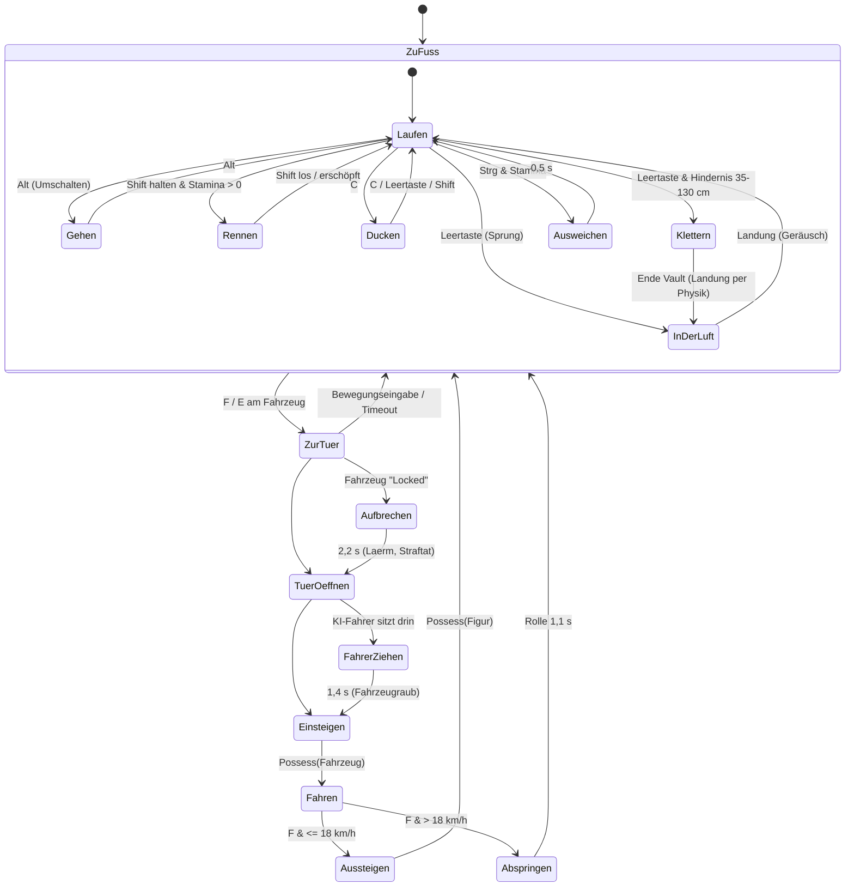
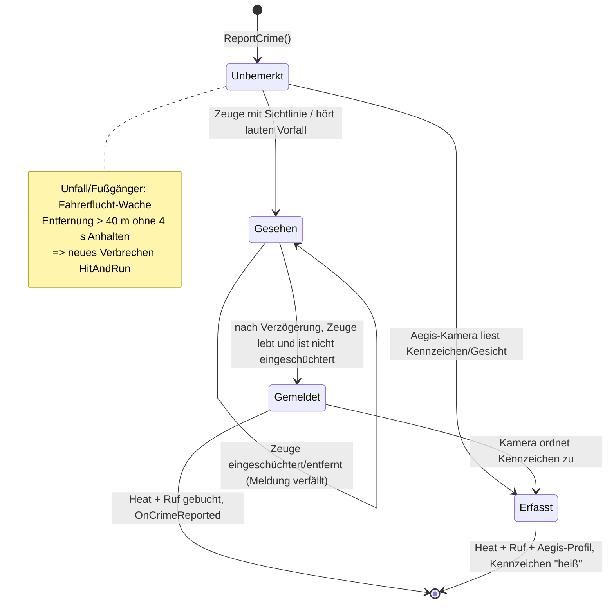
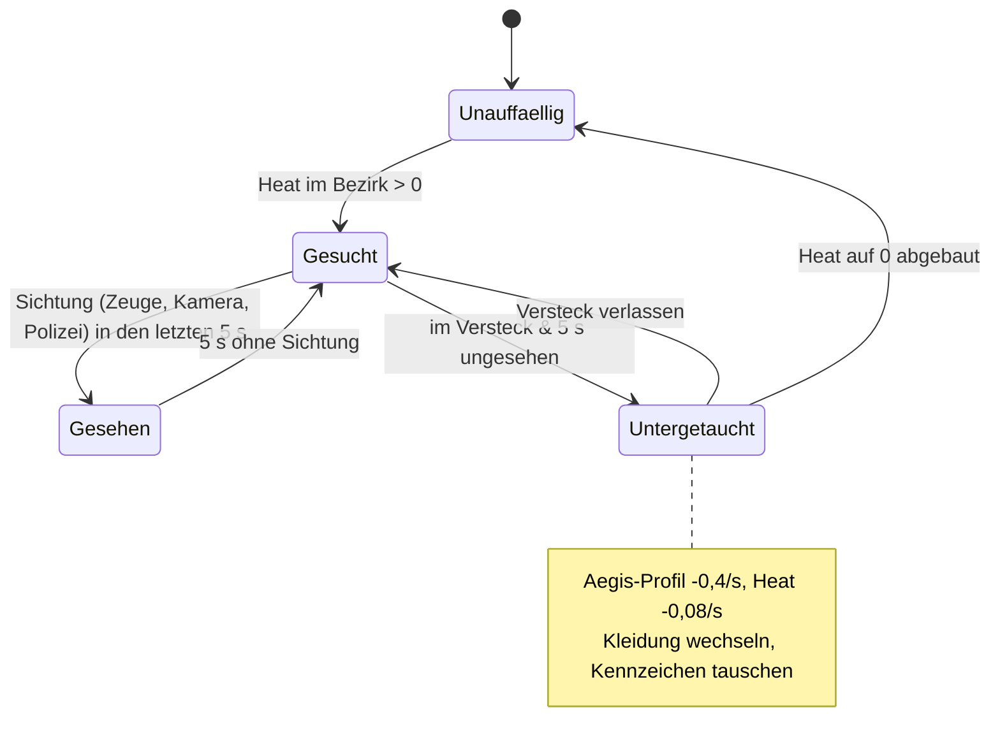

# MTA 6 – Zu Fuß, Interaktion, Chaos-Systemik und Tarnung (Unreal 5.8)

Stand: 21.11.2026 · Modul `MTA6` · Bezug: `docs/WELTKONZEPT.md` (M4–M6, Kap. 8.2a, 9.7, 12, 13 „Zu-Fuß-Paket“)

Alles hier ist C++ und läuft **ohne Assets**: Die Figur ist eine Kapsel mit Kamera, Türen und Kameras haben leere Platzhalter-Meshes. Animationen, Meshes und Sounds werden später in Blueprints gesetzt und lesen nur Variablen bzw. binden an Delegates. **Nichts davon ist kompiliert** (es gab keine UBT-Läufe). Alle Engine-Signaturen wurden per Grep gegen die Header unter `F:\UnrealEngine\UE_5.8\Engine` geprüft.

## 1. Dateien und Klassen

| Datei | Klasse(n) | Aufgabe |
|---|---|---|
| `MTACharacter.h/.cpp` | `AMTACharacter : ACharacter`, `EMTAGait` | Gehen/Laufen/Rennen, Springen, Ducken, Klettern (Vault/Mantle per Trace), Ausweichrolle, Abspringen aus dem Auto, Stamina, Schulterkamera, Variablen für den AnimBP |
| `MTAInteractionInterface.h` | `IMTAInteractable` (BlueprintNativeEvent), `FMTAInteractionInfo`, `EMTAInteractionKind` | Vertrag für alles, womit man interagieren kann |
| `MTAInteractionComponent.h/.cpp` | `UMTAInteractionComponent` | Blick-Trace + Nähe-Overlap, Fokusobjekt, Prompt-Text, Drücken- und Halten-Interaktion, Fahrzeuge an `VehicleEntry` weiterreichen |
| `MTAInteractionActors.h/.cpp` | `AMTAInteractableActor` (abstrakt), `AMTAInteractDoor`, `AMTAInteractVendor`, `AMTAInteractGarage`, `AMTAInteractTerminal`, `AMTAInteractEvidence` | Platzierbare Türen, Händler, Garagen, Terminals (Aegis-Hack), Beweise |
| `MTAVehicleEntryComponent.h/.cpp` | `UMTAVehicleEntryComponent`, `EMTAVehicleEntryPhase` | Einsteigen, Aufbrechen, Fahrer herausziehen, Possess-Wechsel, Aussteigen/Abspringen, Diebstahl melden |
| `MTAChaosTypes.h` | `FMTACrimeEvent`, `FMTACrimeRule` (DataTable-Zeile), `FMTAVehicleRecord`, `FMTAWitnessMemory`, `FMTAAegisCaptureProfile`, Enums | Reine Daten der Chaos-Systemik |
| `MTAChaosSubsystem.h/.cpp` | `UMTAChaosSubsystem : UTickableWorldSubsystem` | Sammelt Verbrechen, verteilt an Zeugen, Fahrerflucht-Erkennung, Kennzeichenregister, Aegis-Profil, Bezirks-Ruf, bucht Heat über `UMTAHeatSubsystem::AddHeat` |
| `MTAChaosWitness.h/.cpp` | `UMTAWitnessComponent` | Zeuge für NPCs: Sichtkegel + Sichtlinie, Hören, Gedächtnis, verzögerte Meldung, Wiedererkennung |
| `MTAChaosAegisCamera.h/.cpp` | `UMTAAegisCameraComponent`, `AMTAAegisCameraActor` | Aegis-Kamera mit Sichtkegel, Trefferchance je Profil/Tier, Tempomessung, Hack/Abschalten |
| `MTAStealthComponent.h/.cpp` | `UMTAStealthComponent`, `EMTAEscapeState` | Sichtbarkeit (Licht, Tageszeit, Hocke), Geräuschpegel, Kleidungs-/Kennzeichenwechsel, Untertauchen |
| `MTAStealthHideout.h/.cpp` | `AMTAStealthHideout`, `EMTAHideoutType` | Versteck-Volumen (Garage, Tunnel, Hinterhof …), optional Kleidung/Kennzeichen tauschen |
| `Config/DefaultInputOnFoot.ini` | – | Zusätzliche Achsen-/Aktions-Mappings (zur Übernahme in `DefaultInput.ini`) |

## 2. Zustandsdiagramme

### 2.1 Spielerfigur und Fahrzeug



### 2.2 Verbrechen (Chaos-Systemik)



### 2.3 Flucht und Untertauchen (`EMTAEscapeState`)



## 3. Eingaben (`Config/DefaultInputOnFoot.ini`)

| Aktion/Achse | Tastatur/Maus | Gamepad | Wirkung |
|---|---|---|---|
| `MoveForward` / `MoveRight` | W/S, A/D | linker Stick | Bewegung relativ zur Kamera; bricht „zur Tür laufen“ ab |
| `Turn` / `LookUp` | Maus | – | Kamera |
| `TurnRate` / `LookUpRate` | – | rechter Stick | Kamera (120 °/s) |
| `Jump` | Leertaste | A / Kreuz | Klettern, falls Hindernis passt, sonst Sprung (8 Stamina); aus der Hocke: aufstehen |
| `Sprint` | Shift (halten) | linker Stick drücken | Rennen (16 Stamina/s) |
| `Crouch` | C | rechter Stick drücken | Ducken (Umschalten, `bToggleCrouch`) |
| `WalkToggle` | Alt | – | Gehen/Laufen umschalten |
| `Dodge` | Strg links | B / Kreis | Ausweichrolle (25 Stamina) |
| `Interact` | E (drücken/halten) | X / Quadrat | Fokusobjekt benutzen; Halten bei Aufbrechen, Hack, Kleidung |
| `EnterExitVehicle` | F | Y / Dreieck | Einsteigen ins nächste Fahrzeug; im Fahrzeug aussteigen bzw. abspringen |
| `ShoulderSwap` | Q | Steuerkreuz rechts | Kamera-Schulter wechseln |

Überschneidungen mit `DefaultInput.ini` (W/S/A/D, Leertaste) sind gewollt: Nur der jeweils besessene Pawn bindet seine Namen. `EnterExitVehicle` funktioniert im Fahrzeug, weil `UMTAVehicleEntryComponent` beim Einsteigen eine eigene `UInputComponent` (Priorität 10) per `APlayerController::PushInputComponent` auf den Controller legt. `AMTAVehiclePawn` muss dafür nicht geändert werden.

## 4. Datenhooks und Konventionen

- **Fahrzeug-Tags** (am Fahrzeug-Aktor): `PlayerOwned` = eigenes Auto (kein Diebstahl), `Locked` = muss aufgebrochen werden.
- **Fahrzeug-Sockel** (optional, am Skeletal Mesh): `DriverSeat`, `DriverDoor`. Fehlen sie, gelten `FallbackSeatOffset`/`FallbackDoorOffset` (Linkslenker).
- **Prop-Tags** für Sachschaden: `Prop` oder `Destructible`, oder die Komponente simuliert Physik. Wände und Gebäude zählen nicht.
- **Kollisions-Ereignisse:** Die Chaos-Systemik bindet `AActor::OnActorHit` des gefahrenen Fahrzeugs. Dafür muss am Fahrzeug-Mesh **„Simulation Generates Hit Events“** (`bNotifyRigidBodyCollision`) an sein.
- **Regeltabelle:** DataTable mit Zeilenstruktur `FMTACrimeRule`, Zeilennamen = Enum-Namen (`VehicleTheft`, `HitAndRun` …), per `UMTAChaosSubsystem::SetRuleTable` setzen. Ohne Tabelle gelten die Standardwerte aus `MakeDefaultRule`.
- **Aegis-Tiers:** `Street` (Core), `PrivateGate` (Greenmoor, Tempo 40), `Advertising` (Sunstrip, Gesichter), `Checkpoint` (Route 9, Tempo 80), `Derelict` (Rustline/Lantern Hill).
- **Kleidung/Kennzeichen:** `UMTAStealthComponent::ChangeOutfit(FName)` und `SwapVehiclePlate(AActor*, FName)`. Inventar und Garage rufen nur diese auf. Wirtschaft bucht Kosten über `AMTAStealthHideout::OnServiceUsed`.
- **Zeugen:** Jeder NPC, der melden kann, bekommt `UMTAWitnessComponent`. Polizisten setzen `bIsPolice = true` (Meldung nach 0,5 s). `Intimidate()` ist der Hook für Bedrohen und Bestechen.

## 5. Anbindung (Codeschnipsel für den Hauptagenten)

### 5.1 GameMode: Figur spawnen und ins Startauto setzen

Das Spiel startet weiter im Fahrzeug (`DefaultPawnClass` bleibt `AMTAVehiclePawn`). Danach wird die Figur erzeugt und ohne Animation hineingesetzt. In `MTA6GameMode.h`:

```cpp
UPROPERTY(EditAnywhere, BlueprintReadWrite, Category = "MTA6|Setup")
TSubclassOf<class AMTACharacter> CharacterClass;

virtual void HandleStartingNewPlayer_Implementation(APlayerController* NewPlayer) override;
```

In `MTA6GameMode.cpp`:

```cpp
#include "MTACharacter.h"
#include "MTAVehicleEntryComponent.h"
#include "MTAChaosSubsystem.h"
#include "MTACityGenerator.h"
#include "WheeledVehiclePawn.h"
#include "EngineUtils.h"

void AMTA6GameMode::HandleStartingNewPlayer_Implementation(APlayerController* NewPlayer)
{
	Super::HandleStartingNewPlayer_Implementation(NewPlayer); // spawnt das Fahrzeug (DefaultPawnClass)

	AWheeledVehiclePawn* Car = NewPlayer ? Cast<AWheeledVehiclePawn>(NewPlayer->GetPawn()) : nullptr;
	if (!Car)
	{
		return;
	}
	FActorSpawnParameters Params;
	Params.SpawnCollisionHandlingOverride = ESpawnActorCollisionHandlingMethod::AlwaysSpawn;
	UClass* HeroClass = CharacterClass ? CharacterClass.Get() : AMTACharacter::StaticClass();
	AMTACharacter* Hero = GetWorld()->SpawnActor<AMTACharacter>(HeroClass,
		Car->GetActorLocation() + FVector(0.f, 0.f, 250.f), Car->GetActorRotation(), Params);
	if (!Hero)
	{
		return;
	}
	NewPlayer->Possess(Hero);                             // Figur zuerst besitzen ...
	Hero->VehicleEntry->PlaceInVehicleImmediately(Car);   // ... dann ohne Straftat ins Auto (possessed wieder das Auto)

	if (UMTAChaosSubsystem* Chaos = GetWorld()->GetSubsystem<UMTAChaosSubsystem>())
	{
		Chaos->SetVehiclePlayerOwned(Car, true);
		// Bezirke vom Stadtgenerator auflösen (sonst gilt DefaultDistrictId = "Core").
		AMTACityGenerator* City = nullptr;
		for (TActorIterator<AMTACityGenerator> It(GetWorld()); It; ++It) { City = *It; break; }
		TWeakObjectPtr<AMTACityGenerator> WeakCity = City;
		Chaos->DistrictResolver = [WeakCity](const FVector& Location) -> FName
		{
			const AMTACityGenerator* C = WeakCity.Get();
			return C ? FName(*StaticEnum<EMTADistrict>()->GetNameStringByValue(static_cast<int64>(C->GetDistrictAtLocation(Location))))
			         : FName(NAME_None);
		};
	}
}
```

**Achtung:** `AMTA6GameMode::GetPlayerVehicle()` liefert zu Fuß `nullptr`, weil dann die Figur der Pawn ist. Alle Aufrufer (Wrack, Festnahme, Teleport, HUD) müssen `nullptr` vertragen. Empfohlener Zusatz, der auch zu Fuß das zuletzt gefahrene Auto findet:

```cpp
AMTAVehiclePawn* AMTA6GameMode::GetPlayerVehicle() const
{
	APawn* Pawn = UGameplayStatics::GetPlayerPawn(this, 0);
	if (AMTAVehiclePawn* Vehicle = Cast<AMTAVehiclePawn>(Pawn)) { return Vehicle; }
	return nullptr; // zu Fuss: kein Fahrzeug
}
```

### 5.2 Polizei-KI und Fahndung (Delegates des Chaos-Subsystems)

```cpp
#include "MTAChaosSubsystem.h"

// z. B. in BeginPlay der Polizei-KI / des Dispatchers (Handler als UFUNCTION deklarieren)
if (UMTAChaosSubsystem* Chaos = GetWorld()->GetSubsystem<UMTAChaosSubsystem>())
{
	Chaos->OnCrimeReported.AddDynamic(this, &AMyPoliceDispatcher::HandleCrimeReported);   // Einsatz auslösen
	Chaos->OnSubjectSighted.AddDynamic(this, &AMyPoliceDispatcher::HandleSighting);       // "zuletzt gesehen"
	Chaos->OnHitAndRun.AddDynamic(this, &AMyPoliceDispatcher::HandleCrimeReported);
	Chaos->OnPlateCaptured.AddDynamic(this, &AMyPoliceDispatcher::HandlePlateCaptured);
}

// Signaturen:
// void HandleCrimeReported(const FMTACrimeEvent& Crime);
// void HandleSighting(AActor* Subject, FVector Location, EMTASightingSource Source);
// void HandlePlateCaptured(const FMTACrimeEvent& Crime, FName PlateId, AActor* CameraActor);

// Polizist sieht den Spieler selbst:
Chaos->NotifySighting(PlayerActor, PlayerActor->GetActorLocation(), EMTASightingSource::Police);
// Direkter Polizeikontakt (Rammen eines Streifenwagens) – Heat sofort:
Chaos->ReportSimpleCrime(EMTACrimeType::PoliceContact, PlayerActor, HitLocation, PoliceCar, 1.f);
```

Heat bucht das Chaos-Subsystem selbst über `UMTAHeatSubsystem::AddHeat(DistrictId, Amount)` (erste Meldung = volle Regel-Heat × Schwere, jede weitere Meldung 15 %). Wenn der GameMode seine eigene Abklingverzögerung über `LastCrimeTime` steuert, bindet er zusätzlich:

```cpp
Chaos->OnHeatRequested.AddDynamic(this, &AMTA6GameMode::HandleChaosHeat);
// void AMTA6GameMode::HandleChaosHeat(FName DistrictId, float Amount) { LastCrimeTime = GameTime; }
// NICHT zusätzlich ReportCrime(Amount) aufrufen, sonst wird die Heat doppelt gebucht.
```

### 5.3 Story: Aegis-Profil spiegeln

```cpp
Chaos->OnAegisProfileChanged.AddDynamic(this, &UMyBridge::HandleAegis);
// void HandleAegis(float NewProfile, float Delta) { /* Story-Flag "aegis" setzen */ }
// Beim Laden: Chaos->SetAegisProfile(SavedAegis);
```

### 5.4 HUD: Interaktions-Prompt, Halte-Fortschritt, Stamina

```cpp
#include "MTACharacter.h"
#include "MTAInteractionComponent.h"
#include "MTAStealthComponent.h"

// in AMTAHUD::DrawHUD()
APawn* Pawn = GetOwningPawn();
AMTACharacter* Hero = Cast<AMTACharacter>(Pawn);
if (!Hero && Pawn) // im Fahrzeug: Figur haengt am Fahrzeug
{
	TArray<AActor*> Attached;
	Pawn->GetAttachedActors(Attached);
	for (AActor* A : Attached) { if ((Hero = Cast<AMTACharacter>(A)) != nullptr) { break; } }
}
if (Hero && !Hero->bIsInVehicle)
{
	const FText Prompt = Hero->Interaction->GetPromptText();
	if (!Prompt.IsEmpty())
	{
		const FLinearColor Color = Hero->Interaction->GetFocusInfo().bIsIllegal ? FLinearColor(1.f, 0.35f, 0.3f) : FLinearColor::White;
		DrawCenteredText(Prompt.ToString(), Canvas->ClipY * 0.78f, Color, 1.2f);
		if (Hero->Interaction->IsHolding())
		{
			const float W = 200.f, X = (Canvas->ClipX - W) * 0.5f, Y = Canvas->ClipY * 0.78f + 28.f;
			DrawRect(FLinearColor(0.f, 0.f, 0.f, 0.5f), X, Y, W, 6.f);
			DrawRect(FLinearColor::White, X, Y, W * Hero->Interaction->GetHoldAlpha(), 6.f);
		}
	}
	if (Hero->GetStaminaFraction() < 0.999f) // Stamina-Balken nur bei Verbrauch
	{
		const FLinearColor C = Hero->bIsExhausted ? FLinearColor(0.9f, 0.3f, 0.2f) : FLinearColor(0.3f, 0.8f, 0.4f);
		DrawRect(C, Canvas->ClipX * 0.5f - 60.f, Canvas->ClipY * 0.9f, 120.f * Hero->GetStaminaFraction(), 4.f);
	}
	// Tarn-Anzeige: Hero->Stealth->Visibility (0..1), Hero->Stealth->NoiseLevel, Hero->Stealth->EscapeState
}
```

### 5.5 NPC-Zeugen (World-AI)

```cpp
#include "MTAChaosWitness.h"
// beim Spawnen eines Passanten (Stufe A, nah) – Stufe B/C ohne Komponente (Kosten!)
UMTAWitnessComponent* Witness = NewObject<UMTAWitnessComponent>(Npc, TEXT("Witness"));
Witness->Courage = 0.6f;
Witness->RegisterComponent();
Witness->OnSawCrime.AddDynamic(this, &UMyCrowd::HandleNpcSawCrime);   // Panik/Flucht
```

Werden Ampelautos von der World-AI als Instanzen statt als `AWheeledVehiclePawn` simuliert, kann man sie weder entern noch Fahrer herausziehen. Für Fahrzeugraub muss die World-AI nahe Fahrzeuge (Stufe A) als echte Pawns mit KI-Controller führen. `EjectedDriverClass` im Charakter-Blueprint legt fest, welche Figur aus dem Auto gezogen wird.

## 6. Abstimmungswerte (Startwerte für Playtests)

| Wert | Standard | Ort |
|---|---|---|
| Laufen / Rennen / Gehen / Ducken | 420 / 680 / 180 / 170 cm/s | `AMTACharacter` |
| Stamina: Rennen / Sprung / Vault / Rolle / Erholung | 16/s / 8 / 10 / 25 / 22/s nach 1 s | `AMTACharacter` |
| Kletterhöhe / -tiefe | 35–130 cm / ≤ 90 cm drüber, sonst hinauf | `AMTACharacter` |
| Aussteigen ruhig bis | 18 km/h, sonst Abspringen | `UMTAVehicleEntryComponent` |
| Unfall ab Relativgeschwindigkeit | 500 cm/s (≈ 18 km/h) | `UMTAChaosSubsystem` |
| Fahrerflucht | > 40 m entfernt, ohne 4 s Halt (Fenster 30 s) | `UMTAChaosSubsystem` |
| Zeugen-Sichtweite / Sichtwinkel / Meldemut | 40 m / ±75° / 70 % | `UMTAWitnessComponent` |
| Aegis-Kamera Reichweite / Kegel / Scan | 35 m / ±30° / 0,5 s | `UMTAAegisCameraComponent` |
| Untertauchen | Aegis −0,4/s, Heat −0,08/s, ab 5 s ungesehen | `AMTAStealthHideout` |

## 7. Risiken und offene Punkte

1. **Nicht kompiliert.** Signaturen sind gegen die 5.8-Header geprüft, aber Tippfehler und Include-Lücken sind erst beim ersten UBT-Lauf sichtbar.
2. **Legacy-Input:** Das Projekt nutzt `BindAxis`/`BindAction` (wie `AMTAVehiclePawn`). Eine spätere Umstellung auf Enhanced Input betrifft alle Pawns gemeinsam.
3. **Hit-Events am Fahrzeug:** Ohne „Simulation Generates Hit Events“ erkennt die Chaos-Systemik keine Unfälle, keinen Sachschaden und keine Fahrerflucht.
4. **Possess-Wechsel:** Kamera-Überblendung, HUD und `GetPlayerVehicle()` müssen damit klarkommen, dass der Pawn zwischen Figur und Auto wechselt (siehe 5.1).
5. **Licht-Messung:** `UMTAStealthComponent` durchsucht alle 5 s alle `ULocalLightComponent`s (`TObjectIterator`) und verfolgt höchstens 4 Lichter per Trace. Bei tausenden Laternen später auf ein Licht-Register des Stadtgenerators umstellen.
6. **Doppelte Heat:** Das Chaos-Subsystem bucht Heat selbst. Bestehende Aufrufe von `AMTA6GameMode::ReportCrime` für dieselben Ereignisse (z. B. Kollisionen in `AMTAVehiclePawn::NotifyHit`) führen sonst zu doppelter Fahndung. Bitte eine Quelle wählen.
7. **Klettern ohne Root Motion:** Der Vault ist eine Bezier-Bahn mit `MOVE_Flying`. Bei sehr dünnen Hindernissen oder schrägen Kanten kann die Figur kurz in Geometrie stecken. Später durch Motion Warping und Montagen ersetzen.
8. **Ausweichrolle** setzt kurzzeitig Reibung und Bremsverzögerung auf 0. Bei Abbruch durch Fallen wird alles zurückgesetzt (`EndDodge`). Ein Treffer-Interrupt (Schaden) ist noch nicht angebunden.
9. **Mehrspieler:** Nichts davon ist repliziert (Konzept: erst ab Meilenstein 9).
